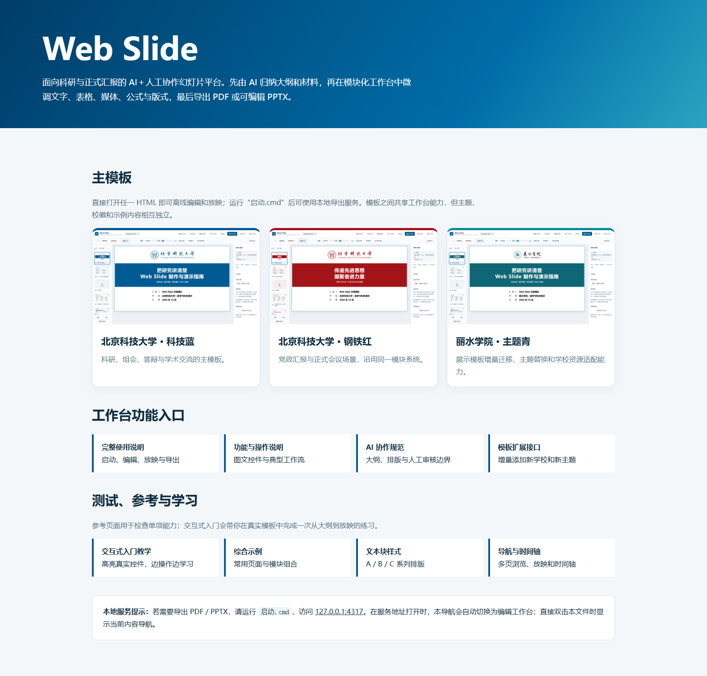
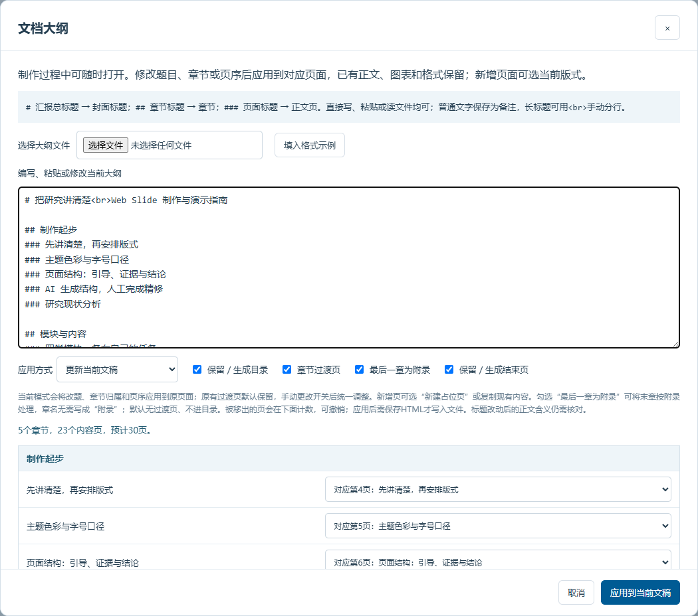
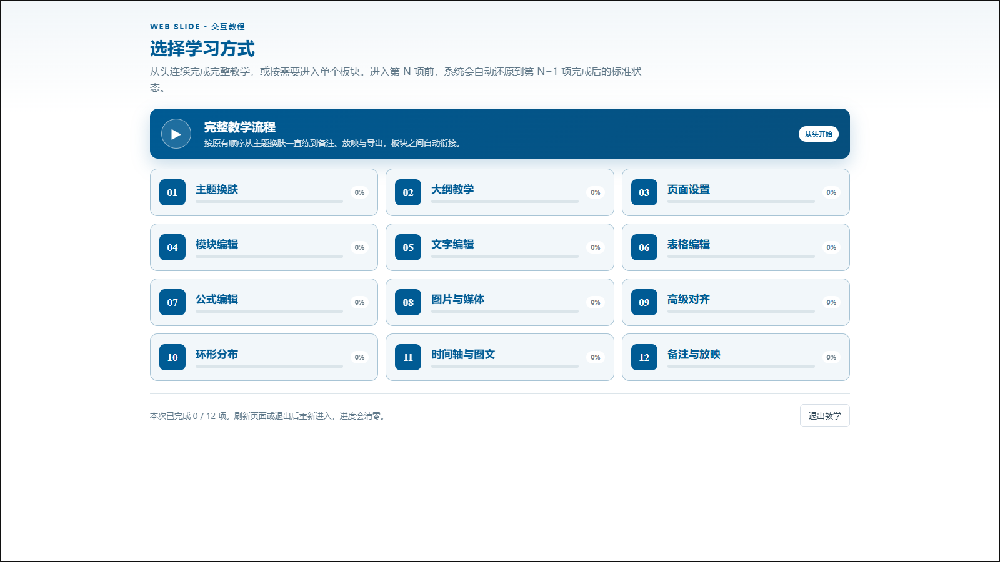
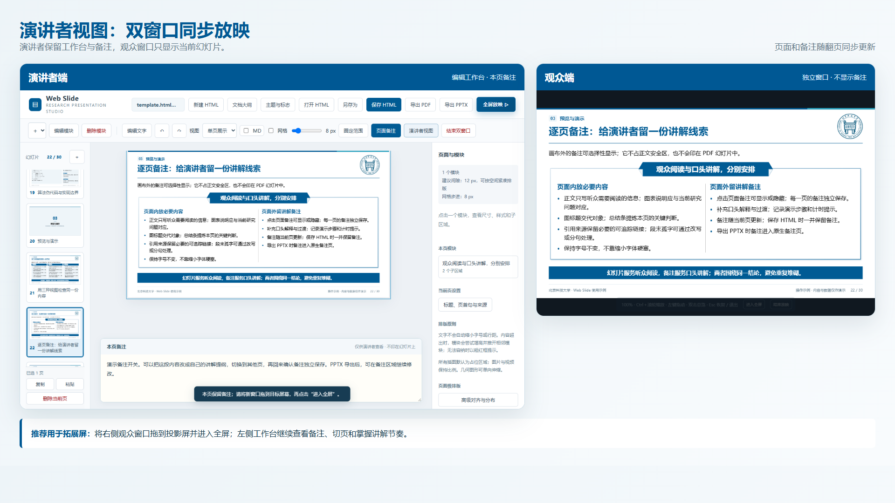
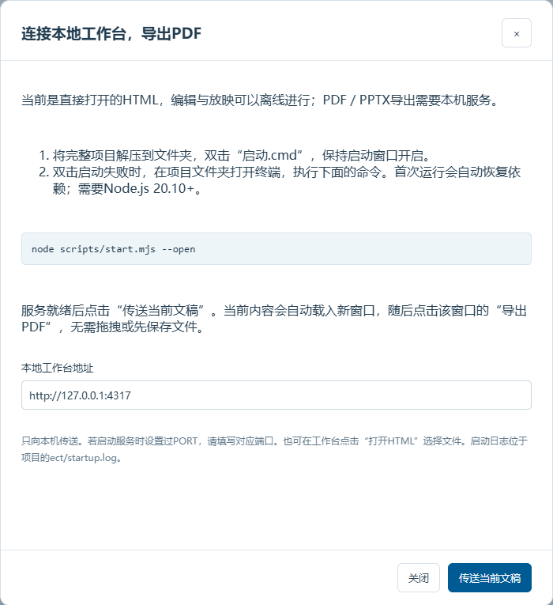

# Web Slide：AI 协作科研幻灯片工作台

当前稳定版本：**v0.2.0**。

Web Slide 把 AI 内容加工、浏览器人工精修、演讲备注和 PDF／PPTX 交付放在同一份可继续编辑的 HTML 中。AI 可以整理材料和选择版式，用户继续修改文字、公式、表格、图片与模块；保存后的 HTML 还能交回 AI 迭代，不必从头制作。

> ## 主入口：`index.html`
>
> **`index.html` 是项目的主入口、离线导航页和使用说明入口。** 下载并解压后优先双击它，再从图文导航进入主模板、交互教学、说明文档和参考页面。

[](docs/images/index-navigation.png)

`index.html` 将项目内容分成四组，避免用户进入目录后无从下手：

- **主模板**：北科科技蓝、北科钢铁红和丽院青示例；
- **工作台说明**：完整使用说明、AI协作规范和模板扩展接口；
- **学习与参考**：交互式入门、综合示例、空白模块模板与文字块速览；
- **本地服务提示**：需要导出PDF／PPTX时，提示启动方式和访问地址。

## 三分钟开始

1. 下载[完整项目 ZIP](https://github.com/lbsun1999/html2ppt-web-slide/archive/refs/heads/main.zip)，解压到普通本地文件夹。
2. 双击根目录的 `index.html`；GitHub 页面只用于阅读说明，不要直接点击 HTML 源文件。
3. 第一次使用选择“交互式入门教学”；已有经验可直接进入北科科技蓝主模板。
4. 在工作台中先确定文档大纲，再修改页面、模块、文字、图表和备注。
5. 保存 HTML；需要 PDF／PPTX 时运行 [`启动.cmd`](启动.cmd)，在本地工作台中导出。

直接编辑、放映以及导入 XLSX／CSV 均不需要安装环境，双击学校模板 HTML 即可使用。PDF／PPTX 导出、模板重新构建和完整自检需要 Node.js 20.10+、Chrome／Edge及项目依赖；不要求 Microsoft Office 或 Python。

## 核心工作流

```text
原始材料 → AI/人工确认大纲 → 选择现有页面与模块 → 浏览器精修
        → 保存可继续编辑的 HTML → 备注与放映 → PDF/PPTX → 人工终审
```

[](docs/images/workbench-overview.png)

## 功能地图

| 功能组 | 主要能力 | 典型用途 |
| --- | --- | --- |
| 文档与大纲 | 新建／打开／保存HTML；导入或粘贴三级大纲；更新现稿或生成干净新稿；设置目录、过渡页与附录 | 先确定章节和逐页标题，再开始制作 |
| 页面与文字 | 页面复制、排序、删除；标题、页首句、页尾总结、来源和备注；字符级字号、粗细、颜色；段落列表、对齐、行距和段后距 | 人工精修文案与层级 |
| 模块与子区域 | 文字、表格、公式、媒体、时间轴；子区域增删排序；模块移动、缩放和固定中心；独立深／浅色文本块 | 复用成熟版式并自由调整结构 |
| 对齐与布局 | 网格吸附、自由拖动、参考线平移／拉伸、多选等距、环形分布；多子区域参与间距计算 | 保持板块边缘、中心和间隙一致 |
| 数据与媒体 | 表格批量粘贴、Excel／CSV导入、行高和字号；LaTeX公式与文档级“MD”源码／预览切换；PNG／JPEG／WebP／SVG／视频上传、裁剪和等高图文 | 处理实验数据、公式和证据图片 |
| 浏览与放映 | 单页、单列和多页滚动；页面备注；演讲者双窗口；全屏、总览、缩放和拖动 | 制作检查与正式汇报 |
| 导出与迭代 | 指定路径导出PDF／PPTX；保留可编辑文字和列表；最新版HTML继续交给AI加工 | 交付后仍能人工修改和继续迭代 |

逐控件截图、操作步骤与快捷键见[工作台控件详解](docs/工作台控件详解.md)；数据接口见[AI接口与排版规则](docs/AI接口与排版规则.md)，AI 与人工的责任边界见[AI制作与迭代流程](docs/AI制作与迭代流程.md)。

[](docs/images/outline-manager.png)

[](docs/images/module-controls.png)

## 模板与交互教学

北科科技蓝是当前主模板。北科钢铁红演示同一版式如何迁移到党政主题；丽院青用于验证学校、主题和素材的增量扩展。模板之间共享工作台能力，但各自携带独立 HTML、素材、说明和导出快照。

| 模板 | 图文说明 | 下载后打开 | 导出快照与预览 |
| --- | --- | --- | --- |
| 北科科研·科技蓝 | [模板说明](templates/template-1/ustb-blue/README.md) | `templates/template-1/ustb-blue/template.html` | [PDF](templates/template-1/ustb-blue/output/template.pdf) · [PPTX](templates/template-1/ustb-blue/output/template.pptx) · [30页总览](docs/images/ustb-preview.png) |
| 北科党政·钢铁红 | [模板说明](templates/template-1/ustb-red/README.md) | `templates/template-1/ustb-red/template.html` | [PDF](templates/template-1/ustb-red/output/template.pdf) · [PPTX](templates/template-1/ustb-red/output/template.pptx) · [公式页](docs/images/red-formula-theme.png) |
| 丽水学院·主题青 | [模板说明](templates/template-1/lishui-cyan/README.md) | `templates/template-1/lishui-cyan/template.html` | [PDF](templates/template-1/lishui-cyan/output/template.pdf) · [PPTX](templates/template-1/lishui-cyan/output/template.pptx) |

### 交互式入门教学

打开 `templates/template-1/ustb-blue/tutorial.html`，可从头完成完整教学，也可从目录直接进入某个分项。教程在真实工作台中练习主题、大纲、页面设置、模块与文字编辑、表格、公式、媒体、高级对齐、时间轴、备注、放映和导出。

[](docs/images/tutorial-catalog.png)

- **代我完成此步**：只执行当前操作；
- **代我完成本项**：完成当前分项尚未进行的操作，并保留最终页面状态；
- **返回教程目录**：切换到其他分项或退出教学。

目录会保留本次打开期间各分项的完成百分比；刷新页面、关闭文稿或退出后重新进入时从 0% 开始。练习所需的校徽、表格和媒体文件均已放在 `tutorial-assets/`，按引导选择即可。完整课程目录和分项说明见[交互教程结构](docs/交互教程结构.md)。

## 放映、备注与导出

### 两种正式放映方式

- **演讲者视图**：适合投影仪或第二块屏幕。观众窗口只显示画面，工作台保留当前页备注并同步翻页；窗口由用户拖到目标屏幕。
- **全屏放映**：适合单屏。方向键或滚轮翻页，双击进入总览；Ctrl＋滚轮缩放，放大后左键拖动；Esc 第一次复位、再次退出。

[](docs/images/presentation-presenter.png)

[](docs/images/presentation-fullscreen.png)

工作台另有单页、单列滚动和可指定列数的多页滚动视图，用于制作与检查，不等同于正式放映。单页展示时可用空格、→、↓前进，用←、↑返回；输入文字或操作表单控件时不会误翻页。点击“页面备注”后，备注作为工作台底部的独立停靠区显示，不再排到全部页面之后；单列滚动停到另一页时，备注随当前页自动切换，多页视图则以用户明确点击选中的页面为准。

### 本地导出

Windows 双击 [`启动.cmd`](启动.cmd)，或在项目目录运行：

```powershell
node scripts/start.mjs --open
```

服务启动后访问 `http://127.0.0.1:4317`，选择“打开 HTML”，再导出到指定路径。无需拖拽文件。遇到 Windows 来源提醒、启动闪退、缺少依赖或端口占用时，查看[启动与导出排障](docs/启动与导出排障.md)。

[](docs/images/local-export-connection.png)

> **PPTX 必须人工逐页审核。** 导出结果已尽量保持标题单行、手动换行、中文标点规则、列表、页脚和参考文献顶端对齐，但不同 PowerPoint 环境仍可能出现字体替代、局部颜色或标点断行差异。

## 主入口与文件列表

根目录中最重要的文件按使用顺序如下：

| 重要级别 | 文件／目录 | 作用 |
| --- | --- | --- |
| **首先打开** | **`index.html`** | **下载后在本地双击；项目主入口、离线导航页，集中链接模板、教学、说明和参考资料** |
| 新手教学 | `交互式入门教学.html` | 下载后从主入口进入；在真实工作台中完成交互式操作训练 |
| 模块样例速览 | `reference/blank-template.html` | 含封面、自动目录、图片／视频、表格、时间轴、公式和附录简历，可作为空白文稿起点 |
| 文字块速览 | `文本块样式展示.html` | 一屏比较默认、A／B／C 系列文字块及其编辑项 |
| AI入口 | [`SKILL.md`](SKILL.md) | AI读取的完整制作、排版、迭代和验收规范 |
| 使用说明 | [`README.md`](README.md) | 当前项目总览与最短使用路径 |
| 本地服务 | [`启动.cmd`](启动.cmd) | 启动 PDF/PPTX 导出与完整自检所需的本地工作台；XLSX／CSV 导入可直接离线使用 |
| 模板包 | [`templates/`](templates/) | 独立学校／主题HTML、素材、说明和可选输出 |
| 图文文档 | [`docs/`](docs/) | 操作说明、排版规则、排障、验收记录和截图 |
| 参考示例 | [`reference/`](reference/) | 综合示例、文字样式与导航／时间轴测试页 |
| 公共代码 | `src/`、`styles.css`、`server.mjs` | 编辑、放映、导出和模块运行时；普通用户无需先读 |
| 维护脚本 | `scripts/`、`tests/` | 模板构建、文档生成、截图和自动检查 |
| 可再生产物 | `ect/` | 日志、测试结果和中间文件，不属于正式源稿 |

新增模板时复制最接近的模板包，替换主题、标志、图片和学校内容即可；只有新增通用模块或工作台能力时才修改公共代码。完整约定见[模板包说明](templates/README.md)。

## 文档索引

| 文档 | 用途 |
| --- | --- |
| [项目使用总览](README.md) | 入口、功能地图、模板、放映、导出与文件列表 |
| [工作台控件详解](docs/工作台控件详解.md) | 文档、大纲、页面、文字、模块、时间轴、公式、备注和放映控件截图 |
| [AI制作与迭代流程](docs/AI制作与迭代流程.md) | 材料、大纲、逐页制作、人机边界和续改流程 |
| [AI接口与排版规则](docs/AI接口与排版规则.md) | project-data、模块、富文本、章节和特殊页面接口 |
| [版式细则与错误复盘](docs/版式细则与错误复盘.md) | 内容密度、短尾行、表格、公式、图文和常见错误 |
| [文本块组件说明](docs/文本块组件说明.md) | A／B／C文本样式及编辑规则 |
| [板块对齐与附加功能](docs/板块对齐与附加功能需求.md) | 参考线、等距、环形分布与验收标准 |
| [交互教程结构](docs/交互教程结构.md) | 12个教程大项、练习页面与核心操作目录 |
| [启动与导出排障](docs/启动与导出排障.md) | Windows提醒、启动失败、端口、依赖和导出问题 |
| [导出实现说明](docs/导出实现说明.md) | PDF/PPTX转换机制与当前边界 |
| [项目结构与清理记录](docs/项目结构与清理记录.md) | 目录职责、运行依赖与可清理内容 |
| [验收记录](docs/验收记录.md) | 自动检查范围、回归结果和已知限制 |
| [CHANGELOG](CHANGELOG.md) | v0.1.0至v0.2.0的主要变化 |

## 维护与验证

恢复依赖并启动服务后运行：

```powershell
npm.cmd ci
npm.cmd run test:all
```

测试日志写入 `ect/self-check/`。自动检查覆盖结构、边界、编辑、主题、公式、表格、时间轴、放映和导出，但不能替代逐页目视检查和真实 PowerPoint 环境终审。

## 许可与资料来源

本仓库临时公开，仅供查看、学习与参考，不授予复制、分发、修改、再许可、公开传播或商业使用许可。后续重大功能更新将迁移至私有仓库维护，完整条款见[LICENSE](LICENSE)。

学校标识、校园图片及其他第三方材料受各自权利人的权利限制。校徽检索可参考[中国高校校徽（LOGO）官方下载资源汇总](https://www.cnblogs.com/cdz-111/articles/22432508)，最终以学校官方原件为准。示例中的校史、数据和占位文字仅用于版式展示，真实汇报必须替换为可核查材料。

联系、合作或申请书面授权，请发送邮件至 [byliao@xs.ustb.edu.cn](mailto:byliao@xs.ustb.edu.cn)。
