# Web Slide：AI 与人工协作的科研幻灯片工作台

把原始材料交给 AI 组织内容，在浏览器里继续精修、演示与交付。同一份 HTML 同时承载文案、版式、素材和编辑功能，人工修改后还能交回 AI 继续加工。

平台支持按用户偏好扩展：丽水学院示例由北科母版自动转换，替换主题色、校徽、校园素材及学校介绍，同时保留共同的版式与编辑、放映、导出能力。也可按其他学校、机构或汇报场景定制内容和视觉风格，让AI加工与人工调整持续配合。

[快速开始](#快速开始) · [控件使用](#控件使用) · [放映与备注](#放映与备注) · [AI协作](#ai协作) · [文件与导出](#文件与导出) · [完整文档导航](#完整文档导航)

[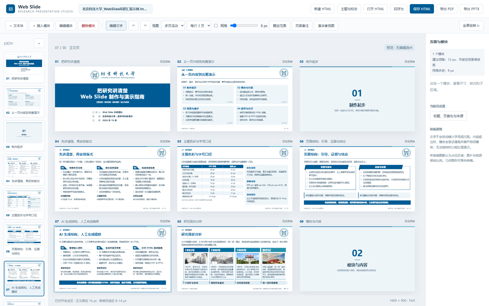](docs/images/workbench-overview.png)

上图是最新北科示例的实际工作台，当前采用每行3页的多页视图。左侧选择页面，中央检查内容，右侧调整当前页或模块；页面较多时向下滚动。截图中的控件均可在随附 HTML 中使用。

## 产品特点

| 特点 | 实际可以做什么 |
| --- | --- |
| AI与人工使用同一份源稿 | AI归纳材料并选版式，人工继续改文字、图表和备注；下一轮读取最新保存的HTML，保留人工修改 |
| 共用母版，可按偏好扩展 | 以北科→丽水的自动转换为例，替换身份、主题色及素材；可继续适配其他学校、机构与汇报场景，定制文案和版式 |
| 直接打开已有示例 | 学校HTML内嵌脚本、样式、字体与媒体，下载后双击即可编辑和放映 |
| 科研内容有成熟版式 | 提供研究现状、公式、实验表、伪代码、主图、总结计划、参考文献和作者简介 |
| 文字可细调到选区与段落 | 选中字可改粗细、颜色和10/12/14/16pt字号；同块可混排普通段落与列表，行距和段后距独立调整 |
| 结构与媒体可调整 | 模块按网格移动、改尺寸和列数；媒体支持自定义比例、取景、等比缩放与并列实际等高 |
| 演示与交付完整 | 单页／多页浏览、全屏放映、缩放拖动、逐页备注、手动双窗口，以及PDF和可编辑PPTX导出 |

平台使用1600×900的16:9画布。正文默认16pt、图标题14pt、脚注与页码约10pt，表格8–14pt适配；具体内容仍需检查短尾行、对齐、密度和溢出。规则见[版式细则与错误复盘](docs/版式细则与错误复盘.md)。

封面、结束页及章节过渡页不显示页脚和页码；正文、目录和附录保留来源与页码。实际页序和总页数仍完整计算，目录范围不变。

## 快速开始

### 下载项目

- [下载完整项目ZIP](https://github.com/lbsun1999/html2ppt-web-slide/archive/refs/heads/main.zip)：源码、两校独立HTML、说明、参考示例及正式PDF/PPTX。
- [版本发布与打包资源](https://github.com/lbsun1999/html2ppt-web-slide/releases)：下载已整理的版本包，解压后即可打开学校HTML。
- 使用Git：`git clone https://github.com/lbsun1999/html2ppt-web-slide.git`。

下载包不含node_modules与测试临时文件。直接打开学校HTML无需安装；需要本地服务时执行下文的依赖安装步骤。

### 直接打开学校示例

先下载项目文件夹，再打开其中的HTML。GitHub中的HTML链接用于查看源文件，不能代替本地运行工作台。

| 学校 | 可编辑源稿 | 导出文件 | 30页总览 |
| --- | --- | --- | --- |
| 北京科技大学 | [HTML源稿](北京科技大学_WebSlide科研汇报示例.html) | [PDF](output/北京科技大学_WebSlide科研汇报示例.pdf) · [PPTX](output/北京科技大学_WebSlide科研汇报示例.pptx) | [5×6预览](docs/images/ustb-preview.png) |
| 丽水学院 | [HTML源稿](丽水学院_WebSlide制作与演示指南.html) | [PDF](output/丽水学院_WebSlide制作与演示指南.pdf) · [PPTX](output/丽水学院_WebSlide制作与演示指南.pptx) | [5×6预览](docs/images/lishui-preview.png) |

两校共用北科底稿，丽水版替换学校标识、校园资料与单一青色主题，保留同一组功能和标准页。真实汇报的页数由内容决定，不要求保留全部30页。

**PPTX导出后必须人工逐页审核，再用于正式汇报或交付。** 当前结果已支持在PowerPoint中继续编辑，仍可能出现局部字体颜色偏差、字体替代或标点断行等细节，需要人工确认并微调。HTML或PDF检查通过不能代替PPTX人工审阅。

### 需要导出或导入Excel时启动服务

| 操作 | 直接打开学校HTML | 启动本地服务后 |
| --- | --- | --- |
| 编辑、保存、放映、填写备注 | 支持 | 支持 |
| 图片／视频上传与取景 | 支持 | 支持 |
| 导出PDF／PPTX、导入Excel | 需要服务 | 支持 |

Windows双击[启动.cmd](启动.cmd)，或在项目目录执行：

```powershell
npm.cmd ci
npm.cmd start
```

需要Node.js 20.10+及Chrome／Edge，首次安装依赖需要网络；无需Microsoft Office或Python。服务启动后访问 `http://127.0.0.1:4317`，点击“打开 HTML”或拖入已有文稿。服务仅监听本机。

`index.html`是服务使用的工作台入口，直接双击会显示启动指引。日常离线编辑优先打开上表中的学校HTML。

## 控件使用

### 先选编辑模式

| 入口 | 使用方式 |
| --- | --- |
| 新建HTML／打开HTML | 新建文稿或载入已有源稿，不需要另外保存项目文件 |
| Web Slide旁的文件名 | 点击修改文稿名称 |
| 编辑文字 | 点击画布中的文字，或选中具体字符后调整格式；再次点击回到预览 |
| 编辑模块 | 点击模块，右侧出现尺寸、移动、样式与子区域控件；再次点击取消 |
| ＋文本块／圈定范围 | 插入深底白字或白底深字的独立文本块；可先圈定区域，位置和尺寸吸附网格 |
| 删除模块 | 进入删除模式后选择要删除的区域 |
| 左侧＋ | 新增内容页、过渡页、目录及附录示例 |
| 左下固定操作区 | 复制、粘贴、上移、下移、删除；缩略图列表单独滚动，按钮始终可见 |
| ↶／↷ | 撤销与重做 |

### 页面复制、多选与排序

[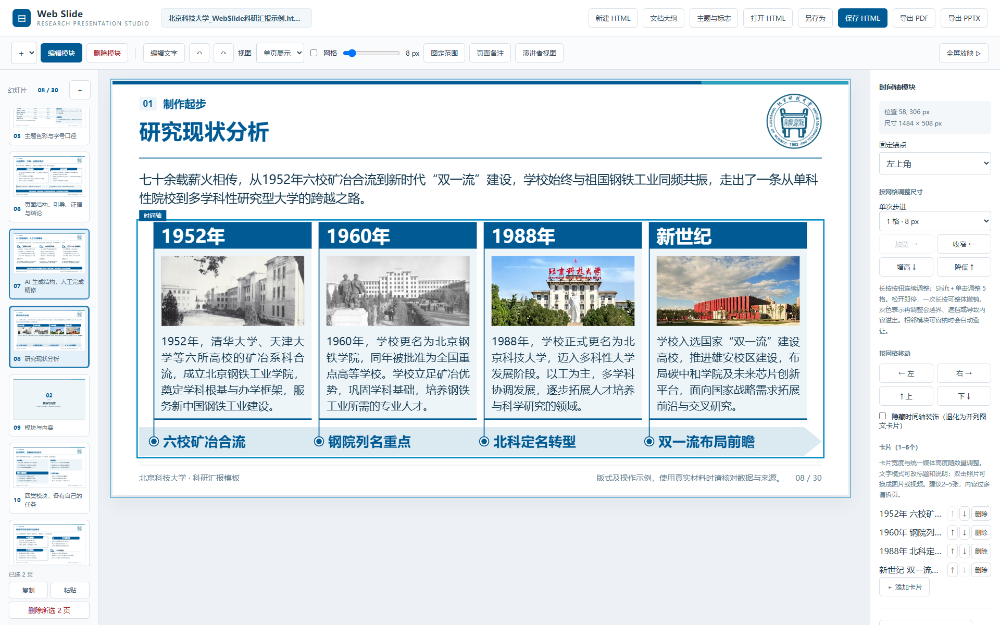](docs/images/page-controls.png)

点击缩略图选一页；Ctrl（macOS用Command）加点击可多选，Shift加点击可连续选择。拖动缩略图到目标位置，蓝线表示插入位置；也可用底部上移、下移按钮。调整顺序后，章节号、自动目录及页码范围一起更新。

点击“复制”，再选定插入位置并点击“粘贴”，副本放在当前页之后。正文、图片／视频、时间轴、备注和富文本会一起复制，新页面使用独立ID。固定操作区支持多页删除，确认后可用撤销恢复，至少保留一页。左侧获得焦点时可用Ctrl／Command+C、V、A和Delete；编辑画布文字时仍使用正常的文字快捷键。

同一窗口内的页面剪贴板不依赖浏览器权限；跨窗口粘贴需浏览器允许读取系统剪贴板，离线文件可能受限制。

### 选中文字，再调格式

[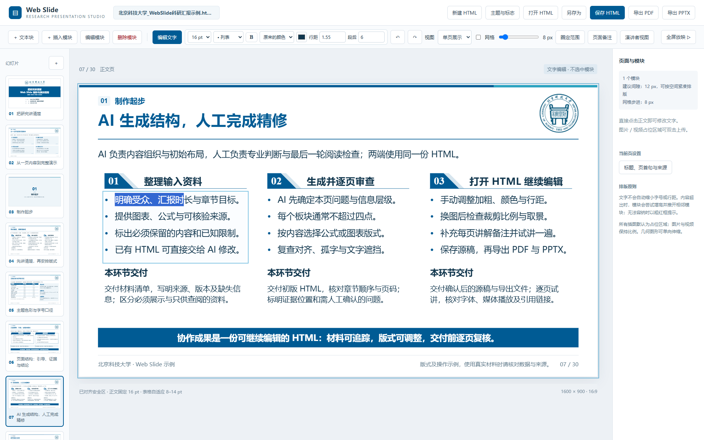](docs/images/text-controls.png)

图中只选中了正文的几个字。操作时先建立选区，再点击上方控件；只修改选区的字符格式，不把整块一起改掉。

选中文字或移动光标时，字号、行距、段后距、颜色、粗细和列表会自动读取当前样式；不同值显示“混合”，不保留上一次操作的旧值。可直接一次选择14pt，无需先切16pt。行距和段后距输入后，点击框外应用。

| 控件 | 作用与范围 |
| --- | --- |
| 10／12／14／16pt | 修改选中文字的字号；未选字符时可调整当前字段 |
| B | 加粗或取消加粗 |
| 主题色／强调色／原色／自选色 | 修改选区颜色，保留与背景的可读对比 |
| 普通段落／列表 | 修改选中段落；允许第一行普通、后几行列点 |
| 行距 | 输入倍数，如1.55；点击框外应用 |
| 段后 | 输入PPT pt，默认6；与行距独立，作用于选中段落 |

模块也可先统一设置列表，再逐段细调。板块通常不超过四点，末行只剩一两个字时先改写或按完整语义分行，不靠缩字号硬塞。

在“编辑文字”模式下，先点击一个文字块，再按住Shift点击其他文字块或表格单元格，可同时选中多个区域。虚线高亮和“已选N块”显示选择范围；字号、粗细、颜色、行距与段后距可统一修改，一次操作可整体撤销。普通点击或Esc退出多选；单个文字块内仍可按字符精调。多选状态不进入导出文件。

### 模块尺寸、位置与子区域

[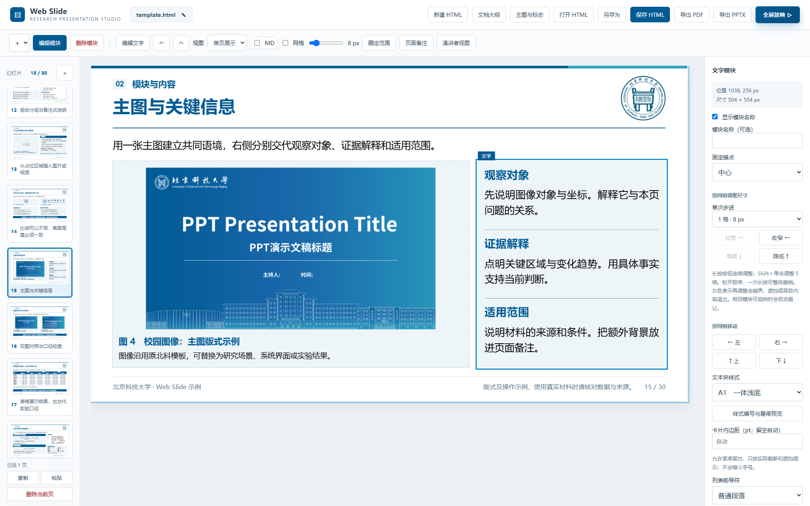](docs/images/module-controls.png)

图中选中主图右侧的说明模块，右侧控件与这个模块对应：先选固定顶点，再调整宽高；按网格移动可改变位置。尺寸按钮支持长按连续调整，步进可选1／2／5格，Shift＋单击可快速调整；一次长按可整体撤销。

文字模块可换样式、调列数、增减子区域；切换样式保留内容。右侧子区域列表按名字显示，直接用`↑`、`↓`排序或点“删除”移除指定区域，移动时标题、内容、图片和格式一起保留。自动目录的顺序仍跟随章节。灰色尺寸按钮表示继续调整会越界、遮挡或导致内容溢出，真实问题需改文案、扩大区域或拆页。

右侧“显示模块名称”可以隐藏或恢复标题，名称和正文仍保存在HTML里。有分组总标题时控制总标题，不影响下面各卡片的分项标题；无框线表格模块控制分组标题栏。编辑文字时，点击文字后可使用工具栏“删除文字块…”删除当前子区域或整个所属模块，确认框会标明范围，删除后可撤销。

“插入”下拉菜单收纳了文字模块、独立文字块、表格、图片／视频以及更多模块。收起时只占短按钮的宽度，展开后显示完整选项，不让最长菜单项撑宽文字编辑工具栏。直接插入时先检测真实空白区域：只有一处可用区域则直接放入；存在多个分离区域时，先显示位置预览供选择。插入后仍可按网格移动和调整尺寸，不占用作者身份卡等固定区域。

独立文本块没有附带标题和分组装饰，可在右侧切换深底白字／白底深字。模块间建议留12px，紧凑时可缩小；页尾前也按实际可用空间检查，不因未留满24px标红。A类和C1卡片的内边距可留空自动调整，也可设为1–24pt，允许文字靠近边缘；C1仍给左侧色条留出净空。按真实内容判断截断和遮挡，不为留白硬性标红，也不缩小字号强塞。

十种文字样式可先看[独立样式展示](文本块样式展示.html)与[组件说明](docs/文本块组件说明.md)。作者简介与阶段计划已保留原有层级和信息关系，并改成可直接操作的模块，见下方说明。

### 作者简介与阶段计划

[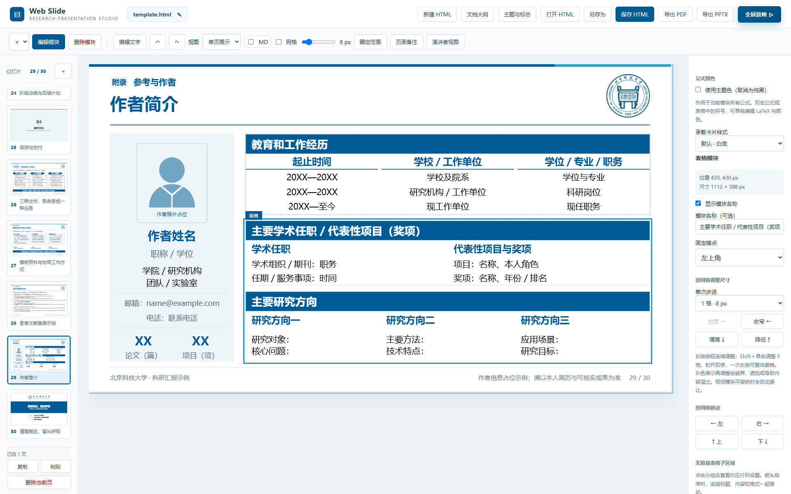](docs/images/profile-modules.png)

作者页左侧保留照片、姓名、单位和成果数量卡片，文字与照片可修改。右侧为两个模块：教育和工作经历是履历横线表，另一个无框线表格模块包含“学术任职／项目”和“研究方向”两个子区域，可继续增减、排序。点击右侧分组名后，行、列、行高、内边距和替换表格均针对该组。履历表正文居中，字段标题下用分段横线；无框线表格全部左对齐，首行主题色加粗。半个字符宽的履历间隔列自动生成。

作者表格默认正文14pt、字段标题16pt。右侧可为整表或当前分组选择10／12／14／16pt，工具栏也可调整选中的单元格或字符。手动指定表格字号后固定该档位；内容过多时通过调整行列、留白、模块尺寸或拆页处理，系统不会悄悄把16pt改回14pt。

[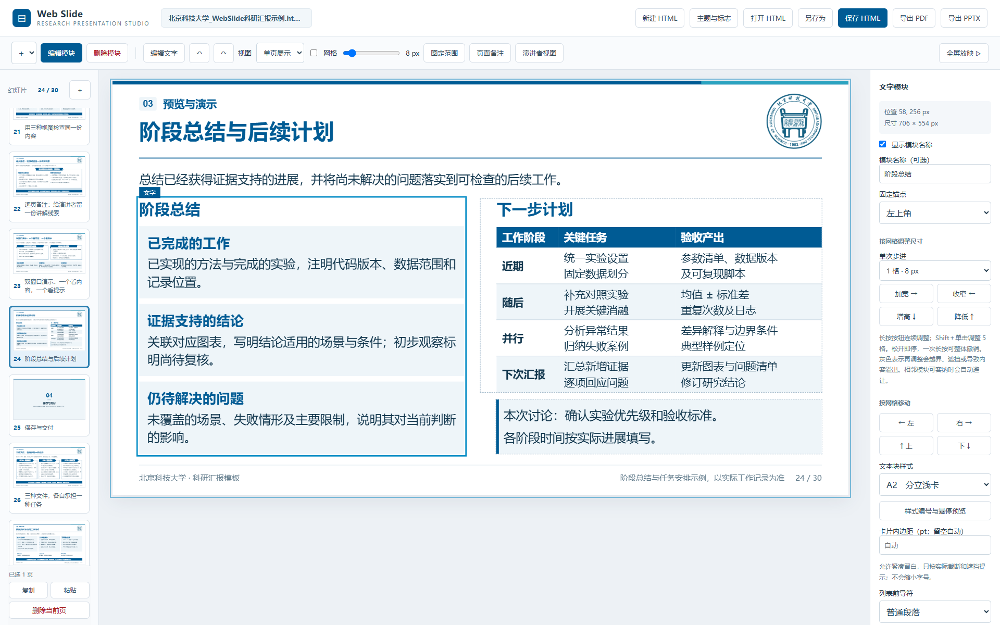](docs/images/summary-modules.png)

阶段总结是一个含三张A2卡片的文字模块，支持增减和排序，第四张会自动改成两列；“下一步计划”保留可替换的纯表格，下方讨论用独立C1模块。分组标题20pt、卡片标题18pt、正文16pt，计划表14pt。模块实际边界不相互遮挡，讨论区不覆盖表格。

普通内容只有一个子区域时，选默认、A3或B1等无编号标题；C3适合多个有次序的子区域，避免单块内容上出现孤立的“01”。两校第13页已改为A3深底标题，保留原有文字说明。

### 时间轴：增减阶段、照片或视频

[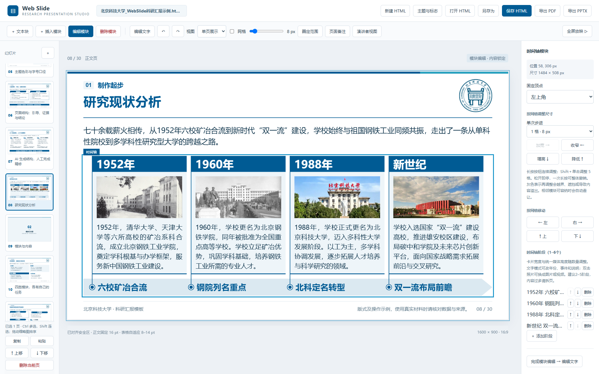](docs/images/timeline-controls.png)

两校第8页现为可编辑时间轴。选择“编辑模块”，点击时间轴，右侧可添加阶段、删除任意阶段或前后移动；支持1–6阶段，建议2–5阶段。卡片宽度和媒体高度会自动调整，同排画面严格等高。阶段较多且文字较长时，应凝练或拆页，真实溢出仍会提示。

切到“编辑文字”可直接改年份、箭头上的事件短名和段落介绍。双击照片上传PNG／JPEG／WebP或MP4／WebM视频，也可调整取景和缩放。所有年份深色底、圆点、连接线及事件标题统一跟随主题色，图文卡片和箭头保留浅底；新增阶段先给占位媒体，再替换真实资料。

新页可通过“插入模块→时间轴”创建。[navigation示例](reference/navigation.html)第10页提供不含校徽、使用媒体占位符的通用时间轴，可直接测试增减阶段及照片／视频替换；实际工作台截图见[reference说明](reference/README.md#导航与时间轴先看章节再调整阶段)。

勾选右侧“隐藏时间轴装饰”后，同一模块可作为并列图文卡片：箭头、圆点、连线和年份隐藏，事件短名转到卡片顶部；照片／视频和说明保留，媒体仍等高。取消勾选恢复时间轴，年份与事件数据不会丢失，无需重新插入另一种模块。

### 图片、视频、表格和目录

| 内容 | 入口与操作 |
| --- | --- |
| 图片／视频 | 双击占位区域或已有媒体，上传文件，选择预设／自定义比例，再调取景和缩放 |
| 图标题／说明 | 在媒体设置中选择是否显示；无图注时不保留冗余高度；并列画面保持实际等高 |
| 表格 | 使用插入模块入口；可导入Excel／CSV或粘贴数据，在文字模式编辑单元格 |
| 表格注释 | 选中表格后在右侧填写或清空；已有注释也可直接编辑，不给所有表自动追加指标说明 |
| 表格行高／内边距 | 选中表格后统一调整最小行高与上下内边距；0行高／空内边距恢复自动，内容多时自然增高。成熟页的表格在右侧页面栏调整 |
| 目录 | 从章节推导序号与页码范围；模块侧栏可增删条目、恢复隐藏项、补充章节说明 |
| 附录 | 默认不进入目录；在页面设置中自定义章节归属，也可明确勾选目录包含附录 |

表格的顶部表头行用深底白字，正文首列保持浅底深字；多级实验表的各级顶部表头同样处理。更多图文、表格和导航实例见[参考库的多页工作台说明](reference/README.md)。

履历横线表及无框线表格采用上文的专用表头样式。导出PPTX时，A3深色标题底作为独立色块保留；页尾总结按整条内容区宽度、单行原生文本导出，避免末尾句号因文本框过窄而换行。

标题类文字在HTML和PPTX中均默认单行，需要分行时按语义手动拆好，覆盖页面、模块、分组、图标题、目录及时间轴标题。超宽时提示精简、加宽或手动分行。PPTX中的脚注、来源、页码和作者姓名也强制单行。原本在网页中只有一行的文字关闭自动换行，多行正文继续自然排版，并写入中文标点断行规则。无序列表导出为可继续编辑的原生项目符号，保留普通段落与列表混排、所选符号及局部粗细和颜色，不把前导符直接拼进正文。

作者身份卡中的职称、学院／研究机构、团队、联系方式等字段同样只保留手动分行，替换成自己的信息后继续遵守；过长时提示调整。参考文献导出时，序号与内容使用相同顶部位置和明确的顶端对齐，多行条目的首行也与序号保持齐平。

### 双击公式编辑LaTeX

[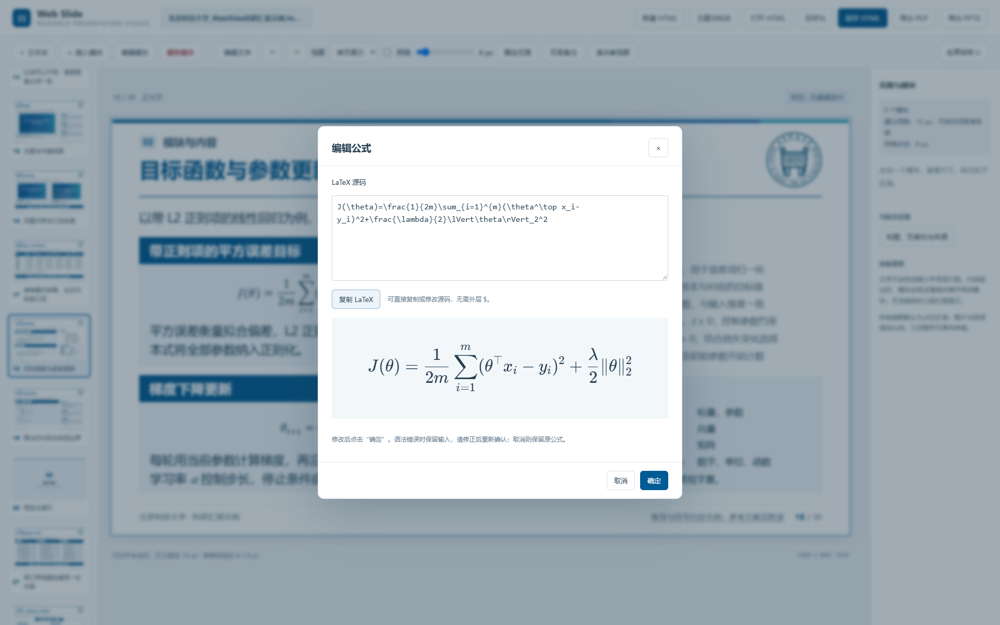](docs/images/formula-editor.png)

单页或单列视图下双击公式，即使在预览模式也能打开。输入LaTeX时不需要外层美元符号；可复制源码、预览、确定或取消。语法错误或超出当前排版时保留输入和原式，按提示精简或拆行。

公式只显示一份，修改后使用KaTeX HTML。变量、单位与函数的字体约定需保持全文一致。导出PPTX时公式是独立图片，**不是Office原生公式**；题目与解释仍可编辑。

## 放映与备注

### 浏览整份文稿

顶部“视图”支持单页展示、单列滚动和多页滚动；多页可选择每行1–6页。单页查细节，单列检查叙事顺序，多页比较版式与密度。切换视图不改变幻灯片内的真实坐标。

### 全屏放映与四列总览

[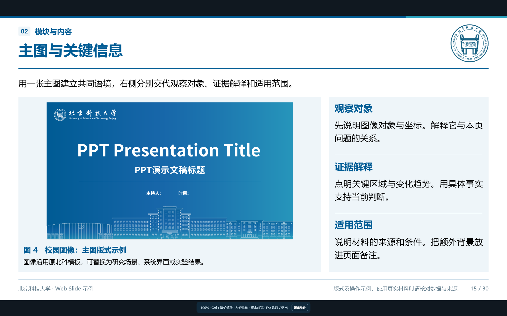](docs/images/presentation-fullscreen.png)

点击“全屏放映”，或双击左侧缩略图进入放映。工作台控件隐藏，底部保留操作提示。

| 操作 | 放映时的效果 |
| --- | --- |
| 方向键／PageUp／PageDown／普通滚轮 | 前后翻页；空格也可下一页 |
| Home／End | 到首页／末页 |
| Ctrl＋滚轮 | 放大或缩小当前页 |
| 放大后按住鼠标左键拖动 | 查看局部内容 |
| 双击画面 | 进入每行4页的滚动总览 |
| 在总览中双击目标页 | 定位并继续放映 |
| 放大后按一次Esc | 恢复原大小 |
| 原大小时再按Esc | 退出放映 |

[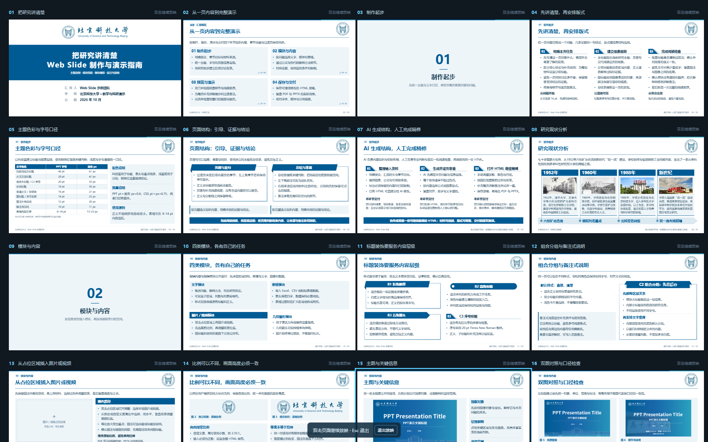](docs/images/presentation-overview.png)

上图是放映中的总览状态，与工作台的多页编辑视图不同。页面较多时滚动查找，双击需要讲解的页面即可返回；不会修改源稿中的页面内容或尺寸。

### 给当前页写备注

[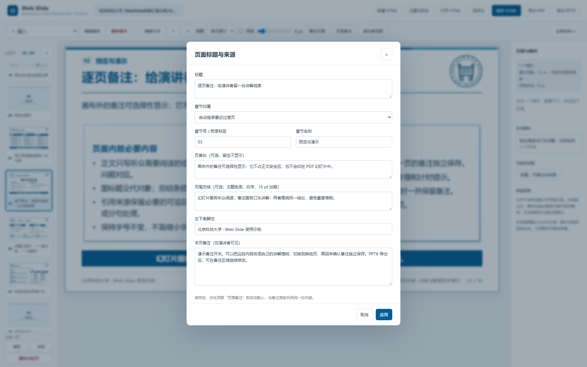](docs/images/page-settings-notes.png)

右侧“当前页设置”→“标题、页首句与来源”→填写“本页备注”并应用。也可点击顶部“页面备注”，直接在画布下方面板编辑；两个入口共用当前页的notes，打开或切页时自动载入，取消弹窗不更改原备注。

同一弹窗还可改标题、可选页首句、主题色页尾总结、左下脚注和来源链接。备注放在画布之外，HTML保存、PPTX写入备注页、PDF可见页不包含。

内容偏少时，可用有实际含义的页尾结论适当平衡留白。页尾总结采用醒目的主题深色底、白色16pt加粗样式；C1浅色备注不能替代此样式。

“演讲者视图”打开独立观众窗口，工作台保留备注，观众窗口只显示幻灯片并同步翻页。可手动把窗口移到投影屏；当前不自动检测或分配显示器。操作过程可对照[参考库的备注示例](reference/README.md#备注与演示总览文稿同时查看当前页提示)。

## AI协作

把原始材料、汇报目的和已有HTML一起交给AI，从[SKILL.md](SKILL.md)开始。AI先核验材料，归纳研究叙事和逐页文案，再选择成熟版式；人工完成专业判断和细节调整，保存后可继续交回AI。

例如可以这样提出任务：

> 请使用北科母版，将这些论文和实验记录整理成一次研究进展汇报。听众是课题组，时长15分钟。先说明研究问题与现状，再讲方法、结果及局限，最后给出可检查的后续计划。缺失数据明确占位，不编造；保留现有HTML的编辑、备注、放映和导出功能。

继续迭代时提供**最新保存的HTML**及本次修改范围。AI应保留未改内容、页面ID、局部格式、逐段列表、媒体取景、备注与链接，不能重新生成示例覆盖人工修改。流程详见[AI制作与迭代流程](docs/AI制作与迭代流程.md)，数据结构见[AI接口与排版规则](docs/AI接口与排版规则.md)。

支持本地skill的AI工具可将本目录作为完整技能资源使用，保留SKILL.md、源码、脚本、样式与素材；具体安装位置按所用工具配置。**不需要先安装北科或辽工大的旧skill，也不需要作者的历史聊天记录。** SKILL.md已写明资源位置、内容加工流程、页型选择、字号与版式标准、人工修改保留方式及交付检查。新用户调用示例见[首次接触本项目](docs/AI制作与迭代流程.md#首次接触本项目时)。项目不会自动覆盖原学校模板技能。

## 文件与导出

### 保存原稿与另存为

“保存 HTML”优先写回已关联文件；“另存为”选择新文件，之后保存写回新目标。使用“打开 HTML”选择原文件可建立关联；双击、拖入或普通上传没有写入句柄时，第一次保存需在文件框中指定原文件。

支持Ctrl+S保存、Ctrl+Shift+S另存为。刷新或重新打开后可能需要再次授权；取消选择不保存，写入失败会提示并保留当前文稿和原关联。不支持直接写回时明确回退为下载副本，不要把下载目录的同名副本误认为已覆盖原稿。实现依赖浏览器的[File System Access API](https://developer.chrome.com/docs/capabilities/web-apis/file-system-access)。

### 导出与分享

| 格式 | 用途与限制 |
| --- | --- |
| HTML | 可继续编辑的源稿，内嵌资源；分享单份HTML即可阅读、编辑和放映 |
| PDF | 稳定阅读，16:9、960×540pt，无浏览器日期、路径及额外页眉页脚 |
| PPTX | 标题、正文和单元格文字可编辑，媒体为独立对象；复杂装饰和公式采用图片，备注保留 |

**PPTX的人工审核是必要步骤。** 请在实际使用的PowerPoint或其他演示软件中打开导出文件，逐页检查：

- 字体、字重和颜色是否正确，深底白字／浅底深字是否清楚。
- 标点是否留在不合适的行首或行尾，文本是否出现意外换行、短尾行或字体替代。
- 标题层级、段落间距、对齐、图注、媒体和页码是否符合最终汇报要求。

这些局部瑕疵通常可直接在PowerPoint中调整；正式汇报前应以人工审阅后的版本为准。自动检查只覆盖可检测的结构和边界问题，不能保证所有办公软件中的视觉效果完全一致。

PDF／PPTX导出需要本地服务。不能把HTML改扩展名冒充PPTX；交付前仍须在目标PowerPoint环境复查字体、显式换行与媒体播放。随附PDF/PPTX是导出时的快照，HTML内容变化后需重新导出。

正式HTML放根目录或用户指定位置，`output/`只放正式PDF/PPTX；`docs/images/`保存说明书插图，`ect/`放可再生中间数据与检查产物。分享整套生成／导出能力时保留项目源码和资源，依赖可用`npm.cmd ci`恢复。

## 完整文档导航

docs中的说明、原始规范和截图记录均可从这里进入：

| 文档 | 适合何时阅读 |
| --- | --- |
| [AI制作与迭代流程](docs/AI制作与迭代流程.md) | 从原始需求、材料到提纲、成稿，再到人工修改和功能迭代 |
| [AI接口与排版规则](docs/AI接口与排版规则.md) | 生成或修改project-data、模块、逐段格式、章节与成熟页面 |
| [版式细则与错误复盘](docs/版式细则与错误复盘.md) | 检查内容密度、标题层级、短尾行、表头、公式、对齐及代表性错误 |
| [文本块组件说明](docs/文本块组件说明.md) | 复用默认、A1–A3、B1–B3、C1–C3以及编辑与渲染代码 |
| [原始文本块样式规范PDF](docs/文本块样式规范.pdf) | 对照最初的视觉要求，结合组件说明中的后续修订使用 |
| [导出实现说明](docs/导出实现说明.md) | 了解PDF/PPTX如何测量、转换和输出，以及当前边界 |
| [项目结构与清理记录](docs/项目结构与清理记录.md) | 查目录职责、运行依赖、维护命令与可清理内容 |
| [验收记录](docs/验收记录.md) | 查回归检查、验证范围与已知限制 |
| [工作台截图记录](docs/工作台截图记录.json) | 复查README截图的源稿哈希、界面状态及窗口尺寸 |

更多可视资料：[北科30页预览](docs/images/ustb-preview.png) · [丽水30页预览](docs/images/lishui-preview.png) · [总结与计划版式](docs/images/summary-layout.png) · [三份参考HTML及多页工作台](reference/README.md) · [十种文字样式展示](文本块样式展示.html)。本页插图可直接点开查看原尺寸。

维护示例与插图可运行：

```powershell
npm.cmd run build:examples
npm.cmd run preview:docs
node scripts/preview-reference.mjs
npm.cmd run clean
```

`build:examples`优先读取当前保存的北科正式HTML，保留手动优化的文字、格式、模块位置和尺寸，更新功能并同步丽水变体；仅北科文件不存在时才初始化默认示例，解析失败则停止。追加`-- --export`可生成正式PDF/PPTX，需先启动服务。`clean`仅清理ect和test-results，不删除源稿、正式导出、说明书插图或reference快照。自动检查不能替代逐页目视复核。

## 资料与标识来源

丽水资料见[学校概况](https://www.lsu.edu.cn/44/list.htm)、[历史沿革](https://www.lsu.edu.cn/47/list.htm)及[素材记录](assets/丽水学院/manifest.json)。校徽检索可参考[中国高校校徽（LOGO）官方下载资源汇总](https://www.cnblogs.com/cdz-111/articles/22432508 "发布于 2026-08-12 22:38")，最终以学校官方原件为准。

项目示例不代表学校官方软件，图片和标识权益归各自权利人。校史、占位数据及教学说明用于版式展示，制作真实科研汇报时应替换为对应材料和可追踪来源。
