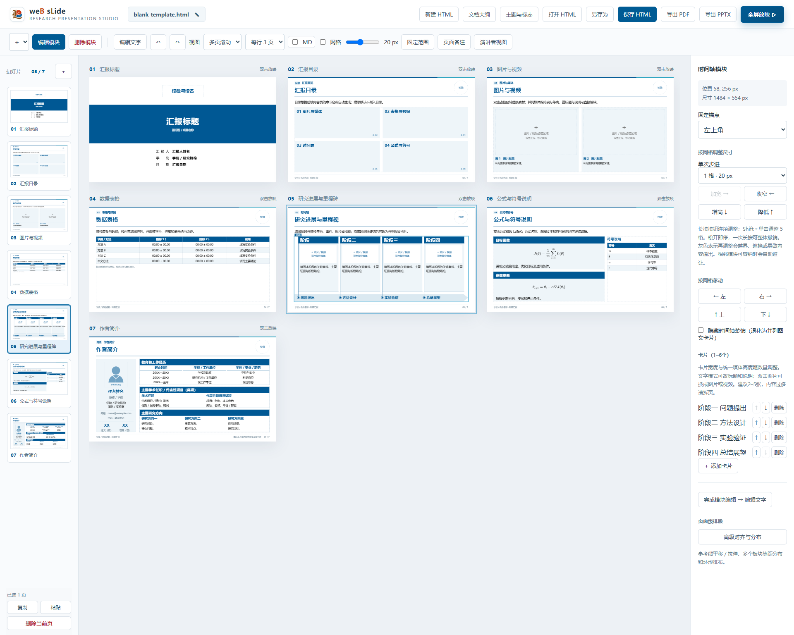

# AI 与人工协同的 Web Slide

## 交互式入门与教学模式

- 根目录 `交互式入门教学.html` 是新用户训练入口；`文本块样式展示.html` 保留为 A／B／C 系列组件展示与回归测试页，二者不得混用。
- 教学必须作用于真实工作台控件，不另造一套无法迁移的演示界面。
- 教学只维护一套：从北科科技蓝主模板进入，先示范把主题色、浅底与正文色联动改为钢铁红，再覆盖大纲、页面设置、多子区域、表格、公式、图文与媒体、时间轴切换、高级对齐、等距／环形分布、文字、备注、放映和导出。其他学校或主题复用同一教学逻辑，不重复复制教学文件。
- 教学首页必须同时保留“完整教学流程”和每个独立板块的入口。选择第N项时，先从教学母稿在后台重建前N−1项完成后的标准状态，再直接进入目标板块；前置重建不计入用户完成进度。返回目录时显示本次打开期间每项的百分比；刷新页面或退出后重新进入必须清零，不能把旧练习状态带到下一次。
- 必须完成的动作使用高亮与轻微闪烁；用户正确操作时保留礼花，并显示杰瑞“干得真棒”图片与对应语音；“代我完成此步”只执行当前操作，“代我完成本项”必须依次完成当前大项剩余操作并保留最终页面状态，禁止仅改变教学索引而不做页面操作。完整流程继续进入下一项；独立分项使用“做完全部教程.png”的奖杯汤姆结算弹窗，只保留右下角返回目录，不得复用完整流程的三类语音反馈或最终欢呼。完整流程全部完成显示奖杯图并播放离线欢呼掌声。新大项第一步不得跨项返回，第2步起才允许“上一步”。反馈不得遮挡或阻断下一步操作。粘贴任务先提供可复制的规范文本。
- 不适合在教学中实际触发、但用户会看到的重要控件，改为必读告示并要求确认，不能悄悄略过。
- 后续已有逐步实操的功能，不在前一大项重复安排纯阅读预告。教学步骤优先对应一次真实点击、输入、选择或可验证的观察；只有安全边界、不可逆影响或放映／导出等不宜实际触发的内容才保留必读告示。
- 教学要求用户打开指定页面时，目标缩略图必须滚动到左栏可见区域中部，并使用不会被滚动容器裁掉的内描边高亮；不能只添加目标类却让用户看不见完整提示。
- 教学步骤进入原生 `dialog` 时，必须等待弹窗处于 `open` 状态，再把教学卡片移入同一顶层弹窗；公式、媒体、Excel工作表选择和表格批量编辑都要保持说明、目标高亮与操作反馈连续，不能因浏览器顶层弹窗遮住或移除引导。
- 弹窗内“应用／确定”的教学事件必须在捕获阶段先记录进度并安全关闭当前业务弹窗，再把教学卡片移回工作台，不能让引导随弹窗一起隐藏，也不能让仍处于浏览器顶层的对话框遮住“返回教程目录”。教学进度只存在当前已打开的教程实例；返回目录时保留，退出或刷新即清空。
- 表格教学页默认只放一张真实、可编辑的预置表格，明确说明它就是练习对象，不保留“左侧示范表＋右侧再插一张”的重复结构。教学必须覆盖完整路径：离线导入配套XLSX／CSV、选择工作表并确认、在右栏调整10／12／14／16pt基准字号与统一行高、切换标准／无框线样式、增减行列，再打开“粘贴替换当前表格”，用Tab分列、回车分行。教学包同时携带示例工作簿和等价纯文本；二者都能在离线HTML中使用。
- 教学页面顺序必须服从教学顺序：表格、公式、媒体、高级对齐、环形分布、时间轴依次出现，不能要求用户在左栏来回寻找后续才会用到的页面。媒体教学须练习原始比例、素材替换和14pt可编辑图标题；无图标题时不保留空白占位。
- 对齐教学拆成“高级对齐”和“环形分布”两个大项。高级对齐在大项开头打开一次插件，连续完成纵／横参考线平移、标尺、网格吸附、参考线位置、反向拉伸及多选等距：先左／上平移，再重新设置另一侧参考线并向右／向下拉伸，之后不退出插件，直接进入多选、选择板块并执行等距。环形分布切换到独立练习页后必须重新打开插件，不继承前一项状态。一步只高亮一个当前目标，切换步骤后清除旧高亮。
- 时间轴教学应明确演示“隐藏时间轴装饰”：同一模块在时间轴与普通并列图文卡片之间切换，内容和子区域顺序不丢失。
- 放映教学并列说明演讲者视图与全屏放映，并补充单页／单列／多页浏览、总览、缩放、拖动及 Esc 复位／退出。
- 教学仅由 URL 参数 `tutorial=1` 开启；普通编辑、保存的 HTML 和放映状态均不得自动进入教学。

## 高级对齐和可选扩展

- 几何对齐优先使用工作台“高级对齐与分布”：一页只启用一条纵向或横向参考线；纵向参考线读取画布顶部0–1600横坐标，横向参考线读取画布左侧0–900纵坐标，切换模式时标尺必须同步切换。显示网格时参考线自动吸附当前网格，关闭网格时在正文安全区内自由拖动，不再要求按住 `Shift`。
- 均匀分布必须固定所选内容在分布方向上的最外侧边界，保持各板块尺寸，仅平移并平分净空。多子区域模块要展开可见子区域参与计算；不能因只选两块就禁用。
- 环形分布必须同时提供数字输入与可拖动滑杆；输入或拖动时在真实画布实时预览，点击“生成组合”后才提交。预览逐项检查正文安全区、外部板块和成员之间的重叠，不能只凭缩略示意判断。教学基准案例为复制4个短小的单行文字块，以约180px半径在−45°～45°窄角度内排布；参数可随页面安全区调整，但成品必须完整可见、互不遮挡。确认后视为一个组合模块，后续可整体移动或缩放；组合必须保留原成员、顺序、圆心、半径和起止角度，再次执行环形分布时应进入二次调整并重排原成员，严禁把整个组合当成单一元素再次复制。修改后仍不合格的预览要明确警示，导出前必须修复。
- SVG 小图标仅在用户明确允许时由 AI 生成。图标必须有语义名称、可替换、可隐藏；隐藏后页面应自动回流，不能留下空洞。
- 普通文段需要行内公式时，使用 Markdown `$...$`，并优先采用 `$J_{\theta}$` 这类短符号。行内公式只承担符号提示，不放分式、求和、长上下标或完整推导；这些内容应移入独立公式模块。行内公式容器高度与内部行高均限制在约`1em`，允许字形少量溢出但不得撑大正文行距。顶部小型“MD”勾选框是文档级开关：取消时显示可复制、可修改的源码，勾选时统一预览行内公式；进入文字编辑会临时显示源码，退出后恢复文档设定。不得让用户逐个子区域重复开启。语法错误保留源码并给出局部提示，不能拖垮整页。复杂公式页仍由 AI 根据材料单独编排。PPTX 的图像公式／LaTeX 源码方案由用户在导出时选择，PDF 固定使用图像。
- 完整技术和验收规则见 `docs/板块对齐与附加功能需求.md`。

本技能负责把用户材料加工成可讲述、可核查、可继续编辑的科研汇报。AI归纳文案、选择版式并检查，人可在HTML工作台内精修，再把最新保存的HTML交回AI继续迭代。核心交付物是可编辑HTML，PDF和PPTX按用户需求导出。

## 资源定位与独立使用

**资源根目录是当前SKILL.md所在目录，不是用户工作目录。** 本包不要求安装其他学校skill，也不依赖作者的聊天记录、原北科或辽工大目录。下文的“成熟版式”专指本包内保存的快照，具体规格就在本文件及配套文档中，不能要求新用户再去寻找外部“原版”。

| 包内资源 | 用途与阅读时机 |
| --- | --- |
| [README](README.md) | 首次使用：环境、入口、控件、保存、放映和导出，含实际工作台截图 |
| [AI制作与迭代流程](docs/AI制作与迭代流程.md) | 新建或继续汇报：材料→提纲→逐页内容→生成→人工迭代 |
| [结构化接口](docs/AI接口与排版规则.md) | 写project-data前：字段、构造器、富文本、目录和特殊页接口 |
| [版式细则与错误复盘](docs/版式细则与错误复盘.md) | 制作正文前及交付前：表格、公式、图文、参考文献、履历的具体规格与复验 |
| [文字组件说明](docs/文本块组件说明.md) | 选择或修改A/B/C文字样式时，结合包内原始规范PDF使用 |
| [reference参考库](reference/README.md) | 三份已确认HTML及多页工作台截图，理解布局和交互 |
| [成熟页数据](src/reference-layouts.json)、[局部样式](reference-layouts.css) | 复用history、formula、summary、references、profile时 |
| [模板包](templates/) | 每套模板自己的HTML、素材、清单、说明与导出快照 |

制作前按任务读取流程和结构接口，排正文前读取版式细则的相关章节。不能只读接口后机械拼模块，也不能仅凭页型名称猜样式。用户当前要求优先，规范用于解决常规选择，不替代用户的主题、研究材料和已经确认的设计。

普通制作以用户材料替换母版内容，输出到用户指定目录；未指定时在当前项目建立清楚命名的正式文件。保留母版，只有用户要求调整模板或平台时才修改共享资源。技能安装目录是资源来源，不是用户成稿的默认输出位置。

现成HTML的浏览、编辑、放映及XLSX／CSV导入不要求Node.js；解析器已经内嵌在HTML中。本地生成、PDF/PPTX导出和完整自检需要Node.js 20.10+、npm依赖和Chrome/Edge，按README启动服务。分享整套技能须保留源码、脚本、样式和素材，不能只发SKILL.md。Python仅供部分维护检查与拼图工具使用；当前公式编辑不要求安装TeX。

继续修改以用户最新保存的HTML为起点，保留未改内容与人工设置；功能沿用本包共享运行时。具体的数据保留和文件写回规则见下文“生成、保存与功能保留”。

- **北科科技蓝**：本地打开 `templates/template-1/ustb-blue/template.html`；30页，科研汇报默认起点，包含公式、研究现状、伪代码、主图、双图、总结及附录。说明见[北科科技蓝模板](templates/template-1/ustb-blue/README.md)。
- **北科钢铁红**：本地打开 `templates/template-1/ustb-red/template.html`；30页，适合党政汇报。说明见[北科钢铁红模板](templates/template-1/ustb-red/README.md)。
- **丽院主题青**：本地打开 `templates/template-1/lishui-cyan/template.html`；30页，验证同一版式族可只替换身份、单色主题和学校素材。说明见[丽水学院主题青模板](templates/template-1/lishui-cyan/README.md)。

三套内置成稿位于`templates/template-1/`的独立模板包，公共编辑、放映和导出能力仍由同一运行时维护。丽水通过 `src/school-variants.js` 从共同底稿转换身份与主题，但转换结果也保存为独立模板包。新增学校或视觉主题时复制最接近的包，修改其`template.html`、`template.json`、README和`assets/`；单纯增加模板不得要求修改核心代码或复制一套编辑器。图片必须替换为对应材料，校史配图不代表对应年份时应说明。

人工已确认的两份参考示例与截图保留在 [reference/README.md](reference/README.md)。截图应先切换到多页视图，再截完整工作台，保留工具栏、侧栏、当前页与设置区，并注明实际页数和比较重点；只有一页的示例如实说明。先参考这些布局和交互，再修改正式文稿。综合示例保留为快照；空白模块模板由专用构建脚本生成，更新后须重新验收目录和各页模块。

[](reference/images/blank-template.png)

选型时可查看[科研正文](reference/images/example-project.png)和[空白模块模板](reference/images/blank-template.png)；默认、A／B／C文字块则用根目录`文本块样式展示.html`快速比较。截图用于理解层级和对齐，源内容仍应从 HTML 的结构化数据读取。

实际汇报的页数由内容决定；模板示例优先采用4或5的倍数只是方便总览，不能为凑页数编造结论。人可以直接打开HTML编辑；AI与人工端共同维护其中的`project-data`，不把截图当源稿。

## 工作方式

### 人工与AI的责任边界

| 环节 | 人工负责 | AI负责 |
| --- | --- | --- |
| 目标与边界 | 提供受众、汇报目的、时长、必须保留的观点及保密范围 | 从材料和上下文提取约束，集中提出会改变结论或范围的缺口 |
| 结构 | 确认章序、逐页题目及重点；也可直接给定已定稿大纲 | 先提出整篇大纲、页与章的归属，标明材料缺口，再复用现有页面加工 |
| 事实与表达 | 判断研究事实、专业结论、数据口径和能否公开 | 忠实归纳、区分事实与假设，核对材料与来源，不编造数据或履历 |
| 制作与检查 | 精修偏好，必要时修改文字、图片、备注和模块 | 排文案、图表与公式，完成对齐、密度、短尾行、溢出及导出检查并修复问题 |
| 交接与迭代 | 保存最新HTML；正式使用前审核内容与PPTX | 读取最新源稿，保留人工改动及平台能力，说明改动和实际验证结果 |

人工审核不代替AI交付前的自查；AI也不能将示例占位或旧页内容当作已确认的研究事实。用户已给定大纲或明确允许直接制作时，按已有授权推进，不重复索要确认；局部修改不要求重新审整篇大纲。

新建整篇汇报时，先将材料整理为下列层级，确定逐页题目和章节关系，再在已有母版或用户成稿中选页加工。大纲可由人现写，也可由AI提出后一起调整：

```markdown
# 幻灯片总标题
## 问题背景与意义
### 研究问题与应用场景
一句话概括本页的问题、证据或结论。

一句话凝练本页希望听众记住的结论。

> 本页制作要求、讲解提示和需要 AI 核对的材料。
### 现有方法与关键不足
## 方法与验证
### 方法框架与参数更新
### 实验设计与结果分析
## 附录
### 参考文献
```

顶部“文档大纲”与“新建HTML”同属文档管理，制作中可随时打开。默认从当前页面反向生成大纲；修改后按预览中的对应关系更新题目、章节与页序，保留原页ID、正文、富文本、图表、位置和备注。新增页可选占位页或复制现有页，删去的题目会移出对应页面，应用前核对预览和移出数量；操作可撤销，保存HTML后写入文件。可直接写／粘贴，或读取MD／TXT。三级标题后的第一段普通文字作为页首句，空一行后的第二段作为页尾总结，`> 引用块`作为本页备注；页面制作要求、讲解提示和需要 AI 核对的材料优先写进引用块。第三段及更多补充文字也进入备注，避免信息丢失。`<br>`表示标题内的手动分行。最后一章是否附录由勾选框确认，不能只凭章名猜测；附录默认不生成过渡页、不进入正文目录。

“另建文稿”沿用当前主题并复制所选页；不能覆盖当前关联文件。大纲建立／更新结构及明确给出的页首句、页尾总结和备注，但这些辅助文字不等于已完成正文或已核验结论。改题后仍须核对正文、图片、公式、来源是否匹配；不要只改页眉。当前页面是后续编辑的事实来源，`project.outline.text`仅记录应用时的大纲，不能用它覆盖后来人工修改的页题。详细示例、映射和迭代步骤见[AI制作与迭代流程](docs/AI制作与迭代流程.md)。

1. **识别任务与材料。** 区分新建汇报、修改成稿、调整母版、增加功能。读取原话、论文、图表、实验记录及最新HTML，确定受众、目的、时长／页数、必须保留的内容和待讨论问题。常规选择直接处理；缺失信息会改变结论或范围时才提问。
2. **建立事实与来源对应。** 区分已完成工作、初步观察、待验证假设和计划。保留单位、实验条件、重复次数及统计定义。不编造履历、成果、比较结果或DOI；缺失数据明确占位，作者普通字段缺值留空，成果数字保留XX。
3. **整理研究叙事与逐页文案。** 常见顺序为问题与意义→现状与缺口→方法与假设→实验设计及结果→结论与局限→计划，按任务取舍。一页围绕一个问题；每块通常不超过四点。先写主题、首句、证据、解释、结论、来源和备注，再选择版式，不先放满高卡片再往里填两句话。
4. **复用结构化页面。** 用`src/model.js`、`src/page-presets.js`等构造器，或解析现有project-data副本。根据下表选成熟页或普通模块。替换文案时同时替换对应图片、图注、解释和来源，不能只改标题。不要重复实现编辑器、放映或导出界面。
5. **生成与交接。** 从资源根目录执行`node scripts/build-document.mjs <中间JSON> <正式HTML路径>`，中间JSON放ect，内置模板写入对应模板包，用户成稿写入用户指定目录。先做逐页视觉检查，再按需求通过本地服务导出；内置模板的PDF/PPTX放在同包`output/`。

逐页文案应能回答：本页讲什么？证据在哪里？在什么条件下成立？听众应记住什么？标题概括对象或有依据的判断；首句补背景或阅读线索，不重复标题。备注补推理和讲述顺序，不把本应展示的关键证据全部藏进去。首次出现的必要缩写给出全称，术语、变量和单位全篇一致。

## 按材料选择页面

容量只是试排起点，不是硬性配额；最终按实际渲染判断。

| 表达任务 | 推荐页型／入口 | 应展示的信息关系 |
| --- | --- | --- |
| 主题和汇报信息 | cover／closing | 共用标题规格，署名标签和值均可编辑 |
| 章节安排 | toc | 编号、章名、页码范围及可选说明，允许人工增减 |
| 章节开场 | transition | 一个章名及简短概览，不堆正文证据 |
| 问题／现状与改进 | 双栏文字、默认或C2 | 同级标题、解释及证据，分别检查两栏的实际密度 |
| 技术演进／代表工作 | timeline模块 | 可增减阶段、年份、照片／视频、贡献／局限说明及底部时间轴 |
| 目标函数／更新方法 | formula成熟页或公式模块 | 公式名称、LaTeX、解释、符号与条件 |
| 算法流程 | 伪代码 | 输入、输出、初始化、循环／分支与停止条件 |
| 多场景结果 | table与合并表头 | 算法列、场景族、子指标、单位及统计口径 |
| 主图＋解释 | 图约62%、说明约38%起步 | 观察、解释、适用条件／局限，不能只用两句短文陪大图 |
| 双图／视频对照 | media模块 | 实际画面等高、图注协调底边、比较口径一致 |
| 进展与后续计划 | summaryPage模块化预设 | A2总结卡片、阶段／任务／验收表、独立C1讨论 |
| 文献、资料来源、作者 | references／profile及附录正文 | 独立成页，不能与未来计划或模板来源混为一页 |

成熟页入口是[src/reference-layouts.js](src/reference-layouts.js)。`applyReferenceLayout`会写入默认字段并清空modules，因此只对新页或明确重建的目标页应用一次；修改已有成熟页直接编辑字段，不能反复应用默认快照覆盖人工成稿。`legacy_*`按包内快照的数据绑定确定含义，不凭编号猜测。

## 母版结构与字号基准

正文按“章节标签／主标题→分割线→可选首句→主要内容”排列，首句属于正文，不是标题区副标题，其下不再加第二道线。标题区高168px、顶部7px细色条；校徽120×120px、右距58px、top为26.5px，在色条与分割线间垂直居中。保留图像原比例及颜色，目视检查透明留边；主标题右侧留出校徽空间，不恢复左上大色块。

封面、结束页及章节过渡页不显示页脚和页码，HTML、PDF与PPTX一致。普通正文、目录与附录保留来源及页码。隐藏这些页面的页码不改变整份文稿的实际页序、总页数和目录范围。

封面和尾页共用40pt标题、约4px画布字距、1.3行高、条带及标识尺寸，不单独给尾页加大字号。标题按语义手动换行，通常最多两行；顶部不额外加入正文装饰条。署名用无边框两列表格，标签两端对齐、值左对齐；标签列约112px，水平间隔28px、垂直12px，学院长度不能改变各行起点。标签和值均可编辑。

标准宽屏13⅓×7.5in对应960×540pt，**PPT pt＝画布px×0.6**；CSS自身的pt＝px×0.75，两者口径不同。先选PPT档位再反算，用户可见的px取整并标“约”。改物理页面尺寸时同步换算、打印和导出，不只保留16:9比例。

| 文字角色 | PPT pt | 画布px约值 | 层级要求 |
| --- | ---: | ---: | --- |
| 封面／尾页标题 | 40 | 67 | 同一字号、字距和字重 |
| 正文主标题 | 28 | 47 | 主题深色、加粗 |
| 分组标题、目录章名 | 20 | 33 | 高于所属分项；C3编号也为20pt |
| 分项标题、公式名称 | 18 | 30 | 高于正文，公式名称深底白字 |
| 正文、首句、公式及解释、页尾结论 | 16 | 27 | 正文默认档位，页尾结论白字加粗 |
| 图标题、伪代码、计划表 | 14 | 23 | 正文可由人明确选14pt；图标题独立于图注说明 |
| 图注说明、履历辅助字段、文献基准 | 12 | 20 | 使用专用版式，不一律继承正文16pt |
| 页码、脚注 | 10 | 17 | 不能因辅助角色任意缩小 |
| 表格总体范围 | 8–14 | 13–23 | 按表型实排；密集结果表优先12/11/10pt |

常用整数档位为10、11、12、14、16、18、20、24、28、32、36、40、44、48、54、60、66、72、80、88、96pt。用户提过10.5pt，但当前偏好整数，不默认取小数。不能只把15.6pt显示成16pt而保留旧样式。父子标题同时靠字号与字重区分；强调句或卡片口号不超过正文主标题。

中文优先Microsoft YaHei，后备PingFang SC／Noto Sans CJK SC；英文使用常见字体，伪代码用Consolas，数值启用等宽数字。C3编号使用Times New Roman、20pt、700字重。正文常规字重约400，题目约700，不用过细字重承担投影阅读；数学粗体按语义而非重要程度选择。

## 固定约束与可调项

新增内容后检查它与正文安全区、其他模块的对齐关系。根据语义安排左／右边缘对齐、水平居中、共同顶边／底边或基线，并保持并列模块的间距一致；单个主模块需要居中时，以实际正文安全区为参照，计入页首句和页尾总结的占用，不机械按整张画布居中。对齐以可见内容为准，复查图片实际高度、图注基线和标题起点，不能只看含空白的外框。跨列的标题、正文和表格应共用清楚的对齐线。

尺寸锚点支持四角和中心。选中心时，宽度变化量的一半分别分配到左右、高度变化量的一半分别分配到上下，原中心坐标不变；扩缩后继续检查边界、遮挡及内容完整。可先按版心布置，再固定中心调整宽高以维持居中关系。当前未提供一键自动居中／对齐按钮，AI应主动计算位置并按实际画面复核，不能把插入成功当成已经对齐。

- 1600×900、16:9。左右安全边距58px；模块默认区域x=58、y=256、w=1484、h=554。建议间隙12px，可按实际空间缩小；只有真实遮挡、越界或内容截断才报错，不把留白建议当硬限制。普通正文可用至页脚线前y=834，总结启用时至y=750；726是原示例的宽松排版参考，不是禁入线。
- 正文主标题用主题深色，章节标签单行。标题类文字默认单行，确需分行时按完整语义手动拆分；此规则同时约束HTML和PPTX，包括封面／尾页／过渡页主标题、模块与分组标题、分项小标题、图标题、目录及时间轴标题。使用`src/title-policy.js`共用选择器、网页样式和溢出检查；PPTX显式关闭自动换行。标题超宽提示精简、加宽或手动分行，不靠自动折行或缩字解决。表格单元格另按列宽及字号规则排版。
- 过渡页的章节名称及章节号都必须导出 `wrap="none"`，不启用自动缩字或自动调整形状。使用标题安全区的宽文本框，不能紧贴浏览器实测字宽；导出换行以标题源字段的显式换行为准。过长标题需精简或手动分行，并检查实际 PPTX XML。
- 字号按上表的语义角色选择，正文可由人明确选14/16pt。行距默认1.55，可手动按倍数调整；不要为了硬塞内容自动缩字号或行距。
- 深底白字、浅底深字。强调优先主题色或强调色；保留原色选项，可自定义颜色。加粗与颜色是选区级格式，列表可按当前正文块独立设置。
- 字号、粗细、颜色必须保留具体字符选区，不因点击工具栏而丢失或扩展为整个板块。列表和段后距按选中段落设置，允许同一正文内首段普通、其余段落列点。逐段格式保存在 `paragraphs.text`，与字符级 `rich.text` 分开；HTML 往返和 PPTX 导出必须同时保留。
- 段落允许左／中／右／两端对齐：文字模式右栏L／E／R／J，快捷键Ctrl+L／E／R／J。光标作用于当前段，选区作用于相交段落；两端对齐末行自然左对齐，不用分散对齐撑开短句。逐段`align`随HTML保存并映射到PPTX；普通输入框和非文字模式保留浏览器原快捷键。
- 示例必须演示真实页尾总结：使用`slide.summary`，深主题色底、白色16pt加粗；正文不得遮挡y=750起的结论条。内容偏少时，可用有实际含义的页尾结论适当平衡留白、突出重点；C1浅色备注不能替代页尾句样式。独立深底白字文本块也不能被误识别为C1，其用途和位置由作者决定。
- 表头是顶部行，不是正文第一列。仅顶部表头行用深底白字，多级表头的各级顶部行同样处理；正文首列即使用th或scope=row也保持浅底深字。不得把深色样式绑定全部th。参考文献无表头，作者履历表头按专用浅色样式处理。
- 表格注释用可选且可编辑的 `tableNote`，不统一追加指标箭头说明。只有结果表含指标方向时才解释 ↑/↓。场景结果表第一列与各场景族之间均保留竖线，深底用白线、浅底用深线。
- “粘贴替换当前表格”先载入当前逻辑单元格，允许批量改值、增减行列；不把履历的装饰间隔列混进数据。Tab以#ACA808底色提示，连续Tab逐个高亮并留细缝，Tab键可插入分列符；提示不进入数据。保留空单元格、带引号的单元格内换行和仍有效的合并表头。分组表只修改当前分组，取消不改原表；确认后复查字号、行高和实际溢出。
- AI交付教学或示例工程时，须实际验证配套表格资产：双击离线HTML后，XLSX仍能读取正确工作表与数值，纯文本能解析为相同行列；本地服务接口可作为额外回归，但不能成为XLSX导入的前置条件。仅写“支持导入”而不提供可用样例，不能视为教学完成。
- 目录章节标题20pt、说明16pt，可用不超过四点的列表。阶段总结的分组标题20pt，分项标题18pt，正文16pt；计划表保留阶段、任务及验收材料，表格与下方讨论独立排布。
- 避免段末只余一两个字，三四字也要复查。可适量增删、按完整语义拆句；并列完整句适合用列表，连续论述保留段落。不要只为对齐而切断语义。
- 分清行距与段间距。存在自动换行的多段文字时，相邻段落至少间隔 6pt（画布 10px）；不能只增大行距来替代段间距。伪代码默认 14pt、1.75 倍行距，按完整步骤分行，保持缩进，过长时拆页。
- 图注底部应与同排说明的基线／底沿对齐，并列媒体实际等高。没有图注时移除图注节点及预留高度，不能留下虚假的图注空位。必要空隙保留，整块空白应补充相关证据、解释模块或页尾结论，不能用装饰填充。
- 封面信息左右两列都可编辑，包括“汇报人”“学院”“日期”等标签；不把左列写死。不要因换学校或换受众而强迫用户接受固定身份字段。
- C2 内部只用无底色默认分组。B1 白框左沿与折角右沿对齐。C3 为两层同形直角梯形，浅色层向右偏移 16px；序号 20pt Times New Roman 加粗。目录选 C3 时序号只在编号块出现一次。
- C3用来表达多个有次序或可对照的子区域。普通内容只有一个子区域时，不放孤立的“01”编号，改用默认、A3深底标题或B1等无序号样式；转换时保留原正文、子标题和补充说明。专门讲解C3样式的组件示范可以单独展示编号，但不能据此给所有单块内容套序号。

### 文字编辑与视觉平衡的判断

多句话形成短尾行时，比较“一句一行／段”是否更易读：独立并列的建议或结论适合真实列表，连续论证保留段落，不遇到句号就机械拆项。列表续行与首行文字起点对齐，前导符与文字保留约PPT 0.5cm的视觉距离，即画布约24px；不用手打圆点加空格。正文长段及现状说明可两端对齐、末行左对齐，不对短标题、公式或伪代码强行分散对齐。

文字少时可补全对象、条件、区别或局限，也可提炼一个有实质信息的小标题，将连贯解释按语义分成两段。例如“换算说明”分为PPT换算与CSS口径两段，而不是一条细长文字后留下整块空白。删改须保留事实、证据、单位和条件，不能为撑满版面增加无关话或虚构结果。

对齐按语义选择：同级同字号说明尽量校齐末行，不同字号图注与正文优先校齐模块边界，参考文献序号始终与条目首行顶端对齐，伪代码保持自然流程。检查的是可见背景／边框和真实文字，不只是名义高度。必要时用共同布局容器、合理内边距和按语义调整末段协调，不靠裁剪、负边距、巨大中间空隙或强撑空框。封面、尾页和过渡页允许比正文更宽松的留白。

### 学校识别与主题替换

| 本包变体 | 主色与辅助色 | 浅底及正文色 | 依据边界 |
| --- | --- | --- | --- |
| 北京科技大学 | 科技蓝#005B94、中蓝#1766A9、青色#2BA3C0，少量钢铁红#A31418 | 浅底#EEF5F9，正文#000000；成熟局部卡片可用#F1F7FB | 以包内正式示例和学校素材为准；墨色、浅底等排版用色不称作官方标准色 |
| 丽水学院 | primary／secondary／accent／emphasis均为#0F6674 | 浅底#EDF6F5，正文#18383F | 本项目从标识提取的单色方案，不冒称学校正式色彩标准 |

深底白字、浅底深字，色卡的标题和解释都适用。主题色可用于页面主标题、分组题目和重点，不要求所有标题都黑色。普通浅底承载长文，较深浅调可按任务用于短粗体强调；色卡示范、主题变量与实际页面底色要一致。

迁移到其他学校时，核对全称与标识→替换theme及本校素材→重写学校介绍／校史／来源→查全篇残留校名、年份、色名及脚注→复验。不能只替换校名，沿用别校校训、校区、办学身份或历史结论。图片文件名不代表拍摄日期，学校总体成果不等于作者个人成果；可能变化的信息按任务核实。

学校换肤只改身份、配色和相应内容，公共组件的几何结构与功能保持共用。北科底稿及丽水变体都在本包内，不依赖其他已安装技能。较深浅调不应使整篇普通正文底色一起变深；原标识不能随主题强行改色或拉伸。

## 章节、目录与附录

时间轴`hideTimeline:true`可复用为并列图文卡片：隐藏年份、箭头、圆点和连线，事件短名放到深色卡片顶部，保留媒体和说明及等高规则。切回时间轴时恢复年份与事件，不能删除隐藏的数据，也不能只隐藏底部事件名而仍把年份当作普通图文标题。

模板中的字号、留白与配色说明置于目录前，标为“00 整体规范”，实际汇报通常删除。目录用“汇报概览”，不占01。正文从01连续递增，按“过渡页→本章全部正文→下一章过渡页”排列，不能按版式类型混合不同章节。

正常内容页自动继承最近过渡页。无过渡页附录用 `chapterMode:"manual"`，并明确 `section:"附录"`、`group`；连续同组附录自动形成一个目录范围。人工可在“标题、页首句与来源”修改章节归属。不要把参考文献混入未来计划。

目录是一个自动生成子区域的文字大模块。章节名称、顺序、编号和页码范围由章节推导；说明存于 tocNotes，样式、尺寸、列数与角标显隐可调。标题应为“01 问题背景与意义”形式，C3 标题不再次拼编号。不要手工维护易过期的页码。

左侧页面列表支持单选、Ctrl／Command切换多选、Shift连续选择，以及拖动排序。复制、粘贴、上移、下移和删除固定在左侧底部，只有缩略图列表滚动，不能把常用操作放到长列表末尾。粘贴插在当前页之后，为新页面及模块生成新ID，保留备注、富文本、媒体和时间轴；同时重映射复制范围内的章节／参考链接与目录说明。删除可多选，至少保留一页，提供确认与撤销。复制粘贴及Delete快捷键仅在左侧页面区生效，不能夺走画布的正常文字编辑。重排后按过渡页重新同步章节、目录编号与范围，不能手动写死页码。

附录默认不进入目录，但应作为前一正文章节页码范围的终点边界，不能把附录页算进正文范围。用户可明确勾选包含附录。目录允许增减子区域：删除自动条目仅隐藏目录项，不删除章节，使用 tocExcluded 保存；可恢复隐藏章节，或通过 tocExtras 添加可编辑自定义条目。重新同步、保存和重开不得复原已删除条目或丢失自定义内容。

B1、B2、B3 不设置样式专属的最小框宽，也不强制标题装饰至少占 25%。标题长度可调，狭窄时适配内边距、标题换行及装饰尺寸，不能因装饰造成误报红框；真实的文字溢出、越界和重叠仍必须提示，不通过关闭检查掩盖问题。

A类与C1卡片不要被默认内边距锁死。`cardPaddingPt`可设1–24pt，未设置时允许先压缩内边距，再按实际内容增高；不自动缩正文或行距。紧凑时横向仍有净空，C1文字不能压住左侧色条，下一行不能跑出卡片。仅因没留满默认边距而标红是错误，真实截断、遮挡及越界仍须检查。

模块名可选，用`showTitle:false`隐藏而不删除名称数据；有总标题时只隐藏总标题，分项标题继续保留。右侧子区域按名字列出，使用`↑`、`↓`与删除操作整个子区域对象，确保富文本、媒体、公式、表格及其格式一同移动，不再只能删除末尾。编辑文字时可删除当前子区域或所属模块，确认范围、可撤销；页标题等固定字段不作为普通子区域删除。自动目录的顺序继续由章节派生。

编辑文字时，以光标所在块确定平移目标，不另外要求用户选择区域。页首句、成熟版式中的正文说明等模块外字段，以及`textBox:true`独立文本框，在右侧显示X／Y与方向控件；支持1px、5px、网格步进、Shift快速移动、恢复原位及撤销。字段移动只改变位置，不推开模块；按实际矩形防止越出正文或覆盖模块、其他文字和媒体。页眉／页脚、身份卡及表格单元格保持结构。普通模块内文字自动对应所属模块，右侧模块列表保留作快捷入口。

模块外字段的位置保存在`slide.textPositions[field]`，含`x,y,w,h,dx,dy`，平移用`dx,dy`，其余是实际画布占用矩形；模块内独立文本框继续保存模块`x,y`。后续AI修改保留此数据，与富文本和段落格式一同迭代。渲染、离线HTML、放映和导出共用位置数据，导出前重新按实际DOM检查，不能只信缓存坐标；内容变化后复查行高及遮挡。见`tests/free-text-position.mjs`。

支持Shift点击多个可编辑文字块或表格单元格进行统一字号、粗细、颜色和间距设置，保持每块文字、段落及未选区域不变，一次操作可撤销。多选高亮只属编辑状态，不写入文稿或导出。字号控件提供10／12／14／16pt；作者表格默认正文14pt、字段标题16pt。手动选定整表字号用`fixedFont:true`保留，过量内容报真实溢出，不能自动退回更小档位；密集实验表未手动指定时仍可8–14pt自适应。

插入功能收纳为一个下拉菜单，收起时只显示“＋”，保留“插入内容”的悬停提示和无障碍名称；使用48px窄控件，展开时显示完整选项，文字模式下检查工具栏是否被无谓撑成两行。文字、表格、图片／视频根据当前实际空白放置；有多个分离区域时先展示区域位置供选择，而非随意覆盖一个模块。新模块仍吸附网格，插入后可移位、调尺寸。固定身份卡、页脚及页尾总结均计入占用／边界，不把它们当空白。优先缩减不影响阅读的卡片内边距，不关闭真实溢出检查。

## 公式、引用与个人介绍

成熟版式快照位于 `src/reference-layouts.json` 和 `reference-layouts.css`，通过 `applyReferenceLayout(slide, 'history'|'formula'|'summary'|'references'|'profile')` 复用完整内容布局。具体结构已随本包提供，不调用外部模板或旧编辑器。保留时间轴、符号说明、作者履历与参考文献表的信息关系，不能简化成几个普通文字卡片。快照正文以 `legacy_*` 字段保存，可继续编辑；特殊页面布局由 AI 调整，常规模块继续用网格编辑。

总结与计划优先使用`summaryPage()`，保留原版20/18/16pt分组、分项与正文层级。左侧为含三个子区域的A2文字模块，右侧为可替换的计划表和独立C1讨论模块，不能退化成一整张固定截图。卡片可增减、按名称用箭头排序和针对性删除；第四张默认改两列。计划表14pt、1.45行距，上下内边距可压至5px以保持标准字号，左右12px；仅顶部表头深色，正文第一列浅底深字。讨论与表格保留实际间隙，不能强撑表高、遮挡空白单元格。参见[当前模块化总结截图](docs/images/summary-modules.png)。

作者页用`profilePage()`复现原版。左侧`profileIdentity`为固定身份卡，照片、姓名、单位及XX成果数量仍可编辑；右侧只有两类模块：`profileHistory:true`的履历表，以及`sectionedTable:true`的无框线分组表格。后者默认含任职／项目和研究方向两个子区域，每组各有标题、行列及富文本，支持独立增删和排序。履历正文默认14pt居中、表头16pt，只有表头下三段横线；0.5em间隔列自动生成。无框线表格全部左对齐，首行默认16pt主题色加粗，正文14pt，不套通用深底表头。照片及原有可核实个人内容必须保留，不能编造。参见[作者页模块截图](docs/images/profile-modules.png)。

这两类页面的默认结构与迁移实现位于`src/editable-layouts.js`。既有成稿迭代不得重复调用默认预设覆盖用户数据；用户明确要求恢复版式时，`restoreEditablePage`保留页面ID、归属、备注、来源和已填表格，改造目标两页，其余页面不重写。固定身份卡纳入占用区域和导出边界检查，不能被新模块覆盖或被自动避让移动。

- 可以接收 LaTeX、论文、截图或推导说明，由 AI 生成公式名称、源码、正文解释及符号定义。每条公式独立浅色框，名称深底白字，与浅色框贴边；名称字号高于解释。双击公式可填 LaTeX 并预览。
- 单页及单列浏览时，未选中编辑模式也能双击公式打开编辑框，提供复制 LaTeX、实时预览、确定和取消。空公式或语法错误必须在框内提示，保留用户输入与原公式，修正并通过校验后才保存；取消不得更改公式。全屏与缩略总览保留原放映手势。
- KaTeX 使用 HTML 单一输出，不能把 MathML、后备文本和公式图像一起展示。标量、变量和索引斜体；函数名、单位、说明性下标正体；向量矩阵按材料统一粗体。复杂公式由 AI 拆行，不缩成不可读小字。
- 公式页用`formulaPage()`创建三个真实模块：左侧`formula`含两个可增减、排序的子区域；右上默认白底符号表，右下A2浅底字体样式表。保留原版的左右关系与贴边深底标题，不使用`modules:[]`的固定截图伪装成模块化。各模块标题18pt；右侧表格以14pt为基准，在8–14pt内按实际内容适配，可独立移动、伸缩、增减行列和切换默认或A类承载卡片。新增公式超出容量时调整模块或拆页，不截断。
- 两张表的数学单元格使用`$LaTeX$`，包括字体样式示例，均可双击编辑。源码保存为`rows`字符串；不把KaTeX渲染文字写回源码。`mathUseThemeColor`设置模块默认，`parts[i].useThemeColor`或`cellMathColors['行,列,公式序号']`设置单条公式；弹窗可勾选主题色，取消为纯黑。右栏统一切换时清除单条覆盖并检查实际字形颜色，不能只改变外框或隐藏的后备公式。符号、逗号及字形由LaTeX统一排版：标量常规斜体、向量粗斜体、矩阵粗正体，数字／函数／单位正体。只渲染一份KaTeX HTML，不能叠加公式图片与后备文本。
- HTML 保留 LaTeX。PDF 按公式排版显示；当前 PPTX 的公式是独立图像，标题与解释仍可编辑，不能声称是 Office 原生公式。公式太宽或说明溢出必须删改、拆行或调整版面。
- 参考文献使用无表头两列表格：窄序号列、正文顶端两端对齐且末行左对齐；条目间距大于条目内部行距。按用户要求遵循 GB/T 7714-2025，英文标点后留必要空格；URL/DOI 内部不乱加空格，链接及日期允许自然断行。引用必须核查，格式示例不是研究证据。
- 来源脚注可链接网页或 `#slide-页面ID`。多页参考文献应指向实际条目所在页，重排后核验链接。校徽入口可参考[中国高校校徽（LOGO）官方下载资源汇总](https://www.cnblogs.com/cdz-111/articles/22432508)，最终核对学校官方材料。
- 作者页保留身份、教育与工作经历、主要任职／项目／奖项、研究方向及粗体大数字成果占位。经历表 1/3/5 列写内容，2/4 列约半个字符宽且无线；浅底表头与正文用三段横线分开，正文居中，并与旁边任职说明保持字号一致。不生成真实个人经历或成果数字。

### 研究现状、实验表与图像证据

研究现状优先使用原生`timeline`时间轴模块。本地打开 `reference/blank-template.html` 后查看第5页，页面说明见[参考示例库](reference/README.md)，控件效果见[实际截图](docs/images/timeline-controls.png)。第8页已使用此模块，不再依赖固定四列快照。每阶段用`year`写年份、`title`写事件短名、`text`写介绍，`asset`存照片或视频；支持1–6阶段，通常2–5阶段更易读，密集长文应拆页。通过右侧添加、删除任意阶段和前后移位，保持媒体与对应文字一起移动；复制页面、保存重开都须保留阶段内容。

时间轴保留24pt年份、14pt说明，18pt阶段短名放在底部浅色大箭头，不上下重复。年份深色底、圆点、线段和短名统一使用当前主题色，不按阶段轮换深浅颜色；卡片与箭头保留浅底。增减和重排阶段不会改变配色规则。卡片等宽并随数量重算；同排媒体采用统一实际高度、等比裁剪，随卡片宽度与说明占用调整，不单向拉伸，不把文字缩小来强塞。照片／视频双击替换，可调缩放与取景。图文共用连续浅底，图片上下间隙一致；线段沿卡片左边从箭头圆心延伸到年份色块顶端，圆点完整落在箭头内，箭头两端比内容宽32px。真实文字仍放不下时提示扩区、凝练或拆页，不遮挡箭头、页脚。真实研究中改为代表工作、贡献及局限，不能把学校历史示例当成领域研究现状。

多场景结果表用“算法列＋场景族＋各族相同顺序的子指标”。`xx.xx ± xx.xx`仅表示均值±标准差的格式占位，核对重复次数，不混同标准误或置信区间。数值单元格左右各至少0.5em；按真实算法名分配首列，不让首列空而数字挤。算法列右侧与场景族边界均划界，不能将竖线误放到组内。

表格总体8–14pt；密集结果表优先12/11/10pt试排，左右半字符边距不能随缩字被压掉。仍放不下时拆场景、指标或页面。普通计划表保持自然高度，不套密集结果表的撑满规则。实验口径与符号说明无浅底时，使用对称栏宽、共同顶线和充分间隙，不贴成一团；表注按本表需要填写并允许删除。

媒体可选预设或自定义比例。同排核对实际画面等高，图标题14pt、说明12pt，各占真实高度并协调底边；无图注时删除节点及预留高度。研究图优先contain，不裁掉坐标、单位、图例或必要证据；校园景观可cover统一裁切并保护主体。单图右栏应写有依据的观察、解释、条件或局限，不靠空框陪衬大图。比较图核对坐标范围、样本、单位及颜色含义。

伪代码14pt、约1.75倍行距，通常以7–10行主要步骤试排，输入输出另列，保留行号、缩进及完整控制流程。超过容量按算法阶段拆页，不以滚动条、裁剪或密集小字应付。

### 主题变体与矢量图片

主题主色、浅底与正文字色是独立字段；用户已指定浅底时直接保留，不能重算覆盖。公式卡、作者身份卡、分割线及占位图使用主题变量；纯黑正文与封面署名用#000000。辅助灰字以原灰色的HSL饱和度／明度为基准，仅将色相对齐主色，不把灰字直接改成鲜艳主色。真实上传照片不自动着色，只有内置人物占位随主题重着色。

所有图像模块、时间轴图片、主题校徽及头像上传均支持纯图形SVG，并以内嵌SVG保留原始清晰度。优先使用用户指定的现成SVG，不通过PNG或PDF重建已有矢量校徽。北科红色版选用`templates/template-1/ustb-red/assets/red-logo-solo.svg`与`logo-full-steel-red.svg`。SVG不得依赖外部资源或脚本。PPTX中SVG媒体按高清图像兼容导出，HTML/PDF保留矢量排版。第14页示范通过asset.themeLogo绑定当前logo/wordmark，双击自定义替换后解除绑定。

## 生成、保存与功能保留

从资源根目录执行命令，路径含空格时加引号。当前构建器复用同一运行时和样式，不要求AI手工维护另一套工具栏：

```powershell
node scripts/build-document.mjs "ect/本次文稿.json" "正式汇报.html"
# 本地服务已启动且需要两种导出时：
node scripts/build-document.mjs "ect/本次文稿.json" "正式汇报.html" --export
```

`--export`可按调用方指定目录输出。`build:examples`优先读取当前保存的北科蓝模板，升级北科蓝和红色政务运行时；`build:lishui`同步生成丽水模板包；只有北科蓝文件不存在才从内置生成器初始化，解析失败时停止，不能悄悄恢复旧稿。它用于维护内置示例，不代替用户其他成稿的局部修改。页面与模块ID、未知可选字段、rich、paragraphs、LaTeX及媒体取景都要保留。

模块编辑和文字编辑均可再次点击关闭，方便预览。常规浏览保留单页、单列、多页滚动及每行页数选择。全屏放映隐藏编辑界面，方向键／滚轮翻页；双击进入固定四列可滚动总览，再双击选页。Ctrl＋滚轮围绕指针缩放100%–400%，放大后左键拖动；第一次Esc恢复100%，再按退出。退出恢复普通视图，缩放平移不写入文稿。Fullscreen或Keyboard Lock被拒绝时按README降级，不保证浏览器原生Esc一定可拦截。

演讲者视图与全屏放映是并列路径，不作为后者的附属说明。双屏或拓展屏场景优先使用演讲者视图：原工作台保留当前页备注，独立观众窗口只接收去除备注后的文稿并同步页码；演讲者端切页时备注自动载入对应页面。观众窗口由用户手动拖到目标屏幕并进入全屏，不宣称自动检测、选择或分配显示设备。单屏直接展示时使用全屏放映。

独立文本块是`type:'text',textBox:true,boxTone:'dark'|'light'`，一个正文区域，无附带标题和分组装饰。支持深底白字或白底深字，使用“圈定范围”手工划区并吸附网格，也可自动找空位；最小框高40px，仍以真实文字能否完整显示为准。保留其移动、尺寸、选区格式及保存／导出，不将它改造成C1备注。

选中文字或移动光标后，字号、行距、段后距、列表、颜色和粗细控件应读取当前选区的实际样式；值不一致时显示“混合”，不沿用上次操作值。允许直接一次选择14pt，不要求先切16pt触发事件。点击工具栏仍保留选区；控件回显不能覆盖用户正在输入的值。

普通表格支持`rowHeightPt`（统一最小行高，0为自然高度）、`cellPaddingPt`（上下内边距，缺省自动）；成熟页对应`referenceRowHeightPt`、`referenceCellPaddingPt`。内容较多时自然增高，不能强行裁切。调整后复查真实边界与导出，保留左右半字符间距。文字块空间紧凑时可适当收减上下内边距，不自动缩小字号或行距。

保存HTML优先写回已关联文件，另存为选择并关联新目标；双击／拖入首次保存需指定原文件，不能假定浏览器授权已存在。取消不写入，失败保留内存修改及原关联；不支持API时明确下载回退，不能声称已覆盖原稿。新建或重新载入要清除旧关联，避免保存到另一份文稿。

## 反复出现的错误：生成与验收都要回看

1. 不把空容器等高、整页无溢出当成版式通过；检查每一栏的实际墨迹、下半栏空位和末行。
2. 页尾结论可适当改善内容偏少时的视觉平衡；使用醒目的深主题色底、白字加粗总结条，不能以 C1 浅色备注替代页尾句样式。补充相关证据、条件和解释，或合并／换版式，也是可选的调整方法。
3. 不仅用同字号加粗区分父子标题；不让强调句超过页标题，不让图注继承正文层级。
4. 不把所有th染深，不给所有表追加指标说明，不用过大单元格内边距撑满页面。
5. 不用裁剪、负边距或重叠掩盖溢出；表格空白区域也不能被下方块覆盖。
6. 不丢失点击格式控件前的选区；不把局部字号／颜色变成全块修改；允许同块内混合普通段和列表。
7. 不让SVG、KaTeX、MathML同时显示，不把KaTeX默认外边距带进固定公式框；修改后检查解释完整性。
8. 不只校齐外框；同时检查可见底边、同级末行、并列媒体实际高度、无图注时的冗余空白。
9. 不忽略全页短尾行，不机械拆句，不让一个板块超过四点而不重新组织。
10. 不把HTML正确当作PDF/PPTX正确；章节与封面标题显式换行、段落间距、物理页面尺寸、引用链接都需另验。

完整的代表性错误、原因及复验方法见[错误复盘](docs/版式细则与错误复盘.md#代表性错误及防复发验收)。改动某类组件后，应同时回查两校全部使用该组件的页面。

## 验证与交付

等待字体、媒体和公式加载，检查每页 `window.slideStudio.check()`，再看单页与总览；空问题数组不能替代目视检查。重点复查板块边缘、最后一行、图注、表格间距、公式重复、页码范围和正文与总结是否遮盖。

同一模块会同时出现在缩略图、多页画布、放映和样式预览中，SVG的渐变、滤镜、遮罩与裁剪标识须按每次渲染实例独立生成，不能只拼模块ID。每个`url(#...)`应指向当前SVG内唯一的资源；隐藏侧栏后仍须有效。用`tests/presentation-decoration.mjs`检查B1、B3和C2在直接全屏、四列总览、缩放与演讲者观众窗口中的边框／阴影，并比较实际画面。运行时修复可定点同步到reference已有HTML，保持project-data不变，再更新哈希和实际预览。

PDF的纸张本身必须为16:9、每页MediaBox为960×540pt、页数与HTML一致；零外边距，无浏览器日期、网页标题、file路径及额外页码。A4横向加“适合纸张”不满足要求，模板内部的安全边距、脚注和页码正常保留。PDF/PPTX是导出时快照，HTML改变后须按需求重新导出。

PPTX 应检查原生文本颜色、换行、准确行距及标题／正文间距；不能把浏览器正确当成 PPTX 正确。正文行距以 CSS 实测点值写入，不依赖 Office 字体默认倍数。并列媒体核验实际图像高度，而不是外层卡片高度。保存 HTML 后重开，确认富文本、LaTeX、章节与备注仍在。

A3标题背景必须显式标记`data-shape`或独立SVG，不能只依赖浏览器CSS背景；PPTX应同时包含深色矩形和其上的可编辑白字。页尾总结通过语义识别设为单行，使用整条总结区域的内部可用宽度，关闭原生自动换行，保留16pt及富文本；不要把紧贴浏览器字形的宽度直接用作PPT文本框，导致最后一个句号单独换行，也不要缩字号补救。用`tests/pptx-native-styles.mjs`及原生XML检查深底对象、wrap="none"和总结框宽度。

脚注、来源、页码、作者姓名均强制单行；覆盖正文、附录和成熟页。封面／尾页与过渡页的标题、说明使用父区域的真实可用宽度，不能用居中flex子元素紧贴字形的宽度。浏览器实测只有一行的段落也关闭原生自动换行；真正跨行的正文保留自动排版，只在所属卡片／单元格内部借用少量余白，不扩到相邻模块。逐个文本对象和富文本run明确写`lang="zh-CN"`，段落写`eaLnBrk="1"`、`latinLnBrk="0"`及`hangingPunct="1"`。每段只保留一份`a:pPr`，避免多个run重复生成段落属性而覆盖列表格式。

作者身份卡内的职称／学位、学院／研究机构、团队／实验室、联系方式和成果标签也只允许手动分行；用户替换字段后规则不变。HTML和PPTX共用`MANUAL_BREAK_SELECTOR`，不只识别“学院／研究机构”这段示例字面。居中身份字段按卡片内部完整可用宽度导出，不能使用紧贴字形的宽度；保留源字段的显式换行，超长时提示精简或手动拆行。

参考文献序号与内容必须顶端对齐，长条目首行和序号位于同一水平线。PptxGenJS文本框使用有效参数`valign:'top'`，核对生成的`a:bodyPr anchor="t"`，不能误写不生效的`vertAnchor`；同时核对两列的y坐标和顶部内边距。`tests/identity-references.mjs`检查原始及替换后的身份信息和多行文献；实际PowerPoint中再测首行位置，不能只确认两个文本框外框顶边相同。

无序列表须从每个`data-paragraph`的`data-bullet`及`data-marker`转换为PPTX原生`a:buChar`和悬挂缩进；普通段落不加符号。同一模块可首段普通、后续列点；保留字符级格式，不能在文本前硬拼“•”或“➢”冒充列表。用`tests/pptx-text-flow.mjs`检查混排、链接、局部粗细／颜色、手动分行及单行字段，目标演示软件中再核对实际行尾标点。

导出的PPTX必须在实际使用的演示软件中人工逐页审核，尤其检查局部字体颜色、字体替代、标点断行和文本换行。可编辑对象便于人工微调，不代表免审交付；没有实际进行人工审阅时，应说明验证范围，不能以自动检查通过替代此步骤。

备注位于画布外，页面设置弹窗和备注面板共用 slide.notes；打开或切页时自动载入，取消弹窗不更改，保存后不强制展开面板。HTML保留、PPTX写入备注、PDF可见页不包含。双窗口演示采用手动拖屏，观众数据移除notes；不宣称自动检测或分配显示屏。

交付正式 HTML、output 中的 PDF/PPTX 和必要说明；ect 中的截图和中间数据不冒充正式源稿。不修改已安装母版以代替生成用户文稿，不自动发布或上传用户材料。

### 新文稿与本地导出

用大纲新建文稿时，普通正文默认完全空白，只保留页标题、章节、页脚等母版信息，lead/source为空、modules为空；不要自动塞入教学示例卡片。复制已有页面是用户明确选择的例外。内容密度要求用于实际成稿，不应用来向空白起稿硬填文字。

Windows从ZIP取出的启动.cmd必须保留实际CRLF并可直接由cmd执行；打包时也检查字节，不只检查工作区。启动失败在窗口和ect/startup.log保留错误。不要让用户关闭安全中心；可信文件的Internet来源提示与实际恶意软件拦截要区分。离线HTML导出通过仅允许loopback地址、校验窗口与随机令牌的本机传送入口发送当前未保存数据，无需拖动文件。浏览器支持时先选PDF/PPTX保存路径，再生成并写入；取消不生成，失败不覆盖旧文件。

学校扩展使用相同运行时，不长期维护重复接口分支。内置模板统一放在`templates/<版式族>/<模板包>/`，每包自带`template.html`、`template.json`、README、`assets/`和可选`output/`。新增包可以直接被工作台打开，不在核心代码中登记学校名称；只有通用数据结构、模块或编辑功能发生变化时才改`src/`。切换学校时同时核对主题、校徽、介绍及图片来源，不能仅改学校名。
