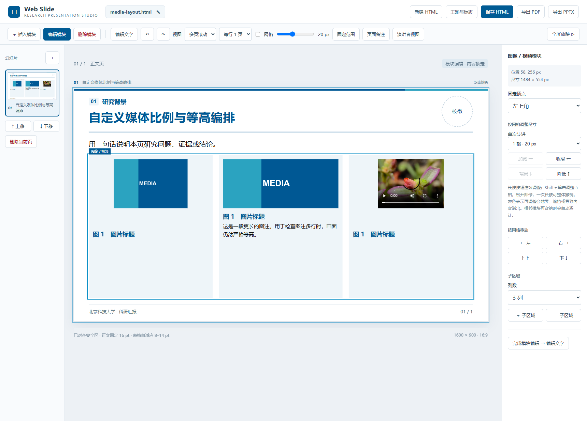

# AI 与人工协同的 Web Slide

本技能负责把用户材料加工成可讲述、可核查、可继续编辑的科研汇报。AI归纳文案、选择版式并检查，人可在HTML工作台内精修，再把最新保存的HTML交回AI继续迭代。核心交付物是可编辑HTML，PDF和PPTX按用户需求导出。

## 资源定位与独立使用

**资源根目录是当前SKILL.md所在目录，不是用户工作目录。** 本包不要求安装其他学校skill，也不依赖作者的聊天记录、原北科或辽工大目录。下文的“成熟版式”专指本包内保存的快照，具体规格就在本文件及配套文档中，不能要求新用户再去寻找外部“原版”。

| 包内资源 | 用途与阅读时机 |
| --- | --- |
| [README](README.md) | 首次使用：环境、入口、控件、保存、放映和导出，含实际工作台截图 |
| [AI制作与迭代流程](docs/AI制作与迭代流程.md) | 新建或继续汇报：材料→提纲→逐页内容→生成→人工迭代 |
| [结构化接口](docs/AI接口与排版规则.md) | 写project-data前：字段、构造器、富文本、目录和特殊页接口 |
| [版式细则与错误复盘](docs/版式细则与错误复盘.md) | 制作正文前及交付前：表格、公式、图文、参考文献、履历的具体规格与复验 |
| [文字组件说明](docs/文本块组件说明.md) | 选择或修改A/B/C文字样式时，结合包内原始规范PDF使用 |
| [reference参考库](reference/README.md) | 五份已确认HTML及多页工作台截图，理解布局和交互 |
| [成熟页数据](src/reference-layouts.json)、[局部样式](reference-layouts.css) | 复用history、formula、summary、references、profile时 |
| [学校素材](assets/) | 两校实际使用的标识、图片及来源记录 |

制作前按任务读取流程和结构接口，排正文前读取版式细则的相关章节。不能只读接口后机械拼模块，也不能仅凭页型名称猜样式。用户当前要求优先，规范用于解决常规选择，不替代用户的主题、研究材料和已经确认的设计。

普通制作以用户材料替换母版内容，输出到用户指定目录；未指定时在当前项目建立清楚命名的正式文件。保留母版，只有用户要求调整模板或平台时才修改共享资源。技能安装目录是资源来源，不是用户成稿的默认输出位置。

现成HTML的浏览、编辑和放映不要求Node.js。本地生成、Excel导入及PDF/PPTX导出需要Node.js 20.10+、npm依赖和Chrome/Edge，按README启动服务。分享整套技能须保留源码、脚本、样式和素材，不能只发SKILL.md。Python仅供部分维护检查与拼图工具使用；当前公式编辑不要求安装TeX。

继续修改以用户最新保存的HTML为起点，保留未改内容与人工设置；功能沿用本包共享运行时。具体的数据保留和文件写回规则见下文“生成、保存与功能保留”。

- [北京科技大学_WebSlide科研汇报示例.html](北京科技大学_WebSlide科研汇报示例.html)：30页，北科科研汇报的默认起点，包含公式、研究现状、伪代码、主图、双图、总结及附录。
- [丽水学院_WebSlide制作与演示指南.html](丽水学院_WebSlide制作与演示指南.html)：30页同结构母版，采用丽水标识、官网校史／校园资料及单一青色主题，保留各类标准页。

两校共用 `src/example.js`／`src/example-pages.js` 的北科底稿；丽水仅通过 `src/school-variants.js` 替换学校资料和主题，不维护一套删减版内容。丽水主题色、第二主题色、装饰色及强调色统一，浅底使用同色浅调。图片必须替换为本校材料，校史配图不代表对应年份时应说明。

人工已确认的五份参考示例与截图保留在 [reference/README.md](reference/README.md)。截图应先切换到多页视图，再截完整工作台，保留工具栏、侧栏、当前页与设置区，并注明实际页数和比较重点；只有一页的示例如实说明。先参考这些布局和交互，再修改正式文稿。HTML是不可随生成脚本覆盖的快照，不应因为升级运行时而重做其中内容；预览图可以重新生成。

[](reference/media-layout.html)

选型时还可查看[科研正文](reference/images/example-project.png)、[文字样式](reference/images/text-styles-example.png)和[备注视图](reference/images/notes-presenter.png)。截图用于理解层级和对齐，源内容仍应从 HTML 的结构化数据读取。

实际汇报的页数由内容决定；模板示例优先采用4或5的倍数只是方便总览，不能为凑页数编造结论。人可以直接打开HTML编辑；AI与人工端共同维护其中的`project-data`，不把截图当源稿。

## 工作方式

1. **识别任务与材料。** 区分新建汇报、修改成稿、调整母版、增加功能。读取原话、论文、图表、实验记录及最新HTML，确定受众、目的、时长／页数、必须保留的内容和待讨论问题。常规选择直接处理；缺失信息会改变结论或范围时才提问。
2. **建立事实与来源对应。** 区分已完成工作、初步观察、待验证假设和计划。保留单位、实验条件、重复次数及统计定义。不编造履历、成果、比较结果或DOI；缺失数据明确占位，作者普通字段缺值留空，成果数字保留XX。
3. **整理研究叙事与逐页文案。** 常见顺序为问题与意义→现状与缺口→方法与假设→实验设计及结果→结论与局限→计划，按任务取舍。一页围绕一个问题；每块通常不超过四点。先写主题、首句、证据、解释、结论、来源和备注，再选择版式，不先放满高卡片再往里填两句话。
4. **复用结构化页面。** 用`src/model.js`、`src/page-presets.js`等构造器，或解析现有project-data副本。根据下表选成熟页或普通模块。替换文案时同时替换对应图片、图注、解释和来源，不能只改标题。不要重复实现编辑器、放映或导出界面。
5. **生成与交接。** 从资源根目录执行`node scripts/build-document.mjs <中间JSON> <正式HTML路径>`，中间JSON放ect，正式HTML放根目录或用户指定目录。先做逐页视觉检查，再按需求通过本地服务导出；`--export`输出PDF/PPTX至output。

逐页文案应能回答：本页讲什么？证据在哪里？在什么条件下成立？听众应记住什么？标题概括对象或有依据的判断；首句补背景或阅读线索，不重复标题。备注补推理和讲述顺序，不把本应展示的关键证据全部藏进去。首次出现的必要缩写给出全称，术语、变量和单位全篇一致。

## 按材料选择页面

容量只是试排起点，不是硬性配额；最终按实际渲染判断。

| 表达任务 | 推荐页型／入口 | 应展示的信息关系 |
| --- | --- | --- |
| 主题和汇报信息 | cover／closing | 共用标题规格，署名标签和值均可编辑 |
| 章节安排 | toc | 编号、章名、页码范围及可选说明，允许人工增减 |
| 章节开场 | transition | 一个章名及简短概览，不堆正文证据 |
| 问题／现状与改进 | 双栏文字、默认或C2 | 同级标题、解释及证据，分别检查两栏的实际密度 |
| 技术演进／代表工作 | history成熟页 | 四阶段年份、统一配图、贡献／局限说明及底部时间轴 |
| 目标函数／更新方法 | formula成熟页或公式模块 | 公式名称、LaTeX、解释、符号与条件 |
| 算法流程 | 伪代码 | 输入、输出、初始化、循环／分支与停止条件 |
| 多场景结果 | table与合并表头 | 算法列、场景族、子指标、单位及统计口径 |
| 主图＋解释 | 图约62%、说明约38%起步 | 观察、解释、适用条件／局限，不能只用两句短文陪大图 |
| 双图／视频对照 | media模块 | 实际画面等高、图注协调底边、比较口径一致 |
| 进展与后续计划 | summary成熟页 | 左侧分层总结，右侧阶段／任务／验收表，下方讨论 |
| 文献、资料来源、作者 | references／profile及附录正文 | 独立成页，不能与未来计划或模板来源混为一页 |

成熟页入口是[src/reference-layouts.js](src/reference-layouts.js)。`applyReferenceLayout`会写入默认字段并清空modules，因此只对新页或明确重建的目标页应用一次；修改已有成熟页直接编辑字段，不能反复应用默认快照覆盖人工成稿。`legacy_*`按包内快照的数据绑定确定含义，不凭编号猜测。

## 母版结构与字号基准

正文按“章节标签／主标题→分割线→可选首句→主要内容”排列，首句属于正文，不是标题区副标题，其下不再加第二道线。标题区高168px、顶部7px细色条；校徽120×120px、右距58px、top为26.5px，在色条与分割线间垂直居中。保留图像原比例及颜色，目视检查透明留边；主标题右侧留出校徽空间，不恢复左上大色块。

封面、结束页及章节过渡页不显示页脚和页码，HTML、PDF与PPTX一致。普通正文、目录与附录保留来源及页码。隐藏这些页面的页码不改变整份文稿的实际页序、总页数和目录范围。

封面和尾页共用40pt标题、约4px画布字距、1.3行高、条带及标识尺寸，不单独给尾页加大字号。标题按语义手动换行，通常最多两行；顶部不额外加入正文装饰条。署名用无边框两列表格，标签两端对齐、值左对齐；标签列约112px，水平间隔28px、垂直12px，学院长度不能改变各行起点。标签和值均可编辑。

标准宽屏13⅓×7.5in对应960×540pt，**PPT pt＝画布px×0.6**；CSS自身的pt＝px×0.75，两者口径不同。先选PPT档位再反算，用户可见的px取整并标“约”。改物理页面尺寸时同步换算、打印和导出，不只保留16:9比例。

| 文字角色 | PPT pt | 画布px约值 | 层级要求 |
| --- | ---: | ---: | --- |
| 封面／尾页标题 | 40 | 67 | 同一字号、字距和字重 |
| 正文主标题 | 28 | 47 | 主题深色、加粗 |
| 分组标题、目录章名 | 20 | 33 | 高于所属分项；C3编号也为20pt |
| 分项标题、公式名称 | 18 | 30 | 高于正文，公式名称深底白字 |
| 正文、首句、公式及解释、页尾结论 | 16 | 27 | 正文默认档位，页尾结论白字加粗 |
| 图标题、伪代码、计划表 | 14 | 23 | 正文可由人明确选14pt；图标题独立于图注说明 |
| 图注说明、履历辅助字段、文献基准 | 12 | 20 | 使用专用版式，不一律继承正文16pt |
| 页码、脚注 | 10 | 17 | 不能因辅助角色任意缩小 |
| 表格总体范围 | 8–14 | 13–23 | 按表型实排；密集结果表优先12/11/10pt |

常用整数档位为10、11、12、14、16、18、20、24、28、32、36、40、44、48、54、60、66、72、80、88、96pt。用户提过10.5pt，但当前偏好整数，不默认取小数。不能只把15.6pt显示成16pt而保留旧样式。父子标题同时靠字号与字重区分；强调句或卡片口号不超过正文主标题。

中文优先Microsoft YaHei，后备PingFang SC／Noto Sans CJK SC；英文使用常见字体，伪代码用Consolas，数值启用等宽数字。C3编号使用Times New Roman、20pt、700字重。正文常规字重约400，题目约700，不用过细字重承担投影阅读；数学粗体按语义而非重要程度选择。

## 固定约束与可调项

- 1600×900、16:9。左右安全边距58px；模块默认区域x=58、y=256、w=1484、h=554。建议间隙12px，可按实际空间缩小；只有真实遮挡、越界或内容截断才报错，不把留白建议当硬限制。普通正文可用至页脚线前y=834，总结启用时至y=750；726是原示例的宽松排版参考，不是禁入线。
- 正文主标题用主题深色，章节标签单行。封面、尾页、过渡页标题只允许按语义手动换行；PPTX 必须关闭自动换行，不能只设置网页 CSS。
- 过渡页的章节名称及章节号都必须导出 `wrap="none"`，不启用自动缩字或自动调整形状。使用标题安全区的宽文本框，不能紧贴浏览器实测字宽；导出换行以标题源字段的显式换行为准。过长标题需精简或手动分行，并检查实际 PPTX XML。
- 字号按上表的语义角色选择，正文可由人明确选14/16pt。行距默认1.55，可手动按倍数调整；不要为了硬塞内容自动缩字号或行距。
- 深底白字、浅底深字。强调优先主题色或强调色；保留原色选项，可自定义颜色。加粗与颜色是选区级格式，列表可按当前正文块独立设置。
- 字号、粗细、颜色必须保留具体字符选区，不因点击工具栏而丢失或扩展为整个板块。列表和段后距按选中段落设置，允许同一正文内首段普通、其余段落列点。逐段格式保存在 `paragraphs.text`，与字符级 `rich.text` 分开；HTML 往返和 PPTX 导出必须同时保留。
- 示例必须演示真实页尾总结：使用`slide.summary`，深主题色底、白色16pt加粗；正文不得遮挡y=750起的结论条。内容偏少时，可用有实际含义的页尾结论适当平衡留白、突出重点；C1浅色备注不能替代页尾句样式。独立深底白字文本块也不能被误识别为C1，其用途和位置由作者决定。
- 表头是顶部行，不是正文第一列。仅顶部表头行用深底白字，多级表头的各级顶部行同样处理；正文首列即使用th或scope=row也保持浅底深字。不得把深色样式绑定全部th。参考文献无表头，作者履历表头按专用浅色样式处理。
- 表格注释用可选且可编辑的 `tableNote`，不统一追加指标箭头说明。只有结果表含指标方向时才解释 ↑/↓。场景结果表第一列与各场景族之间均保留竖线，深底用白线、浅底用深线。
- 目录章节标题20pt、说明16pt，可用不超过四点的列表。阶段总结的分组标题20pt，分项标题18pt，正文16pt；计划表保留阶段、任务及验收材料，表格与下方讨论独立排布。
- 避免段末只余一两个字，三四字也要复查。可适量增删、按完整语义拆句；并列完整句适合用列表，连续论述保留段落。不要只为对齐而切断语义。
- 分清行距与段间距。存在自动换行的多段文字时，相邻段落至少间隔 6pt（画布 10px）；不能只增大行距来替代段间距。伪代码默认 14pt、1.75 倍行距，按完整步骤分行，保持缩进，过长时拆页。
- 图注底部应与同排说明的基线／底沿对齐，并列媒体实际等高。没有图注时移除图注节点及预留高度，不能留下虚假的图注空位。必要空隙保留，整块空白应补充相关证据、解释模块或页尾结论，不能用装饰填充。
- 封面信息左右两列都可编辑，包括“汇报人”“学院”“日期”等标签；不把左列写死。不要因换学校或换受众而强迫用户接受固定身份字段。
- C2 内部只用无底色默认分组。B1 白框左沿与折角右沿对齐。C3 为两层同形直角梯形，浅色层向右偏移 16px；序号 20pt Times New Roman 加粗。目录选 C3 时序号只在编号块出现一次。

### 文字编辑与视觉平衡的判断

多句话形成短尾行时，比较“一句一行／段”是否更易读：独立并列的建议或结论适合真实列表，连续论证保留段落，不遇到句号就机械拆项。列表续行与首行文字起点对齐，前导符与文字保留约PPT 0.5cm的视觉距离，即画布约24px；不用手打圆点加空格。正文长段及现状说明可两端对齐、末行左对齐，不对短标题、公式或伪代码强行分散对齐。

文字少时可补全对象、条件、区别或局限，也可提炼一个有实质信息的小标题，将连贯解释按语义分成两段。例如“换算说明”分为PPT换算与CSS口径两段，而不是一条细长文字后留下整块空白。删改须保留事实、证据、单位和条件，不能为撑满版面增加无关话或虚构结果。

对齐按语义选择：同级同字号说明尽量校齐末行，不同字号图注与正文优先校齐模块边界，参考文献序号始终与条目首行顶端对齐，伪代码保持自然流程。检查的是可见背景／边框和真实文字，不只是名义高度。必要时用共同布局容器、合理内边距和按语义调整末段协调，不靠裁剪、负边距、巨大中间空隙或强撑空框。封面、尾页和过渡页允许比正文更宽松的留白。

### 学校识别与主题替换

| 本包变体 | 主色与辅助色 | 浅底及正文色 | 依据边界 |
| --- | --- | --- | --- |
| 北京科技大学 | 科技蓝#005B94、中蓝#1766A9、青色#2BA3C0，少量钢铁红#A31418 | 浅底#EEF5F9，正文#12374E；成熟局部卡片可用#F1F7FB | 以包内正式示例和学校素材为准；墨色、浅底等排版用色不称作官方标准色 |
| 丽水学院 | primary／secondary／accent／emphasis均为#0F6674 | 浅底#EDF6F5，正文#18383F | 本项目从标识提取的单色方案，不冒称学校正式色彩标准 |

深底白字、浅底深字，色卡的标题和解释都适用。主题色可用于页面主标题、分组题目和重点，不要求所有标题都黑色。普通浅底承载长文，较深浅调可按任务用于短粗体强调；色卡示范、主题变量与实际页面底色要一致。

迁移到其他学校时，核对全称与标识→替换theme及本校素材→重写学校介绍／校史／来源→查全篇残留校名、年份、色名及脚注→复验。不能只替换校名，沿用别校校训、校区、办学身份或历史结论。图片文件名不代表拍摄日期，学校总体成果不等于作者个人成果；可能变化的信息按任务核实。

学校换肤只改身份、配色和相应内容，公共组件的几何结构与功能保持共用。北科底稿及丽水变体都在本包内，不依赖其他已安装技能。较深浅调不应使整篇普通正文底色一起变深；原标识不能随主题强行改色或拉伸。

## 章节、目录与附录

模板中的字号、留白与配色说明置于目录前，标为“00 整体规范”，实际汇报通常删除。目录用“汇报概览”，不占01。正文从01连续递增，按“过渡页→本章全部正文→下一章过渡页”排列，不能按版式类型混合不同章节。

正常内容页自动继承最近过渡页。无过渡页附录用 `chapterMode:"manual"`，并明确 `section:"附录"`、`group`；连续同组附录自动形成一个目录范围。人工可在“标题、页首句与来源”修改章节归属。不要把参考文献混入未来计划。

目录是一个自动生成子区域的文字大模块。章节名称、顺序、编号和页码范围由章节推导；说明存于 tocNotes，样式、尺寸、列数与角标显隐可调。标题应为“01 问题背景与意义”形式，C3 标题不再次拼编号。不要手工维护易过期的页码。

附录默认不进入目录，但应作为前一正文章节页码范围的终点边界，不能把附录页算进正文范围。用户可明确勾选包含附录。目录允许增减子区域：删除自动条目仅隐藏目录项，不删除章节，使用 tocExcluded 保存；可恢复隐藏章节，或通过 tocExtras 添加可编辑自定义条目。重新同步、保存和重开不得复原已删除条目或丢失自定义内容。

B1、B2、B3 不设置样式专属的最小框宽，也不强制标题装饰至少占 25%。标题长度可调，狭窄时适配内边距、标题换行及装饰尺寸，不能因装饰造成误报红框；真实的文字溢出、越界和重叠仍必须提示，不通过关闭检查掩盖问题。

## 公式、引用与个人介绍

成熟版式快照位于 `src/reference-layouts.json` 和 `reference-layouts.css`，通过 `applyReferenceLayout(slide, 'history'|'formula'|'summary'|'references'|'profile')` 复用完整内容布局。具体结构已随本包提供，不调用外部模板或旧编辑器。保留时间轴、符号说明、作者履历与参考文献表的信息关系，不能简化成几个普通文字卡片。快照正文以 `legacy_*` 字段保存，可继续编辑；特殊页面布局由 AI 调整，常规模块继续用网格编辑。

总结与计划使用包内summary快照的内缩浅色卡片、序号和20/18/16pt层级；右侧计划表14pt、1.45行距、上下8px左右12px内边距，按自然高度排“阶段、关键任务、验收产出”。仅顶部表头深色，正文第一列浅底深字。下方讨论与表格至少相隔12px，并与左侧末块协调底边；不能强撑表高或覆盖空白单元格。可对照[包内总结页截图](docs/images/summary-layout.png)。

- 可以接收 LaTeX、论文、截图或推导说明，由 AI 生成公式名称、源码、正文解释及符号定义。每条公式独立浅色框，名称深底白字，与浅色框贴边；名称字号高于解释。双击公式可填 LaTeX 并预览。
- 单页及单列浏览时，未选中编辑模式也能双击公式打开编辑框，提供复制 LaTeX、实时预览、确定和取消。空公式或语法错误必须在框内提示，保留用户输入与原公式，修正并通过校验后才保存；取消不得更改公式。全屏与缩略总览保留原放映手势。
- KaTeX 使用 HTML 单一输出，不能把 MathML、后备文本和公式图像一起展示。标量、变量和索引斜体；函数名、单位、说明性下标正体；向量矩阵按材料统一粗体。复杂公式由 AI 拆行，不缩成不可读小字。
- 原公式页保留单份数学矢量图及配套符号图，保证字形一致；双击修改 LaTeX 后替换为单份 KaTeX HTML，不能叠加两套公式。符号之间的逗号属于标点，变量本身使用数学斜体，不用正体 Unicode 字符拼凑符号说明。普通文字用常规字重，标题加粗；向量粗斜体、矩阵粗正体的示例须与材料定义一致。
- HTML 保留 LaTeX。PDF 按公式排版显示；当前 PPTX 的公式是独立图像，标题与解释仍可编辑，不能声称是 Office 原生公式。公式太宽或说明溢出必须删改、拆行或调整版面。
- 参考文献使用无表头两列表格：窄序号列、正文顶端两端对齐且末行左对齐；条目间距大于条目内部行距。按用户要求遵循 GB/T 7714-2025，英文标点后留必要空格；URL/DOI 内部不乱加空格，链接及日期允许自然断行。引用必须核查，格式示例不是研究证据。
- 来源脚注可链接网页或 `#slide-页面ID`。多页参考文献应指向实际条目所在页，重排后核验链接。校徽入口可参考[中国高校校徽（LOGO）官方下载资源汇总](https://www.cnblogs.com/cdz-111/articles/22432508)，最终核对学校官方材料。
- 作者页保留身份、教育与工作经历、主要任职／项目／奖项、研究方向及粗体大数字成果占位。经历表 1/3/5 列写内容，2/4 列约半个字符宽且无线；浅底表头与正文用三段横线分开，正文居中，并与旁边任职说明保持字号一致。不生成真实个人经历或成果数字。

### 研究现状、实验表与图像证据

研究现状使用history成熟页：24pt年份、统一裁剪图片、14pt说明，18pt阶段短名放在底部浅色大箭头，不上下重复。图文共用连续浅底，四列图上／图下间距一致；线段沿文字框左边从箭头圆心延伸到年份色块顶端，圆点完整落在箭头内，箭头两端略宽于内容。真实研究中改为代表工作、贡献及局限，不能把学校历史示例当成领域研究现状。

多场景结果表用“算法列＋场景族＋各族相同顺序的子指标”。`xx.xx ± xx.xx`仅表示均值±标准差的格式占位，核对重复次数，不混同标准误或置信区间。数值单元格左右各至少0.5em；按真实算法名分配首列，不让首列空而数字挤。算法列右侧与场景族边界均划界，不能将竖线误放到组内。

表格总体8–14pt；密集结果表优先12/11/10pt试排，左右半字符边距不能随缩字被压掉。仍放不下时拆场景、指标或页面。普通计划表保持自然高度，不套密集结果表的撑满规则。实验口径与符号说明无浅底时，使用对称栏宽、共同顶线和充分间隙，不贴成一团；表注按本表需要填写并允许删除。

媒体可选预设或自定义比例。同排核对实际画面等高，图标题14pt、说明12pt，各占真实高度并协调底边；无图注时删除节点及预留高度。研究图优先contain，不裁掉坐标、单位、图例或必要证据；校园景观可cover统一裁切并保护主体。单图右栏应写有依据的观察、解释、条件或局限，不靠空框陪衬大图。比较图核对坐标范围、样本、单位及颜色含义。

伪代码14pt、约1.75倍行距，通常以7–10行主要步骤试排，输入输出另列，保留行号、缩进及完整控制流程。超过容量按算法阶段拆页，不以滚动条、裁剪或密集小字应付。

## 生成、保存与功能保留

从资源根目录执行命令，路径含空格时加引号。当前构建器复用同一运行时和样式，不要求AI手工维护另一套工具栏：

```powershell
node scripts/build-document.mjs "ect/本次文稿.json" "正式汇报.html"
# 本地服务已启动且需要两种导出时：
node scripts/build-document.mjs "ect/本次文稿.json" "正式汇报.html" --export
```

`--export`输出至本包output。`build:examples`优先读取当前保存的北科正式HTML，升级运行时并据此同步丽水；只有北科文件不存在才从内置生成器初始化，解析失败时停止，不能悄悄恢复旧稿。它用于维护两校示例，不代替用户其他成稿的局部修改。页面与模块ID、未知可选字段、rich、paragraphs、LaTeX及媒体取景都要保留。

模块编辑和文字编辑均可再次点击关闭，方便预览。常规浏览保留单页、单列、多页滚动及每行页数选择。全屏放映隐藏编辑界面，方向键／滚轮翻页；双击进入固定四列可滚动总览，再双击选页。Ctrl＋滚轮围绕指针缩放100%–400%，放大后左键拖动；第一次Esc恢复100%，再按退出。退出恢复普通视图，缩放平移不写入文稿。Fullscreen或Keyboard Lock被拒绝时按README降级，不保证浏览器原生Esc一定可拦截。

独立文本块是`type:'text',textBox:true,boxTone:'dark'|'light'`，一个正文区域，无附带标题和分组装饰。支持深底白字或白底深字，使用“圈定范围”手工划区并吸附网格，也可自动找空位；最小框高40px，仍以真实文字能否完整显示为准。保留其移动、尺寸、选区格式及保存／导出，不将它改造成C1备注。

选中文字或移动光标后，字号、行距、段后距、列表、颜色和粗细控件应读取当前选区的实际样式；值不一致时显示“混合”，不沿用上次操作值。允许直接一次选择14pt，不要求先切16pt触发事件。点击工具栏仍保留选区；控件回显不能覆盖用户正在输入的值。

普通表格支持`rowHeightPt`（统一最小行高，0为自然高度）、`cellPaddingPt`（上下内边距，缺省自动）；成熟页对应`referenceRowHeightPt`、`referenceCellPaddingPt`。内容较多时自然增高，不能强行裁切。调整后复查真实边界与导出，保留左右半字符间距。文字块空间紧凑时可适当收减上下内边距，不自动缩小字号或行距。

保存HTML优先写回已关联文件，另存为选择并关联新目标；双击／拖入首次保存需指定原文件，不能假定浏览器授权已存在。取消不写入，失败保留内存修改及原关联；不支持API时明确下载回退，不能声称已覆盖原稿。新建或重新载入要清除旧关联，避免保存到另一份文稿。

## 反复出现的错误：生成与验收都要回看

1. 不把空容器等高、整页无溢出当成版式通过；检查每一栏的实际墨迹、下半栏空位和末行。
2. 页尾结论可适当改善内容偏少时的视觉平衡；使用醒目的深主题色底、白字加粗总结条，不能以 C1 浅色备注替代页尾句样式。补充相关证据、条件和解释，或合并／换版式，也是可选的调整方法。
3. 不仅用同字号加粗区分父子标题；不让强调句超过页标题，不让图注继承正文层级。
4. 不把所有th染深，不给所有表追加指标说明，不用过大单元格内边距撑满页面。
5. 不用裁剪、负边距或重叠掩盖溢出；表格空白区域也不能被下方块覆盖。
6. 不丢失点击格式控件前的选区；不把局部字号／颜色变成全块修改；允许同块内混合普通段和列表。
7. 不让SVG、KaTeX、MathML同时显示，不把KaTeX默认外边距带进固定公式框；修改后检查解释完整性。
8. 不只校齐外框；同时检查可见底边、同级末行、并列媒体实际高度、无图注时的冗余空白。
9. 不忽略全页短尾行，不机械拆句，不让一个板块超过四点而不重新组织。
10. 不把HTML正确当作PDF/PPTX正确；章节与封面标题显式换行、段落间距、物理页面尺寸、引用链接都需另验。

完整的代表性错误、原因及复验方法见[错误复盘](docs/版式细则与错误复盘.md#代表性错误及防复发验收)。改动某类组件后，应同时回查两校全部使用该组件的页面。

## 验证与交付

等待字体、媒体和公式加载，检查每页 `window.slideStudio.check()`，再看单页与总览；空问题数组不能替代目视检查。重点复查板块边缘、最后一行、图注、表格间距、公式重复、页码范围和正文与总结是否遮盖。

PDF的纸张本身必须为16:9、每页MediaBox为960×540pt、页数与HTML一致；零外边距，无浏览器日期、网页标题、file路径及额外页码。A4横向加“适合纸张”不满足要求，模板内部的安全边距、脚注和页码正常保留。PDF/PPTX是导出时快照，HTML改变后须按需求重新导出。

PPTX 应检查原生文本颜色、换行、准确行距及标题／正文间距；不能把浏览器正确当成 PPTX 正确。正文行距以 CSS 实测点值写入，不依赖 Office 字体默认倍数。并列媒体核验实际图像高度，而不是外层卡片高度。保存 HTML 后重开，确认富文本、LaTeX、章节与备注仍在。

导出的PPTX必须在实际使用的演示软件中人工逐页审核，尤其检查局部字体颜色、字体替代、标点断行和文本换行。可编辑对象便于人工微调，不代表免审交付；没有实际进行人工审阅时，应说明验证范围，不能以自动检查通过替代此步骤。

备注位于画布外，页面设置弹窗和备注面板共用 slide.notes；打开或切页时自动载入，取消弹窗不更改，保存后不强制展开面板。HTML保留、PPTX写入备注、PDF可见页不包含。双窗口演示采用手动拖屏，观众数据移除notes；不宣称自动检测或分配显示屏。

交付正式 HTML、output 中的 PDF/PPTX 和必要说明；ect 中的截图和中间数据不冒充正式源稿。不修改已安装母版以代替生成用户文稿，不自动发布或上传用户材料。
