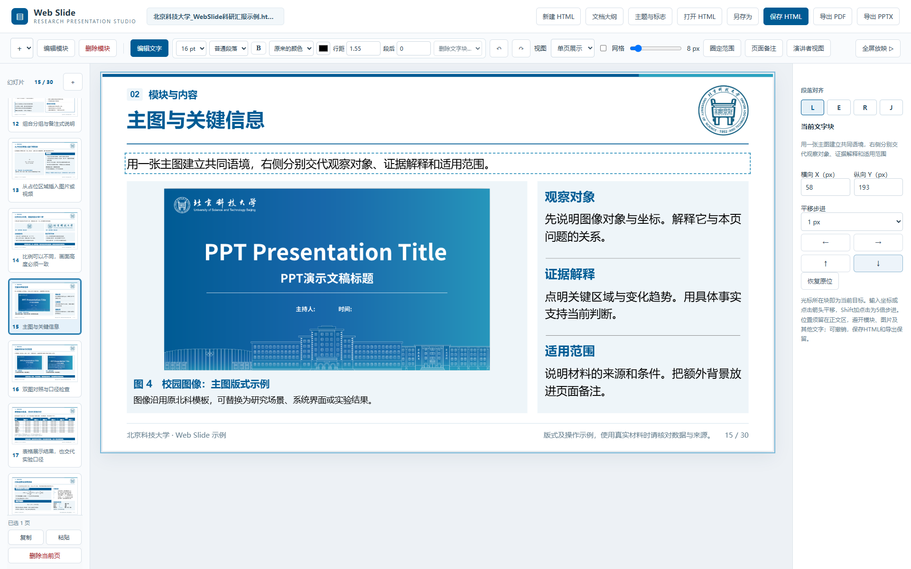
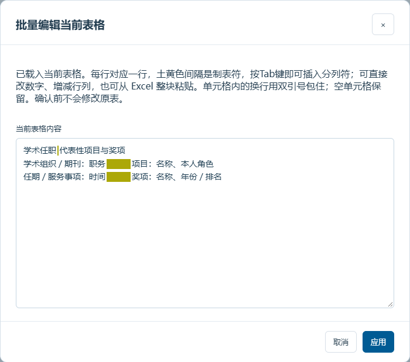

# Web Slide 工作台控件详解

本页承接主 README 中不宜展开的操作细节。建议先从根目录 `index.html` 进入主模板；需要某项功能时，再按目录查看对应控件、截图和注意事项。

> 本页说明的是人工工作台操作。AI 如何准备材料、大纲和逐页内容，见[AI制作与迭代流程](AI制作与迭代流程.md)；版式判断与错误复盘见[版式细则与错误复盘](版式细则与错误复盘.md)。

## 控件使用

### 先选编辑模式

上图是顶部文档管理区。“文档大纲”与“新建HTML”并列，随时可以打开，不限于制作开始时使用。

| 入口 | 使用方式 |
| --- | --- |
| 新建HTML／打开HTML | 新建文稿或载入已有源稿，不需要另外保存项目文件 |
| 文档大纲 | 制作中随时打开，现写／粘贴／读取MD或TXT，更新当前页题、章节与页序，或另建文稿 |
| Web Slide旁的文件名 | 点击修改文稿名称 |
| 编辑文字 | 点击画布中的文字，或选中具体字符后调整格式；再次点击回到预览 |
| 编辑模块 | 点击模块，右侧出现尺寸、移动、样式与子区域控件；再次点击取消 |
| ＋文本块／圈定范围 | 插入深底白字或白底深字的独立文本块；可先圈定区域，位置和尺寸吸附网格 |
| 删除模块 | 进入删除模式后选择要删除的区域 |
| 左侧＋ | 新增内容页、过渡页、目录及附录示例 |
| 左下固定操作区 | 复制、粘贴、上移、下移、删除；缩略图列表单独滚动，按钮始终可见 |
| ↶／↷ | 撤销与重做 |

### 先定大纲，也能随时修改

“文档大纲”位于顶部“新建HTML”旁边，制作到一半也能打开。弹窗会载入当前章序和每页题目；直接写、粘贴或读取MD／TXT文件均可，用`# 总标题`、`## 章节标题`、`### 页面标题`区分层级。长标题需要手动分行时写` `。可下载[可导入的大纲示例](大纲示例.md)。

默认更新当前文稿：下方预览显示每个题目对应的现有页，改名和排序后保留原页正文、图表、局部格式、位置和备注，目录同步更新。新增题目可选占位页或复制旧页，删去题目会移出对应页面，应用前检查映射和移出数量。**“最后一章为附录”**可以明确末章身份，章名不限于“附录”；勾选后默认无过渡页、不进入正文目录。

也可选择“另建文稿”，沿用当前主题。**默认正文内容区完全留空**，只保留大纲题目、章节和页眉页脚；非正文页保留必要标题与信息，填写提示放备注。同名示例也不会自动复制正文；需要复用时，在对应页下拉框明确选择旧页。取消不会改稿，应用后可撤销，保存HTML才写入文件。大纲建立的是结构，不自动完成研究文案。详见[人机分工与逐页制作流程](AI制作与迭代流程.md#3-提纲与逐页结构)。

### 页面复制、多选与排序

点击缩略图选一页；Ctrl（macOS用Command）加点击可多选，Shift加点击可连续选择。拖动缩略图到目标位置，蓝线表示插入位置；也可用底部上移、下移按钮。调整顺序后，章节号、自动目录及页码范围一起更新。

点击“复制”，再选定插入位置并点击“粘贴”，副本放在当前页之后。正文、图片／视频、时间轴、备注和富文本会一起复制，新页面使用独立ID。固定操作区支持多页删除，确认后可用撤销恢复，至少保留一页。左侧获得焦点时可用Ctrl／Command+C、V、A和Delete；编辑画布文字时仍使用正常的文字快捷键。

同一窗口内的页面剪贴板不依赖浏览器权限；跨窗口粘贴需浏览器允许读取系统剪贴板，离线文件可能受限制。

### 选中文字，再调格式

图中只选中了正文的几个字。操作时先建立选区，再点击上方控件；只修改选区的字符格式，不把整块一起改掉。

选中文字或移动光标时，字号、行距、段后距、颜色、粗细和列表会自动读取当前样式；不同值显示“混合”，不保留上一次操作的旧值。可直接一次选择14pt，无需先切16pt。行距和段后距输入后，点击框外应用。

| 控件 | 作用与范围 |
| --- | --- |
| 10／12／14／16pt | 修改选中文字的字号；未选字符时可调整当前字段 |
| B | 加粗或取消加粗 |
| 主题色／强调色／原色／自选色 | 修改选区颜色，保留与背景的可读对比 |
| 普通段落／列表 | 修改选中段落；允许第一行普通、后几行列点 |
| 行距 | 输入倍数，如1.55；点击框外应用 |
| 段后 | 输入PPT pt，默认6；与行距独立，作用于选中段落 |
| 右栏 L／E／R／J | 左／中／右／两端对齐；Ctrl+L／E／R／J可直接切换 |

右侧的段落对齐控件如下，蓝色表示当前段落采用的方式：

| 字母 | 对齐方式 | 文字编辑快捷键 |
| --- | --- | --- |
| L | 左对齐 | Ctrl+L |
| E | 居中 | Ctrl+E |
| R | 右对齐 | Ctrl+R |
| J | 两端对齐，末行自然左对齐 | Ctrl+J |

先把光标放入段落，或选中需要一起调整的几段，再点单选项或按快捷键。同一文字块可逐段设置；若选区包含多种方式，四项均不选中。HTML保存与PPTX导出保留设置。快捷键只在画布文字编辑时接管，普通输入框仍用浏览器原行为。

模块也可先统一设置列表，再逐段细调。板块通常不超过四点，末行只剩一两个字时先改写或按完整语义分行，不靠缩字号硬塞。

在“编辑文字”模式下，先点击一个文字块，再按住Shift点击其他文字块或表格单元格，可同时选中多个区域。虚线高亮和“已选N块”显示选择范围；字号、粗细、颜色、行距与段后距可统一修改，一次操作可整体撤销。普通点击或Esc退出多选；单个文字块内仍可按字符精调。多选状态不进入导出文件。

### 模块尺寸、位置与子区域

图中选中主图右侧的说明模块，右侧控件与这个模块对应：先选固定锚点（四角或中心），再调整宽高；按网格移动可改变位置。尺寸按钮支持长按连续调整，步进可选1／2／5格，Shift＋单击可快速调整；一次长按可整体撤销。

文字模块可换样式、调列数、增减子区域；切换样式保留内容。右侧子区域列表按名字显示，直接用`↑`、`↓`排序或点“删除”移除指定区域，移动时标题、内容、图片和格式一起保留。自动目录的顺序仍跟随章节。灰色尺寸按钮表示继续调整会越界、遮挡或导致内容溢出，真实问题需改文案、扩大区域或拆页。

尺寸锚点可选四角或“中心”。固定中心时，调整宽高会向两侧平均扩展或收缩，中心位置保持不变；文字字号不随之缩小。新增模块后仍应检查它在正文区的居中关系、与其他模块的边缘／基线及间距，AI排版规范已覆盖这些要求；当前没有一键自动居中按钮。

右侧“显示模块名称”可以隐藏或恢复标题，名称和正文仍保存在HTML里。有分组总标题时控制总标题，不影响下面各卡片的分项标题；无框线表格模块控制分组标题栏。编辑文字时，点击文字后可使用工具栏“删除文字块…”删除当前子区域或整个所属模块，确认框会标明范围，删除后可撤销。

编辑文字时，光标进入页首句、成熟版式中的正文说明或独立文本框，右侧自动显示“当前文字块”，可输入X／Y坐标或用箭头平移，步进可选1px、5px和当前网格，Shift加点击为5倍步进。碰到模块、其他文字、图片或正文边界时会拒绝移动；原版式字段可恢复原位，操作可撤销。页眉、页脚、身份卡和表格单元格保留各自结构。模块内文字仍对应所属模块的控件；右侧模块列表作为快捷入口保留。

平移位置随HTML保存，重新打开、放映和PDF／PPTX导出均保留。修改文字内容后，仍需检查新增行是否挤入其他内容。

“＋”下拉菜单收纳了文字模块、独立文字块、表格、图片／视频以及更多模块。收起时只显示加号，鼠标悬停提示“插入内容”；展开后显示完整选项。直接插入时先检测真实空白区域：只有一处可用区域则直接放入；存在多个分离区域时，先显示位置预览供选择。插入后仍可按网格移动和调整尺寸，不占用作者身份卡等固定区域。

独立文本块没有附带标题和分组装饰，可在右侧切换深底白字／白底深字。模块间建议留12px，紧凑时可缩小；页尾前也按实际可用空间检查，不因未留满24px标红。A类和C1卡片的内边距可留空自动调整，也可设为1–24pt，允许文字靠近边缘；C1仍给左侧色条留出净空。按真实内容判断截断和遮挡，不为留白硬性标红，也不缩小字号强塞。

十种文字样式的视觉关系与适用场景见[文本块组件说明](文本块组件说明.md)。作者简介与阶段计划已保留原有层级和信息关系，并改成可直接操作的模块，见下方说明。

### 作者简介与阶段计划

作者页左侧保留照片、姓名、单位和成果数量卡片，文字与照片可修改。右侧为两个模块：教育和工作经历是履历横线表，另一个无框线表格模块包含“学术任职／项目”和“研究方向”两个子区域，可继续增减、排序。点击右侧分组名后，行、列、行高、内边距和替换表格均针对该组。履历表正文居中，字段标题下用分段横线；无框线表格全部左对齐，首行主题色加粗。半个字符宽的履历间隔列自动生成。

作者表格默认正文14pt、字段标题16pt。右侧可为整表或当前分组选择10／12／14／16pt，工具栏也可调整选中的单元格或字符。手动指定表格字号后固定该档位；内容过多时通过调整行列、留白、模块尺寸或拆页处理，系统不会悄悄把16pt改回14pt。

阶段总结是一个含三张A2卡片的文字模块，支持增减和排序，第四张会自动改成两列；“下一步计划”保留可替换的纯表格，下方讨论用独立C1模块。分组标题20pt、卡片标题18pt、正文16pt，计划表14pt。模块实际边界不相互遮挡，讨论区不覆盖表格。

普通内容只有一个子区域时，选默认、A3或B1等无编号标题；C3适合多个有次序的子区域，避免单块内容上出现孤立的“01”。两校第13页已改为A3深底标题，保留原有文字说明。

### 时间轴：增减阶段、照片或视频

两校第8页现为可编辑时间轴。选择“编辑模块”，点击时间轴，右侧可添加阶段、删除任意阶段或前后移动；支持1–6阶段，建议2–5阶段。卡片宽度和媒体高度会自动调整，同排画面严格等高。阶段较多且文字较长时，应凝练或拆页，真实溢出仍会提示。

切到“编辑文字”可直接改年份、箭头上的事件短名和段落介绍。双击照片上传PNG／JPEG／WebP或MP4／WebM视频，也可调整取景和缩放。所有年份深色底、圆点、连接线及事件标题统一跟随主题色，图文卡片和箭头保留浅底；新增阶段先给占位媒体，再替换真实资料。

新页可通过“插入模块→时间轴”创建。通用时间轴位于参考项目第10页，使用媒体占位符并支持增减阶段及照片／视频替换；页面位置、操作方法和实际截图见[参考示例库说明](../reference/README.md#导航与时间轴先看章节再调整阶段)。

勾选右侧“隐藏时间轴装饰”后，同一模块可作为并列图文卡片：箭头、圆点、连线和年份隐藏，事件短名转到卡片顶部；照片／视频和说明保留，媒体仍等高。取消勾选恢复时间轴，年份与事件数据不会丢失，无需重新插入另一种模块。

### 图片、视频、表格和目录

| 内容 | 入口与操作 |
| --- | --- |
| 图片／视频 | 双击占位区域或已有媒体，上传文件，选择预设／自定义比例，再调取景和缩放 |
| 图标题／说明 | 在媒体设置中选择是否显示；无图注时不保留冗余高度；并列画面保持实际等高 |
| 表格 | 使用插入模块入口；可导入Excel／CSV或粘贴数据，在文字模式编辑单元格 |
| 粘贴替换当前表格 | 弹窗预填当前内容，按行和制表符分列，可批量改数字或增减行列；取消不改表 |
| 表格注释 | 选中表格后在右侧填写或清空；已有注释也可直接编辑，不给所有表自动追加指标说明 |
| 表格行高／内边距 | 选中表格后统一调整最小行高与上下内边距；0行高／空内边距恢复自动，内容多时自然增高。成熟页的表格在右侧页面栏调整 |
| 目录 | 从章节推导序号与页码范围；模块侧栏可增删条目、恢复隐藏项、补充章节说明 |
| 附录 | 默认不进入目录；在页面设置中自定义章节归属，也可明确勾选目录包含附录 |

表格的顶部表头行用深底白字，正文首列保持浅底深字；多级实验表的各级顶部表头同样处理。更多图文、表格和导航实例见[参考库的多页工作台说明](../reference/README.md)。

1. 进入“编辑模块”，点击表格；分组表先在右侧点选要改的分组。
2. 点击“粘贴替换当前表格”。上图显示自动载入的原内容，可直接改数字，也可从Excel整块粘贴。
3. 每行对应表格一行，Tab分列；添加／删去行或Tab即可调整行列。单元格内换行以双引号包住，空单元格保留。
4. 点击“应用”后检查表格；“取消”不改原表，应用后也可撤销。表格变大时应调整尺寸或拆页，确保文字完整。

**土黄色（#ACA808）表示Tab分列符**，已有和新输入的Tab都会高亮；连续Tab之间保留细白缝。下图是弹窗内临时输入的演示：每行三段高亮表示三个Tab，两端内容之间有两个空单元格。演示未应用到原表。

按Tab直接插入分列符，Shift+Tab可移出输入框；底色和白缝只是编辑提示，不写入表格数据。仍有效的合并表头保留。作者页的分组表格只改当前分组，履历的装饰空白列不算数据列。

履历横线表及无框线表格采用上文的专用表头样式。导出PPTX时，A3深色标题底作为独立色块保留；页尾总结按整条内容区宽度、单行原生文本导出，避免末尾句号因文本框过窄而换行。

标题类文字在HTML和PPTX中均默认单行，需要分行时按语义手动拆好，覆盖页面、模块、分组、图标题、目录及时间轴标题。超宽时提示精简、加宽或手动分行。PPTX中的脚注、来源、页码和作者姓名也强制单行。原本在网页中只有一行的文字关闭自动换行，多行正文继续自然排版，并写入中文标点断行规则。无序列表导出为可继续编辑的原生项目符号，保留普通段落与列表混排、所选符号及局部粗细和颜色，不把前导符直接拼进正文。

作者身份卡中的职称、学院／研究机构、团队、联系方式等字段同样只保留手动分行，替换成自己的信息后继续遵守；过长时提示调整。参考文献导出时，序号与内容使用相同顶部位置和明确的顶端对齐，多行条目的首行也与序号保持齐平。

### 双击公式编辑LaTeX

单页或单列视图下双击公式，即使在预览模式也能打开。输入LaTeX时不需要外层美元符号；可复制源码、预览、确定或取消。语法错误或超出当前排版时保留输入和原式，按提示精简或拆行。

公式只显示一份，修改后使用KaTeX HTML。变量、单位与函数的字体约定需保持全文一致。导出PPTX时公式是独立图片，**不是Office原生公式**；题目与解释仍可编辑。

## 放映与备注

### 浏览整份文稿

顶部“视图”支持单页展示、单列滚动和多页滚动；多页可选择每行1–6页。单页查细节，单列检查叙事顺序，多页比较版式与密度。切换视图不改变幻灯片内的真实坐标。

### 全屏放映与四列总览

点击“全屏放映”，或双击左侧缩略图进入放映。工作台控件隐藏，底部保留操作提示。

| 操作 | 放映时的效果 |
| --- | --- |
| 方向键／PageUp／PageDown／普通滚轮 | 前后翻页；空格也可下一页 |
| Home／End | 到首页／末页 |
| Ctrl＋滚轮 | 放大或缩小当前页 |
| 放大后按住鼠标左键拖动 | 查看局部内容 |
| 双击画面 | 进入每行4页的滚动总览 |
| 在总览中双击目标页 | 定位并继续放映 |
| 放大后按一次Esc | 恢复原大小 |
| 原大小时再按Esc | 退出放映 |

上图是放映中的总览状态，与工作台的多页编辑视图不同。页面较多时滚动查找，双击需要讲解的页面即可返回；不会修改源稿中的页面内容或尺寸。

### 演讲者视图与拓展屏

“演讲者视图”与“全屏放映”是两种并列的放映方式。只有一块屏幕、需要直接专注画面时使用全屏放映；连接投影仪或第二块屏幕时，优先使用演讲者视图。

点击“演讲者视图”后，系统打开独立的观众窗口，同时让原工作台保留为演讲者端：

- 将观众窗口拖到投影屏或第二块显示器，再点击观众窗口中的“进入全屏”。
- 演讲者端继续显示当前页备注，观众窗口不会收到或显示备注内容。
- 在任一放映窗口翻页时，两边页码同步；演讲者端的备注会随当前页面自动切换。
- 双窗口结束后点击“结束双窗口”，即可回到正常编辑状态。

浏览器若拦截弹出窗口，请允许当前本地页面打开弹窗；项目不会自动检测或指定显示器，窗口放到哪块屏幕由用户手动决定。

### 给当前页写备注

右侧“当前页设置”→“标题、页首句与来源”→填写“本页备注”并应用。也可点击顶部“页面备注”，直接在画布下方面板编辑；两个入口共用当前页的notes，打开或切页时自动载入，取消弹窗不更改原备注。

同一弹窗还可改标题、可选页首句、主题色页尾总结、左下脚注和来源链接。备注放在画布之外，HTML保存、PPTX写入备注页、PDF可见页不包含。

内容偏少时，可用有实际含义的页尾结论适当平衡留白。页尾总结采用醒目的主题深色底、白色16pt加粗样式；C1浅色备注不能替代此样式。

