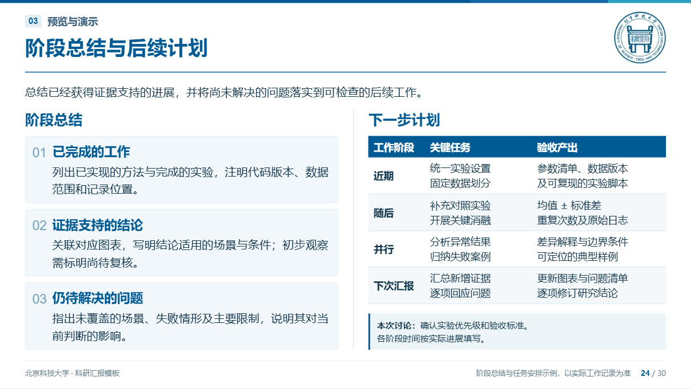

# 版式细则与代表性错误复盘

本文件是Web Slide的完整排版依据，适用于示例和真实汇报。已将北科、辽工大母版中可复用的经验写成独立条款，并按当前平台的字段、组件和导出方式整理；使用者无需安装旧技能、找到旧文件夹或读取聊天记录。检查脚本返回空数组，不代表已经满足视觉要求。

按内容查阅：[文案与密度](#先决定内容再决定空间) · [字号](#画布标题与字号) · [文字与段落](#换行段落与选区编辑) · [对齐](#对齐与遮挡) · [表格](#表格表头是顶部行正文首列不涂深) · [总结计划](#总结与后续计划优先完整复用原页) · [公式](#公式与数学字体) · [图文与时间轴](#媒体伪代码与时间轴) · [文献与作者](#参考文献作者与来源) · [验收](#交付前的实际检查)。

## 先决定内容，再决定空间

一页围绕一个问题、方法或证据判断。首句提供背景或阅读线索，可以不填；其后给证据、解释、适用条件。结论、初步观察、假设和计划必须分清。教学示例的操作说明不能原封不动带进真实科研汇报。

不能把“容器占满画布”当成“内容充实”。逐栏查看实际文字、图片墨迹：若一栏只有两段短句，下面仍能放下完整说明块，应补充有依据的观察、比较条件、失败情形或局限；也可放大有效图表、改变栏宽、合并相关内容或换版式。不能只加高空框、扩大行距、用 space-between 拉散内容，或编造结果填空。

页尾结论使用`slide.summary`：横贯正文安全区，主题深色底、白色16pt加粗，顶部750px。原示例正文常排到726px以保留24px呼吸，但这不是硬限制；文字完整、不遮挡时可更靠近结论条。内容偏少时，可用有实际含义的页尾结论平衡留白并突出重点，不要求先穷尽其他方法。C1浅色备注不能替代页尾句样式；独立深底白字文本块另有自己的用途，不属于C1。

文字较少时也应编辑措辞：提炼有信息的小标题，把对象、条件与区别说明完整。文字太多时删重复、合并同义项或拆页。一个板块通常不超过四个分条，超过时先重组主题，不能无限增加圆点。

例如字号换算说明，不把PPT与CSS的两种口径塞进一条长句后留下整块空白。可设18pt小标题“换算说明”，下方12pt正文分两段：第一段解释标准宽屏的PPT换算与整数取值，第二段说明CSS换算及口径差异。两段各自语义完整；独立并列提示则改列表。增删文字要增加实际信息，不制造空话。

## 画布、标题与字号

- 画布1600×900，预览仅整体缩放。左右安全边距58px；普通模块起点y=256px。成熟特殊页面沿用各自正常文档流，不把普通模块坐标硬套进去。
- 标题、分割线、可选首句、主要内容依次排列；首句是正文，不是标题区副标题。没有首句不强塞文字。页脚独立，不能与正文、图注或结论重叠。
- 校徽120×120px，保留原比例，在顶部细条与标题分割线之间垂直居中；长标题不得进入校徽区域。正文顶部不恢复旧蓝色方块。
- 封面与尾页共用标题字号、字距、条带和标志尺寸。信息采用无边框两列表格：标签两端对齐、值左对齐，共同列起点；标签和值都可编辑。
- 标准宽屏13⅓×7.5in对应960×540pt，因此 PPT pt＝画布px×0.6；CSS pt＝px×0.75，是另一口径。先选整数PPT档位再反算，面向用户的px取整并标“约”。

| 角色 | PPT字号 | 画布px约值 |
| --- | ---: | ---: |
| 封面／尾页标题 | 40 | 67 |
| 正文页标题 | 28 | 47 |
| 分组标题、目录章标题 | 20 | 33 |
| 分项标题、公式名称 | 18 | 30 |
| 正文、页首句、公式解释、页尾结论 | 16 | 27 |
| 图标题、伪代码、必要辅助正文 | 14 | 23 |
| 图注说明、作者页辅助字段 | 12 | 20 |
| 页码、脚注 | 10 | 17 |
| 表格总体范围 | 8–14 | 13–23 |

父子标题同时用字号和字重区分，不能只加粗。强调句和卡片口号不能大过正文页主标题。中文优先微软雅黑，英文用常见字体，C3序号用20pt Times New Roman加粗；不要用奇怪的数字装饰字体。

### 封面、结束页与校徽

封面和结束页共用标题变量：40pt、约67px、700字重、1.3行高、4px画布字距，通常最多两行，只按语义手动分行。顶部标识区235px，标题条带330px；尾页不能单独加大字体、标志或条带。结束用语长度应在同一规格内可读。

署名使用整张无边框两列表格，整表居中。标签列约112px、两端对齐；值列左对齐，行间列起点一致。水平间隔28px、垂直间隔12px。标签16pt、值18pt；标签和值均可编辑，不能固定写死“汇报人”“学院”。不将各行分别居中，不让长学院名推歪单行缩进。

正文校徽120×120px，右距58px。在7px顶部色条下缘与166px分割线上缘之间居中，top为26.5px，两侧垂直净空约19.5px。PNG素材内部透明留边会影响视觉大小，应目视检查，不拉伸补偿。标题区右侧预留校徽空间；页脚的短来源不再重复左上章节名。

### 颜色与身份

主题变量、色卡示范、普通浅底和局部样式保持一致。深色块中的色名、数值、说明均用白字；浅色块全部使用深色字，不只改标题。主标题和分组题目可以用主题色，辅助灰不能承担低对比的小字。

学校官方标识、官方标准色与本项目派生的墨色／浅底要区分，不能把全部色值称为官方发布。跨校只迁移版式与功能，学校全称、英文名、校训、历史、校区、照片和来源都要重新核对。学校精神不作为每页装饰口号，学校总体成果不移植为作者成果。配色数值见[SKILL的主题表](../SKILL.md#学校识别与主题替换)。

## 换行、段落与选区编辑

复查标题、正文、列表、表格、图注及来源的最后一行。仅剩一至三个汉字或标点必须改写；三四字以上也要结合栏宽判断。先在保持事实、公式和条件的前提下适量增删，必要时按完整语义拆句。不能缩小单段、插空格或强行分散对齐来隐藏问题。

多句话形成短尾行时，判断能否一句一行或一句一段。并列完整建议适合列表，连贯推理保留段落；不能机械地遇句号就拆。列表续行与文字起点对齐，前导符与正文之间保留约0.5cm的PPT视觉距离，不能靠手打空格模拟。

PPT 0.5cm约14pt，反算为约24px原始画布距离；不能直接把浏览器0.5cm当作PPT尺寸。圆点本身约6px，续行保持文字起点，不能退到圆点下方。窄栏中重新检查缩进后产生的短尾行，不用缩小正文解决。

行距与段后距独立。正文默认约1.55倍行距，多段之间默认至少6pt；自动换行的段落与下一段也需明显区别于同段行距。人工可按语义细调，AI不能以过大段后距撑满页面。正文通常两端对齐、末行左对齐；并列短句采用列表时仍保持续行缩进。

手动换行也必须在实际画布复查。不能截断变量、数字与单位，不能只用连续br模拟本应具有前导符的列表。强调、改色或加粗会改变字宽，修改之后要再检查全段末行，而不只确认选区样式生效。

粗细、颜色、14/16pt字号针对具体字符选区。点击下拉框、颜色控件或加粗按钮不能丢失选区、扩大为全字段或误改相邻文字。列表与段后距按选中段落设置，允许首段普通、第二至四段列点。模块级统一设置之后仍可逐段修改。保存、重开、切页和导出都须保留这些差异。

## 对齐与遮挡

同级并列区域检查共同顶线、可见底边及末行。仅外框等高、实际内容一边提前结束，不能认定合格。可共用grid/flex、按语义调整末段，或把确有意义的末块推到底部；不要用负边距、绝对定位、巨大中间空隙或裁剪硬拉齐。

同字号说明适合校齐末行；不同字号的图注和正文优先校齐模块边界。参考文献序号与条目首行顶端对齐，不套用底部对齐规则。伪代码按自然流程排列，不为了末行齐平拉散代码。

任何内容都不能覆盖表格，包括空白单元格区域。表格、图注和下方说明依正常文档流排布，至少留12px间距。普通计划表不设height:100%，不靠flex:1压扁包装器，也不让下方说明侵入真实表格底边。

12px是建议节奏，空间紧凑时可缩小；模块间和页尾前不再机械强制24px。普通模块可用至页脚线前834px，启用页尾结论时至750px。文本块可收减上下内边距以显示完整文字，但不缩小字号／行距，也不取消真实越界、重叠及截断检查。单纯留白小于建议值不能标红或阻止导出。

## 表格：表头是顶部行，正文首列不涂深

默认首行为深色表头；两级实验表的第二级指标行也属于表头，两级都深底白字。第一列是算法、阶段或条目名称，不能因位于第一列或用了`th`就染深；正文行标题即使用`scope="row"`，也保持浅底深字。参考文献表无表头，履历表按专用浅色表头处理。

深色样式应限定`thead th`或`th[scope="col"]`，不能给所有`th`设置深底。迁移旧页面时同时检查通用CSS、局部CSS和最终计算样式，防止新样式把原版首列、行距或间距覆盖。

实验比较表使用算法列及多个场景族，每族下设相同顺序、单位和方向的指标；`xx.xx ± xx.xx`只表示均值±标准差的格式占位，不代表实验数据。不能混淆标准差、标准误与置信区间。高亮关注方法不代表它最优。

数值单元格左右各至少0.5em，使相邻文字墨迹之间至少有一个字符的距离。按真实算法名分配首列宽度，不能首列过空、数字列拥挤。算法列右侧与场景族之间都保留竖线：深底表头白线，白／浅底正文深线。组内不乱加粗线。

表格8–14pt适配，密集结果表优先12/11/10pt试排；左右内边距不随缩字压掉，仍放不下时拆场景或拆页。包内summary计划表按14pt、约1.45行距、上下8px左右12px内边距自然排布，任务与产出按完整短语分行。不能通过增大空白单元格填满页面。

三场景各三指标时，可先按算法列约12%、其余88%分给九个数值列试排，再据真实算法名和数值宽度修正。这是容量起点，不是固定百分比；列数、字体或加粗变化后重新验证。不能只看scrollWidth未超容器，还要核对字符墨迹没有侵入左右0.5em净空。多级表头的合并范围、指标顺序、单位、组边界必须同步改变。

结果表下两组无底色说明可采用等宽双栏、共同顶线，相对画布中心对称。以组间96px、外侧各内缩24px、距表24px试排；14pt独立标题＋12pt说明列表，两组都保留真实高度。说明变长后重新给表格分配空间，不能把说明压到表格底下。具体间距按实际信息量调整，不强套到所有表型。

指标方向只在确实需要时用↑/↓，不在每个表后自动重复“越大越好”。`tableNote`可填可删、可编辑；计划表、履历表、字号表不会被自动追加指标说明。实验设置与符号解释若无底色，要用对称栏宽、相同顶线和充分间隙区分，不能贴成一团。

单元格可统一调最小行高和上下内边距，适用于普通表格以及成熟页的参考文献、计划或履历表。最小行高为0时按自然内容排布，内容多的行仍可增高；不能用固定高度裁切文字。缩窄时仍保留数值列左右半字符间距，拉宽时复查表格是否挤入说明或页脚，不用空白行高代替必要内容。

## 总结与后续计划：优先完整复用原页

使用包内`referenceLayout:'summary'`，完整结构位于`src/reference-layouts.json`，局部样式位于`reference-layouts.css`。保留浅色内缩卡片、序号、20pt分组题目、18pt分项题目、16pt正文，以及自然高度的14pt计划表。不要改成几块近似普通模块或全列蓝底表格，不要求新用户再寻找外部原稿。

左侧卡片文字应向内收，当前快照左内缩62px，序号有自己的空间，两行解释完整可读。右侧表格使用明确的列宽：阶段、关键任务、验收产出；仅顶部表头深色，正文阶段名称浅底深字。讨论说明位于表格下方，与左侧底部协调，不能遮盖表格。

## 公式与数学字体

每式一张卡片：18pt深底白字题目条，与下方浅色框同宽贴边；浅框内为16pt公式和16pt解释。公式说明要解释作用、关键项或计算约定，不能只重复题目。按实际内容分配高度，不让短公式与巨大内边距形成空洞。

每个公式只显示一份。原SVG保留LaTeX，双击修改后使用单份KaTeX HTML；清除展示公式默认外边距，不继承大行距制造额外高度。替换之后同时检查公式、解释、卡片与下一块的边界。语法错或超出当前版式时保留输入和编辑框，原式不变，提示精简或按语义拆行。

符号或公式改变时，同步检查名称、编号、解释和符号表，不能只改源码而留下旧显示结果。长式按等号、求和结构或推导步骤分行，不按容器宽度自动压小字形。源码保存在普通公式parts[].latex或成熟页referenceLatex[]；包内初始SVG已经提供，不要求用户安装XeLaTeX、dvisvgm或旧模板重绘脚本。

| 对象 | 约定 |
| --- | --- |
| 标量、变量、变量下标 | 常规字重、数学斜体 |
| 向量 | 与原文统一，通常粗斜体 |
| 矩阵 | 与原文统一，通常粗正体 |
| 数字、单位、函数、说明性下标 | 常规正体，函数用sin/log或operatorname |
| 逗号、括号、运算符 | 同一数学字体内的正体标点，不混入普通文字逗号 |
| 正文解释 | 正体、常规字重，不用过细字重承担投影阅读 |

可用的LaTeX写法示例：标量`x_i`、向量`\boldsymbol{x}`、矩阵`\mathbf{A}`、函数`\sin`／`\operatorname{argmin}`、单位`\mathrm{m/s}`、说明性下标`x_{\mathrm{max}}`。这些是字形示范，不规定所有学科都采用同一向量矩阵约定；研究原文另有定义时全篇沿用。`x_i,\,y_i`整组交给数学渲染，逗号保持数学标点，变量保留斜体。

符号说明与公式统一数学字形。不能用普通Unicode上下标、正体变量和手拼逗号凑公式。右下说明区可以解释字体约定；真实汇报中可换为实际符号或方法限制。PPTX中的公式是独立图像，不宣称Office原生公式。

## 媒体、伪代码与时间轴

图像和视频保持原比例，同排画面实际等高，不只让外框等高。裁剪不能去掉坐标、单位、图例或必要证据。图注在画面之外，14pt图标题、12pt说明各占真实高度；无图注就移除节点和预留高度。图注与相邻说明应协调底边。

原生时间轴支持1–6阶段，通常2–5阶段。各块图文共用同一浅底，年份深色底、圆点、连接线和事件短名统一当前主题色。底部浅色大箭头略宽于内容，圆心在箭头内部，连接线从圆心一直连到年份色块顶端，并与卡片左沿对齐；阶段短名只放在箭头上。阶段间距紧凑一致，图像上下留白相同，正文两端对齐、末行左对齐。

当前timeline模块按阶段数量均分卡片：列间16px、内容两侧内缩32px；年份24pt加粗，说明14pt，阶段短名18pt加粗。媒体框两侧各内缩16px，高度按列宽及文字剩余空间统一计算，最低72px，不写死所有数量的图片尺寸。年份到图片、图片到说明均留16px，说明左右16px、底部12px内边距。用object-position保护图像主体，支持照片／视频替换，保留素材供重新裁切。

当前底部箭头独占62px高，距上方图文16px；箭头左右各比内容多32px。圆点视窗24px，圆心与卡片左沿同轴，完整轮廓位于箭头内，阶段标题在点右侧且留净空。连续竖线从圆心连到年份色块顶端，不在色块底边提前停止；各段连线同轴，不能悬空、穿字或把首点露出箭头半圈。首句、图片、说明和时间轴都占真实高度，不能为保留阶段数量而裁剪正文；长内容应凝练、扩区或拆页。

单图页可从图62%／文38%起步，右栏按有依据的观察、解释、条件或局限组织，分组18pt、正文16pt、必要辅助14pt，组间约20px。分组数量由材料决定，不强制每页三块；内容少时调整图文比例或增加醒目页尾结论。并列比较图要核对坐标范围、单位、颜色映射和样本口径，不仅检查视觉尺寸。

伪代码14pt、约1.75倍行距，明确输入、输出、初始化、循环、分支和停止条件；保持缩进，变量与公式一致。按步骤分行，超长时分阶段拆页，不能用滚动条或密密麻麻小字。

## 参考文献、作者与来源

参考文献使用无表头两列：窄序号列、正文顶端对齐；正文两端对齐且末行左对齐。条目之间距离大于同一条目的内部行距，序号与内容间距不要过宽。中英文均按用户要求用英文标点，标点后留必要空格；URL/DOI内部不插空格，允许链接内部、日期符号后自然断行。

参考文献与模板制作来源分开：真实汇报只列确实引用且核对过的资料，不保留为展示类型而编排的教学条目。按GB/T 7714—2025及资源本体选择类型，不能因为从网上取得就全部写EB/OL；核对作者、题名、版本、出版信息、卷期页码、日期、标准／专利号及访问路径等实际所需字段，不把某类必备项套到所有类型。包内格式示例不代表元数据已经适用于用户研究。

推荐试排基准为12pt、1.35行高、单元格上6px下7px内边距。相邻条目合计多13px留白，与同一条目内的行距明确区分；不设固定行高裁剪多行条目。序号列默认48px、右内边距6px，正文列不额外加左内边距，按最长编号适量加宽，不留大块列间空白。文献多时拆成多页附录，编号连续，不挤压页脚。

英文句点、逗号、冒号、分号作为著录分隔符时，其后留一个半角空格，标点前不加空格。这是本项目排版约定，不机械用于所有内部标点：https://、DOI、日期、小数、版本、专利号和缩写均保留本体。链接用white-space:normal、overflow-wrap:anywhere、word-break:normal；普通英文单词不因此逐字断开。日期如(2012-03-18)[2020-06-24]可在连字符后及括号组之间提供wbr断点，不在数字内部断，不让右括号单独开行。软换行不能改变复制文本或href。

来源脚注可链接网页、DOI或实际文献所在页／条目，重排后仍须正确；不假定参考文献只有最后一页。不得猜DOI，格式示例不能充当科研证据。附录独立标“附录”，默认不进正文章节目录，不并入未来计划。

当前标准来源字段支持http(s)或#slide-页面ID，内部跳转应指向该文献实际所在页。需要更细的条目级定位时先核对或扩展导航能力，不能写一个看似合理、实际不能到达的锚点。不要把所有引用都指向第一张参考文献页；重排及保存重开后实际点击验证。

作者页保留教育工作经历、主要任职／代表性项目奖项、研究方向；照片用本人的授权材料或中性占位。没有资料时保留字段与空值，不写“待填写”，论文和项目的大号XX占位不能一起删掉，更不能编造经历或数字。

履历表五列：1/3/5内容，2/4为空白间隔，各约半个字符、无线无内边距；浅色表头下用三段横线分隔，正文比表头小一档且与任职说明同字号，居中顶端对齐。姓名区底边与右侧研究方向底边齐平，末行对齐，不能只让空框等高。

profile成熟页左栏约340px，含头像、姓名、职称／学位、单位、团队、联系字段及成果占位。右侧依次放教育工作经历、主要学术任职／代表性项目（奖项）、研究方向；资料少时可合并区块，过多时拆附录，不能只堆没有解释的方向标签。

局部层级为姓名及成果数字20pt、分组题目18pt、身份／履历表头／分项题目14pt、履历正文及任职辅助说明12pt。12pt对应约20px，两个间隔列各0.5em即约10px，不能放宽成普通空白栏。履历内容行上下内边距约5px，保持自然高度，正文居中规则只限履历表，不影响文献表的左对齐序号和两端对齐正文。

姓名身份区下沿与右侧最后一个研究方向框下沿齐平，同级12pt末行也尽量协调。可用共同容器和数量区自动上边距，保持两侧约12px下内边距；替换照片或增加履历行后重新检查，不分别猜绝对高度。头像保护比例及面部；参考人物的姓名、职称、论文数和照片不能移植给作者。任职写组织／职务，项目写名称／本人角色，奖项写年份及必要排名，均须有材料依据。

## 代表性错误及防复发验收

| 出现过的错误 | 固定规则与复验 |
| --- | --- |
| 履历和计划模块化后退化成普通卡片，原有层级丢失 | 保留身份卡、履历横线、分组表及20/18/16pt层级，只将可变内容拆成模块；与成熟页比较并复验可增减操作 |
| 标题只能删内容才能隐藏，或子区域只能删除最后一个 | 显隐与数据分离；按区域名字提供↑↓及删除，整个内容对象一同移动，支持撤销与保存重开 |
| Shift多选后只改到一块，或改字号覆盖未选字符 | 临时块选择与字符选区区分；批量只提交选中的字段，一次撤销；普通点击回到字符编辑 |
| 选16pt却被表格自适应退回14pt | 用户手动指定用fixedFont保留，真实放不下时提示调整；自动表格才允许在默认范围降档 |
| A3在HTML有深底，PPTX却只剩白字 | 标题深底显式标记data-shape，导出独立原生色块并检查覆盖范围与绘制顺序 |
| 页尾总结末尾句号在PPTX自动换行 | 用总结区的整条内部宽度，关闭原生换行，保留16pt及字符格式，不以缩字补救紧贴字形的文本框 |
| 把正文首列全涂深，认为th都应深底 | 仅顶部表头行深底；检查计算样式与PPTX，正文第一列浅底 |
| 近似“抄”了结构，却丢掉成熟页精髓 | 完整迁移结构、CSS、列宽、字号和留白；与原截图并排比较 |
| 通用CSS覆盖旧页，迁移后表格变样 | 特殊页局部作用域隔离；复查首列背景、单元格间距和标题层级 |
| 只有容器满高，实际文字只占上半部 | 看每一栏的真实内容底边；补充相关解释或调整版式，不撑空卡 |
| 单块内容使用C3，只出现孤立的01 | 普通单块改默认、A3或B1等无编号标题；保留正文、子标题及说明 |
| 时间轴只能固定四阶段，增减后照片不等高、连线偏移 | 使用原生timeline模块；添加、删除及重排后复验等宽卡片、实际媒体等高、圆心到年份顶端的连线及箭头内圆点 |
| 时间轴按阶段轮换配色，新增阶段风格不统一 | 深底年份、圆点、连接线与事件短名统一当前主题色，浅底卡片和箭头保留 |
| 页面操作埋在长缩略图列表末尾 | 左下固定复制、粘贴、移动和删除，缩略图独立滚动；低窗口高度也能看到按钮 |
| 复制页面沿用原ID，目录或内链混乱 | 页面与模块重建ID，重映射复制范围内的引用；多选拖排、删除、撤销及保存重开后检查目录和媒体 |
| C1浅色补充说明替代页尾句样式，或禁止用页尾结论改善留白 | 页尾总结用summary，深底白字加粗，可适当平衡内容偏少时的留白；C1只作补充 |
| 同字号加粗就当父子标题 | 20/18/16pt建立分组、分项、正文层级 |
| 首句段后距过大、标题正文又挤在一起 | 分别检查线到首句、首句到内容、标题到正文，不共用错误的大间距 |
| 中文短尾行、三字孤行未处理 | 全页文字逐段看真实换行；增删改写或按完整语义分句 |
| 超过四点仍往一个板块堆 | 提炼子主题、合并或拆页，不缩字 |
| 点颜色／字号后选区消失或整块变色 | 用真实鼠标点击控件，核验仅选中字改变，保存重开再查 |
| 选区换了，控件还显示上一次字号／间距 | 读取当前字符和段落实际样式，混合值明确显示；14pt直接一次生效 |
| 仅因小于24px留白就标红或不能插入 | 建议间隙12px且可缩小；按真实遮挡、文本边界及页脚位置验收 |
| 一块只能全列表，不能首段普通后段列点 | 逐段格式独立保存与导出，保留模块统一设置能力 |
| 段后距被行距替代 | 两个独立控件与字段；换行段落有可见的段间距 |
| 公式重复，或换LaTeX后解释被截掉 | 单份渲染，清展示外边距，测卡片自然高度；错误不覆盖原式 |
| 符号正体、逗号字体跳变 | 变量和整组标点用同一数学渲染，不手拼Unicode |
| 所有表格都追加同一指标脚注 | tableNote默认空且可编辑，仅结果表按需解释箭头 |
| 首列很空、数字列却挤在一起 | 按内容分列，数字左右各0.5em，核查真实墨迹距离 |
| 表格下说明遮住空白单元格 | 正常流、自然表高；复查真实底边及至少12px间隙 |
| 图片无图注仍留一段空位 | 无图注移除占位；并列画面按实际图像等高 |
| 封面尾页标题字号不同、署名起点乱 | 共用变量和无边框两列表格；左右标签也可改 |
| 校徽靠下、章节标签自动换行 | 校徽垂直居中；章节单行，PPTX也明确禁止自动换行 |
| 章节号乱序、附录算进正文目录 | syncSections后核对实际页序、页码范围和目录；附录默认排除 |
| 引文不带链接或全部跳到同一页 | 每条来源指向实际条目；重排和离线保存后复验 |
| 作者履历字太大、间隔列太宽、数字丢失 | 专用五列履历、半字符空列、XX大号统计占位、真实底边对齐 |
| PDF是A4加白边，带浏览器日期和file路径 | 核对PDF每页960×540pt，零外边距、无浏览器页眉页脚 |
| HTML正确就认为PPTX也正确 | 核对PPTX文字、间距、主题色、显式分行和真实对象边界 |
| 只修正文总结，过渡／尾页标点仍另起一行 | 按语义识别所有单行字段，使用父区域宽度，明确中文断行规则；多行正文仍允许正常换行 |
| 只限制作者姓名，学院信息的末字仍自动折行 | 身份卡所有文字字段都只允许手动分行，替换内容也保留规则；居中字段使用卡片内部完整宽度 |
| 文献两列外框齐平，序号仍与首行错位 | 使用有效的`valign:'top'`并检查`anchor="t"`、顶部坐标和内边距；不能误用无效的`vertAnchor` |
| 无序列表导出成普通文字，富文本后符号消失 | 读取逐段列表属性，用原生项目符号和缩进；一个段落只留一份段落属性 |
| 插入按钮随最长菜单项变宽，挤成两行工具栏 | 收起时固定短按钮宽度，展开时显示完整选项；实际进入文字模式验收 |
| 直接全屏白框丢失边框／阴影，观众窗口却正常 | 缩略图与画布的SVG资源按渲染实例生成唯一ID；隐藏侧栏后验证引用仍指向当前SVG，比较两种放映画面 |
| 用户双击index后只见白页 | 显示启动说明；离线优先打开学校示例，服务入口说明清楚 |
| 模块外正文能改文字却不能调整位置 | 以光标所在块显示平移控件，保存字段偏移；按正文边界、模块及实际内容阻止遮挡，放映与导出共用坐标 |
| 中文控件名称显示一串问号 | 用UTF-8文件修复真实标签，检查源码中的问号占位及替换字符，并实际打开控件核验 |
| 保存只下载副本，误以为原稿已更新 | 取得文件句柄后覆盖保存，另存为关联新文件；不支持时说明回退，取消与失败保留原关联 |

## 交付前的实际检查

逐页看单页和总览，尤其检查正文栏的下半部、表格下方、图注末行和左右可见底边。对修改过的公式、文字和表格实际编辑一次，而不只看初始示例。核对完整页序与章节归属、脚注链接和附录。

保存HTML后离线重开，再检查选区格式、逐段列表与段后距、LaTeX、媒体、时间轴、页尾总结和备注。导出PDF与PPTX，分别核对物理页面尺寸与原生文本换行；不能用HTML截图代替导出验收。README预览图与正式文件同步更新。reference当前保留完整科研示例和七页空白模块模板；文字块样式由根目录一屏速览页呈现。空白模板使用标志占位符，第5页提供通用时间轴，第7页作者简介作为附录自动排除在目录外。更新示例后同步校验哈希、实际多页截图与说明，不能让截图和文件内容脱节。

## 公式模块与主题迁移补充

公式页应有三个可编辑模块，而不是模块数为0的固定版式。左边的公式模块可增减子区域，右边两张表可移动和伸缩；标题统一18pt，表格在8–14pt内适配。符号表和字体样式表的每个数学示例都必须能双击编辑，并验证勾选颜色后实际KaTeX字形变为主题色或纯黑。

| 问题 | 修正与验收 |
| --- | --- |
| 颜色开关只改到容器，旧公式图仍是蓝色 | 以唯一的LaTeX数据渲染字形；检查所有实际可见数学节点的计算颜色 |
| 字体样式说明仍是不可编辑图片 | 与符号表共用可解析$LaTeX$的表格单元格，保存重开检查源码 |
| 将灰蓝辅助字直接改为红色或降低透明度 | 保留原色HSL的饱和度与明度，仅旋转到主题色相 |
| 浅色卡片、照片占位仍硬编码原蓝底 | 使用主题浅底、分割线变量或中性灰，保留用户自定义浅底 |
| 有高清SVG却先转成低清PNG展示 | 所有图片模块直接接受SVG，HTML保留矢量源 |
| 表格缩字时未计入标题、表注的实际高度 | 检查整个卡片的正常流高度，标题18pt不随表格缩小 |
