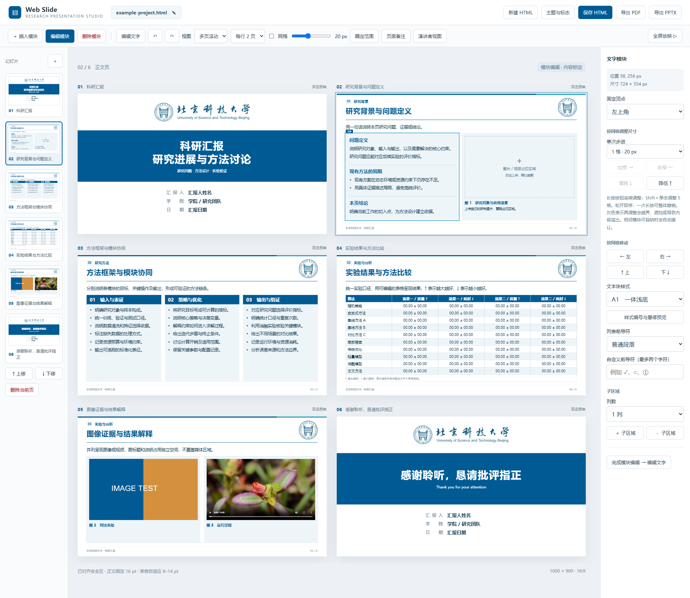
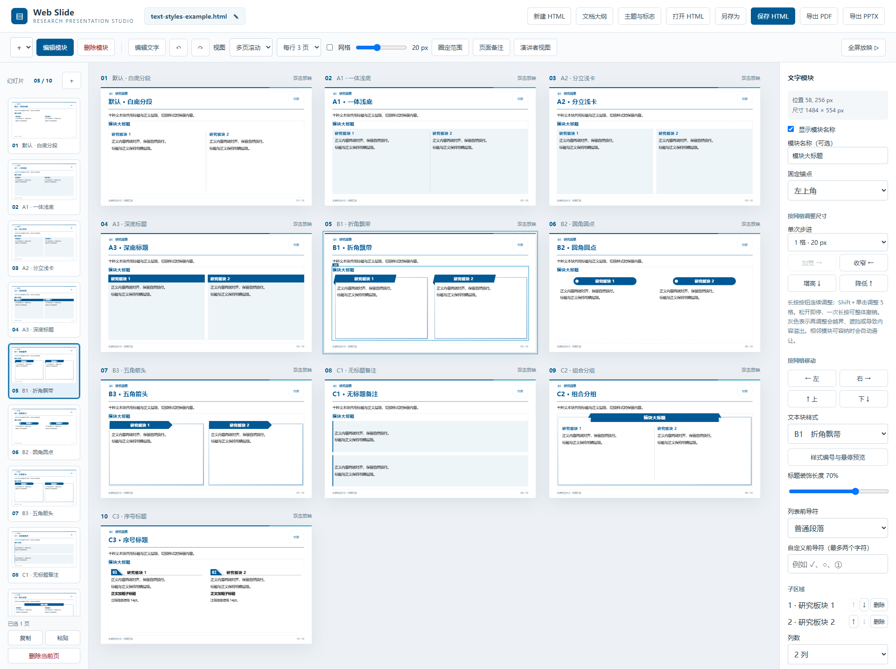
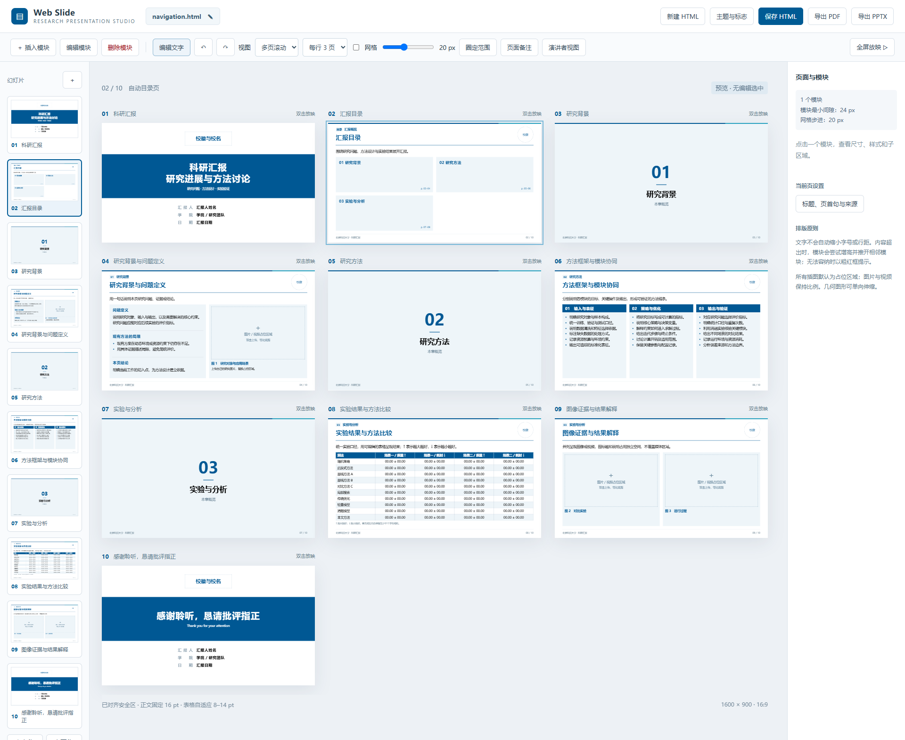
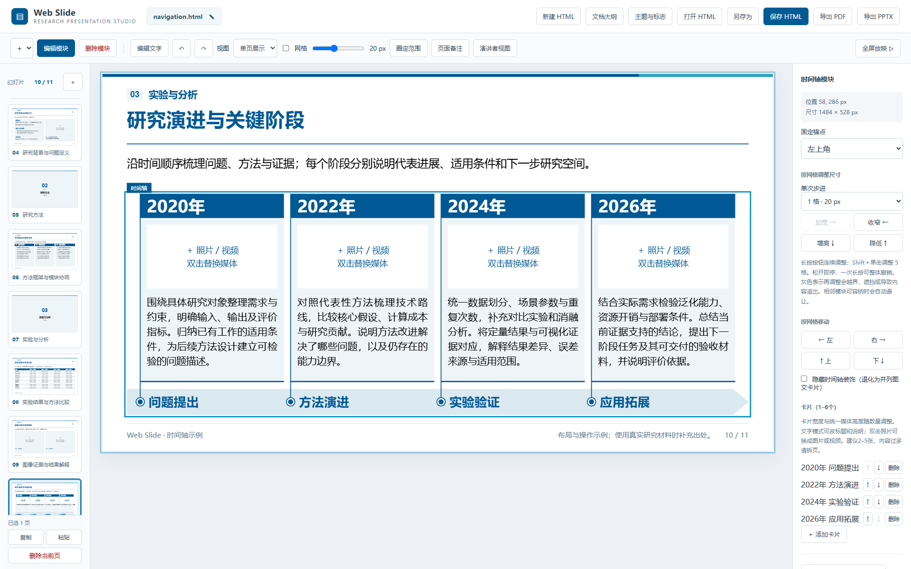

# 参考示例：结构、文字样式与导航

这里只保留三份HTML。下面均为浏览器中实际打开文件、切换多页视图后的工作台截图，保留工具栏、左侧缩略图、画布和设置区。下载到本地后打开HTML即可操作。

| 示例文件 | 页数 | 截图方式 | 主要用途 |
| --- | ---: | --- | --- |
| [example-project.html](example-project.html) | 6 | 每行2页，选中第2页文字模块 | 科研汇报结构与模块分工 |
| [text-styles-example.html](text-styles-example.html) | 10 | 每行3页，选中第5页B1模块 | 比较默认、A／B／C文字样式 |
| [navigation.html](navigation.html) | 11 | 每行3页，选中第10页时间轴 | 目录、章节、页面管理与可编辑时间轴 |

前两份保留已确认的参考内容。navigation保留原有十页，新增第10页通用时间轴，原结束页顺延至第11页，并升级为当前工作台。两校正式文稿及完整功能说明见[项目README](../README.md)。

三份示例已定点修复全屏放映时白框边框／阴影的SVG引用，页面内容与布局数据保持原样。`snapshots.json`记录当前文件哈希，下面的多页工作台预览与文件同步。

## 科研汇报：看整体结构与模块分工

[打开example-project](example-project.html) · [原尺寸截图](images/example-project.png)

- 六页依次呈现封面、问题背景、方法框架、结果表、图像证据和结束页，可对照各页的信息职责。
- 第2页展示模块尺寸、位置、样式及子区域设置，区分“改内容”和“改模块”。
- 真实研究要替换占位材料、核对来源，不能把示例数字当作证据。

## 文字样式：同屏比较层级与留白

[打开text-styles-example](text-styles-example.html) · [原尺寸截图](images/text-styles-example.png)

| 页码 | 样式 | 重点 |
| --- | --- | --- |
| 1–4 | 默认、A1、A2、A3 | 分段、整体浅底、分立卡片和深色标题 |
| 5–7 | B1、B2、B3 | 折角、圆角与箭头标题 |
| 8–10 | C1、C2、C3 | 补充备注、组合分组与编号步骤 |

C2内部仅用无底色默认分组。C3适合多个有次序的子区域；普通内容只有一块时，使用默认、A3或B1等无序号样式，避免孤立的“01”。本文件中的单块C3专用于展示组件形态。

## 导航与时间轴：先看章节，再调整阶段

[打开navigation](navigation.html) · [完整工作台原图](images/navigation.png)

目录位于第2页，第3、5、7页是章节过渡。新增第10页时间轴，第11页结束。目录从过渡页推导标题、序号及页码范围；移动页面后重新同步，不手工维护页码。

时间轴使用通用的“问题提出、方法演进、实验验证、应用拓展”四阶段，不含学校标识与校园图像。深色年份块、圆点、线段及事件短名统一主题色，卡片及箭头保留浅底。

1. 左侧选第10页，进入“编辑模块”并点击时间轴；右侧可添加阶段、删除任意阶段或前后移动。支持1–6阶段，建议2–5阶段。
2. 增减后卡片自动均分宽度，媒体框保持实际等高；年份、事件与说明随对应阶段一起重排。
3. 切换“编辑文字”，修改年份、事件短名和介绍。双击占位框上传照片或MP4／WebM视频，可调整取景及缩放。
4. 保存HTML再打开，复查内容、阶段顺序和媒体。长内容应凝练、扩大模块或拆页，不能遮挡箭头及页脚。

左侧支持Ctrl／Shift多选、复制粘贴、拖动排序和选中删除，常用按钮固定在左下角；操作及快捷键见[页面管理说明](../README.md#页面复制多选与排序)。备注与放映直接参考[主项目说明](../README.md#放映与备注)，不再保留单独的备注示例文件。

## 截图与维护

运行`node scripts/preview-reference.mjs`：先核对这三份HTML的SHA-256，再打开实际工作台、展示全部页面并截图。navigation额外生成第10页时间轴近景。`snapshots.json`记录实际页数、每行页数、当前页、窗口尺寸和源文件哈希；更新HTML时同步记录与说明，不能只换截图。
