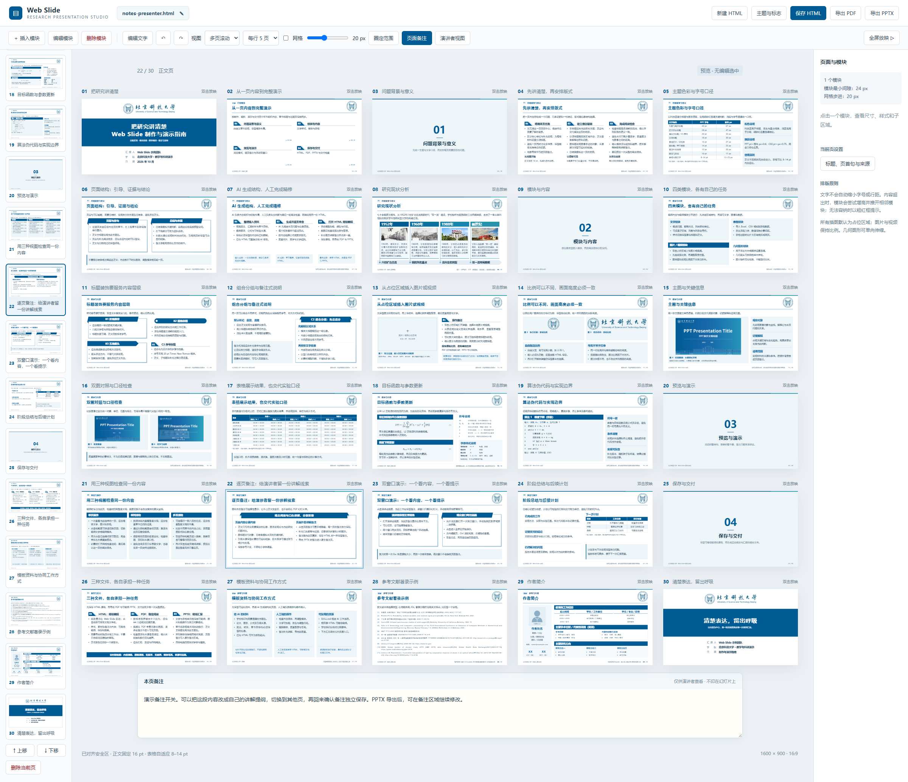

# 参考示例：先看多页工作台，再选版式

这里保留五份已经人工认可的 HTML。下面的图片均来自文件在浏览器中的**实际工作台**：先切换“多页滚动”，再截图，保留顶部工具栏、左侧缩略图、中央画布与右侧设置；不是只截封面，也不是把单页图片拼成示意界面。多页文件的全部页面均出现在对应截图中。

这些文件保留已认可的示范内容。其中media-layout按本次需求保留原媒体页，并新增可编辑时间轴页和当前工作台功能；其余四份维持历史快照。最新正式文稿请使用[项目首页](../README.md)中的两校示例。点击文件名打开HTML；要看截图细节，可点每张图下面的“查看原尺寸截图”。

| 示例文件 | 实际页数 | 截图方式 | 主要用途 |
| --- | ---: | --- | --- |
| [example-project.html](example-project.html) | 6 | 每行2页，共3行；选中第2页文字模块 | 看完整汇报的页面分工与模块编辑 |
| [media-layout.html](media-layout.html) | 2 | 每行1页，完整展示两页；选中第2页时间轴 | 对比媒体比例，测试阶段增减、照片／视频替换与阶段重排 |
| [navigation.html](navigation.html) | 10 | 每行3页，全部展示；选中第2页目录 | 看目录、过渡页与正文的顺序 |
| [notes-presenter.html](notes-presenter.html) | 30 | 每行5页，共6行；选中第22页并展开备注 | 看完整文稿总览与当前页备注的关系 |
| [text-styles-example.html](text-styles-example.html) | 10 | 每行3页，全部展示；选中第5页B1模块 | 同屏比较十种文字样式与右侧控件 |

## 六页科研汇报：从整体结构看模块分工

[打开示例](example-project.html) · [查看原尺寸截图](images/example-project.png)

- 6页依次呈现封面、问题背景、方法框架、结果表、图像证据与结束页，可对照各页内容职责和信息密度。
- 截图选中第2页左侧文字模块，右侧能看到网格尺寸、移动、文本样式及子区域设置，便于理解“改内容”和“改模块”的区别。
- 参考页面结构时同时看正文、表格与媒体的留白和层级；真实研究需换成自己的材料，历史示例中的占位图与数字不作为研究证据。

## 媒体与时间轴：统一画面高度，再组织阶段

[打开示例](media-layout.html) · [查看原尺寸截图](images/media-layout.png)

第1页保留原媒体示例，观察不同宽高比的媒体是否保持原比例、画面是否实际等高，以及图注是否占用独立区域。第2页加入与两校第8页同类型的原生时间轴模块，截图显示真实工作台与右侧阶段控件。

可双击媒体打开取景与比例设置，测试预设比例、自定义宽高和原始比例。替换图片或增删图注后，再检查并列画面的高度与下沿；外框等高不等于图像等高。

时间轴验收可按以下步骤操作：

1. 左侧选第2页，点击“编辑模块”并选中时间轴；添加第5阶段，观察卡片变窄、照片实际高度仍一致。
2. 用右侧箭头前后移动阶段，或删除指定阶段；照片、年份、事件与说明应一起移动。
3. 切换“编辑文字”，修改年份、箭头上的事件短名及介绍；双击照片换成自己的图片或MP4／WebM视频。
4. 保存HTML并重新打开，确认阶段内容及顺序保持，浅底、连线、箭头和圆点均没有遮挡或越界。长内容应适量凝练或拆页。

左下操作区也固定了复制、粘贴、上移、下移和删除。Ctrl／Shift可多选，拖动缩略图可重排；操作截图与快捷键说明见[项目页面管理](../README.md#页面复制多选与排序)。

## 目录与导航：把章节顺序放在同一视野中

[打开示例](navigation.html) · [查看原尺寸截图](images/navigation.png)

- 第2页是目录，第3、5、7页为章节过渡，其后跟随对应正文；在总览中核对“目录—章节—内容”的关系比只看目录单页清楚。
- 通过左侧缩略图选择当前页，观察中央选中边框和页码提示；切换单页、单列、多页视图，比较阅读与编辑方式。
- 正式文稿的目录应从章节推导序号与页码范围，重排后一起检查，不手工维护容易过期的页码。

## 备注与演示：总览文稿，同时查看当前页提示

[打开示例](notes-presenter.html) · [查看原尺寸截图](images/notes-presenter.png)

截图展示全部30页，同时选中第22页“逐页备注”，画布下方展开该页讲解提示。中央总览用于检查章节与版式，备注区用于补充口头说明，两者各占独立空间。

在左侧切换页面，再点击顶部“页面备注”，观察备注是否随当前页更新。演讲者视图与观众窗口的动态联动需打开HTML实际操作，静态截图不能展示翻页同步和全屏行为。

最新两校文稿还支持从右侧“当前页设置”的弹窗填写备注；这份历史快照保持原操作方式。操作入口见[项目备注说明](../README.md#放映与备注)。

## 十种文字样式：同屏比较，不只看一种

[打开示例](text-styles-example.html) · [查看原尺寸截图](images/text-styles-example.png)

| 页面 | 样式 | 比较重点 |
| --- | --- | --- |
| 1–4 | 默认、A1、A2、A3 | 无底色、整体浅底、独立卡片与深色标题的区别 |
| 5–7 | B1、B2、B3 | 折角、圆角及箭头标题如何建立视觉入口 |
| 8–10 | C1、C2、C3 | 补充备注、组合分组与编号步骤各自承担什么角色 |

截图选中第5页B1，右侧显示样式与模块调整。选型时先比较整页信息层级，再看标题长度、正文换行、分组间距和边缘对齐；不要只因为装饰好看而选样式。C2内部保留无底色分组，C3编号与标题各出现一次。

## 如何复现这些截图

打开相应HTML，在顶部选择“多页滚动”和表中每行页数，用左侧缩略图选择对应页面。需要演示备注时再展开“页面备注”；点击模块可在右侧查看设置。普通窗口放不下全部页面时正常滚动，截图脚本使用较高的真实浏览器窗口展示完整工作台。

在项目根目录运行 `node scripts/preview-reference.mjs` 可更新预览。脚本先核对五份HTML的SHA-256，再设置视图和截图，并核验全部页面在画面中；不会改写HTML源文件。`snapshots.json`记录源文件哈希、实际页数、每行页数、当前页及截图尺寸，便于复查。
